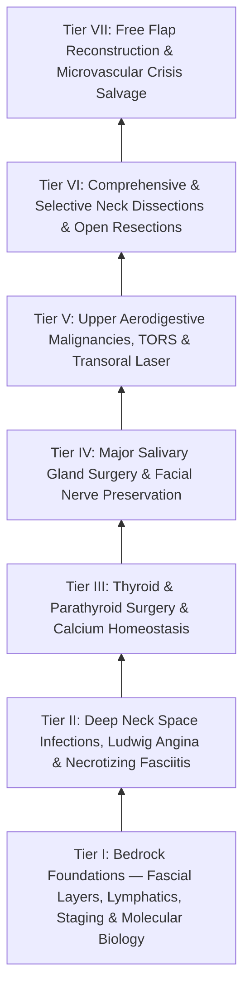

# The Head and Neck Oncology Knowledge Graph provides a structured mastery curriculum

> [!NOTE] **Subspecialty Knowledge Cards Census & Curriculum Architecture**
> | Metric | Value | Details |
> | :--- | :--- | :--- |
> | **Atomic Cards (Notes)** | **182** | Granular single-concept clinical and surgical factoids |
> | **Source Coverage** | **182 / 182 (100%)** | Full attribution to authoritative surgical textbooks |
> | **Active Recall Questions** | **424 total (2.3/card)** | Integrated retrieval prompts with mechanistic rationales |
> | **Illustrated Cards** | **51 notes (81 figs)** | High-yield operative line drawings and anatomical diagrams |
> | **Personal Notes Guard** | **100% verified** | Cryptographically guarded resident notes region |
> | **Active Wiki-Links** | **1,395 links** | Bidirectional knowledge graph traversal web |
> | **Mastery Pyramid** | **7 Progressive Tiers** | From Bedrock Foundations to High-Stakes Complication Rescue |

---

## Tier I: Bedrock Foundations — Cervical Fascia, Lymphatic Levels & AJCC-8 TNM Staging

### 📖 Tier I Clinical Foundations & Craft Nuances

### **1\. Cervical Fascial Layers & Deep Neck Spaces**

> * **[[Deep cervical fascia divides into superficial, middle, and deep layers that define surgical planes|Deep Cervical Fascia]]:**  
  * *Superficial (Investing) Layer:* Encloses the sternocleidomastoid (SCM), trapezius, submandibular, and parotid glands; attaches to mandible, zygoma, mastoid, and clavicle.  
  * *Middle (Pretracheal / Visceral) Layer:* Muscular division encloses strap muscles; visceral division encloses thyroid, trachea, and esophagus, continuing posteriorly as the buccopharyngeal fascia.  
  * *Deep (Prevertebral) Layer:* Encloses paraspinal muscles and vertebrae; splits into the **alar fascia** anteriorly and **prevertebral fascia proper** posteriorly. The phrenic nerve and brachial plexus lie deep to this layer.  
> * **Deep Neck Spaces & Spread of Infection / Malignancy:**  
  * *[[The retropharyngeal space extends from skull base to tracheal bifurcation and contains lymph nodes draining the nasopharynx|Retropharyngeal Space]]:* Located between the buccopharyngeal fascia anteriorly and the alar fascia posteriorly; extends from skull base down to the superior mediastinum (level of T1–T2).  
  * *[[The danger space permits unrestricted infection spread from skull base to posterior mediastinum|Danger Space]]:* Located between the alar fascia anteriorly and prevertebral fascia proper posteriorly; extends from skull base directly down through the posterior mediastinum to the level of the diaphragm.

### **2\. Cervical Lymph Node Levels (Robbins / AAO-HNS Classification)**

| Lymph Node Level | Anatomical Subdivisions & Boundaries | Primary Tumor Drainage Basins   |
| :---- | :---- | :---- |
| **Level I (Submental / Submandibular)** | • **IA (Submental):** Between anterior bellies of digastric muscles and hyoid bone. • **IB (Submandibular):** Bound by anterior/posterior digastric bellies and inferior border of mandible. | Lip, anterior floor of mouth, anterior oral tongue, buccal mucosa, nasal cavity. |
| **Level II (Upper Jugular)** | Skull base to hyoid bone (carotid bifurcation); anterior to posterior border of SCM. • **IIA:** Anteromedial to CN XI. • **IIB (Submuscular):** Posterolateral to CN XI. | Oral cavity, oropharynx, nasopharynx, hypopharynx, larynx, parotid gland. |
| **Level III (Mid-Jugular)** | Hyoid bone superiorly to inferior border of cricoid cartilage (omohyoid muscle junction) inferiorly; lateral border of sternohyoid to posterior border of SCM. | Oral cavity, larynx, hypopharynx, oropharynx, thyroid gland. |
| **Level IV (Lower Jugular)** | Inferior border of cricoid cartilage superiorly to clavicle inferiorly; lateral border of sternohyoid to posterior border of SCM. Contains the thoracic duct on the left. | Hypopharynx, subglottic larynx, cervical esophagus, thyroid gland; Virchow’s node (infraclavicular primary). |
| **Level V (Posterior Triangle)** | Posterior border of SCM to anterior border of trapezius; clavicle inferiorly. • **VA:** Above horizontal plane of cricoid ring (contains CN XI). • **VB:** Below horizontal plane of cricoid ring (supraclavicular). | Nasopharynx, posterior scalp, cutaneous neck, thyroid (advanced). |
| **Level VI (Anterior / Central Compartment)** | Hyoid bone to suprasternal notch; medially bound between bilateral common carotid arteries. Contains prelaryngeal (Delphian), pretracheal, and paratracheal nodes. | Thyroid gland, subglottic larynx, cervical trachea, piriform apex, cervical esophagus. |

### **3\. AJCC 8th Edition Staging Breakthroughs**

> * **Oral Cavity [[AJCC 8th edition incorporates depth of invasion into oral cavity T-staging|Depth of Invasion]] (DOI):** Replaced superficial tumor thickness. Measured from the horizon of the adjacent normal basement membrane to the deepest point of invasion. *Every $5\text{ mm}$ of DOI upstages the T category:*  
  * $T1: \le 2\text{ cm}$ AND $\text{DOI} \le 5\text{ mm}$.  
  * $T2: \le 2\text{ cm}$ with $\text{DOI} > 5\text{ mm}$ to $\le 10\text{ mm}$, OR $2\text{–}4\text{ cm}$ with $\text{DOI} \le 10\text{ mm}$.  
  * $T3: > 4\text{ cm}$ OR any tumor with $\text{DOI} > 10\text{ mm}$.  
> * **[[Extranodal extension in cervical lymph nodes upstages nodal disease and dictates adjuvant chemoradiotherapy|Extranodal Extension]] (ENE):** Pathological tumor extension through the lymph node capsule into surrounding connective tissue automatically upstages clinical $N1$ to $N2a$ (if $\le 3\text{ cm}$) or $N3b$ (if $\text{clinical } ENE^+$ or pathological $ENE^+$ in nodes $>3\text{ cm}$). High indication for adjuvant chemoradiotherapy (Cisplatin \+ RT).  
> * **HPV-Mediated Oropharyngeal Carcinoma (p16+ OPSCC):** Distinct clinical and pathological staging system reflecting favorable biological prognosis; clinical N stage based on node size and laterality rather than number/ENE.

### **4\. The Referred Otalgia Diagnostic Dashboard**

> * **[[Referred otalgia originates from shared sensory pathways of cranial nerves V, VII, IX, X, and cervical roots C2-C3|The Referred Otalgia Diagnostic Network]]:**  
  * *Auriculotemporal (CN V3):* TMJ, mandibular teeth/gingiva, floor of mouth, anterior tongue.  
  * *Jacobson’s Nerve (CN IX):* Palatine tonsil, base of tongue, oropharynx (post-tonsillectomy otalgia and HPV-positive OPSCC sentinel symptom).  
  * *Arnold’s Nerve (CN X):* Larynx, hypopharynx, piriform sinus, cervical esophagus (laryngeal cancer screen and Arnold ear-cough reflex).  
  * *Nervus Intermedius (CN VII):* Posterior EAC / concha (pre-herpetic deep otalgia in Ramsay Hunt syndrome).  
  * *Cervical Plexus (C2–C3):* Pinna, lobule, mastoid skin (cervical spine degenerative disease and myofascial spasm).  
  * *Universal Cancer Screen:* Unilateral otalgia with a completely normal otoscopic exam warrants immediate in-office flexible laryngoscopy to rule out occult mucosal malignancy of the tongue base, tonsil, piriform sinus, or larynx.

Self-Assessment Checkpoint: Tier I Foundations (Click to Expand)

**Q1: Why does a 1.8-cm [[Oral tongue carcinoma spreads along intrinsic lingual musculature to bilateral cervical lymphatics|oral tongue SCC]] with a Depth of Invasion (DOI) of 11 mm stage as T3 in AJCC 8th Edition?**  
*A:* AJCC 8th Edition integrates depth of invasion into T-staging. Even though the surface diameter is under 2 cm, any tumor with a $\text{DOI} > 10\text{ mm}$ penetrates deeply into the intrinsic tongue musculature with a high rate of [[Elective neck dissection is indicated for oral cavity squamous cell carcinoma with depth of invasion exceeding four millimeters|occult nodal metastasis]] and is classified as T3.  
**Q2: What fascial boundary separates the Retropharyngeal space from the Danger space?**  
*A:* The **alar fascia**. The retropharyngeal space lies between the buccopharyngeal fascia and the alar fascia (ending at T1–T2), while the danger space lies between the alar fascia and the prevertebral fascia proper (extending continuously to the diaphragm).

---

## Tier II: Comprehensive Cervical Lymphadenectomy (Neck Dissection Mastercraft)

### 📖 Tier II Clinical Foundations & Craft Nuances

### **1\. Neck Dissection Classification (Robbins / Medina)**

| Dissection Class | Lymph Node Levels Removed | Non-Lymphatic Structures Sacrificed / Preserved   |
| :---- | :---- | :---- |
| **Radical Neck Dissection (RND)** | Levels I through V | **Sacrifices ALL three:** (1) Spinal Accessory Nerve (CN XI), (2) Internal Jugular Vein (IJV), (3) Sternocleidomastoid Muscle (SCM). |
| **Modified Radical (MRND Type I)** | Levels I through V | **Preserves CN XI**; sacrifices IJV and SCM. |
| **Modified Radical (MRND Type II)** | Levels I through V | **Preserves CN XI and IJV**; sacrifices SCM. |
| **Modified Radical (MRND Type III / Functional)** | Levels I through V | **Preserves ALL three:** CN XI, IJV, and SCM. (Standard for comprehensive node clearance). |
| **Selective Neck Dissections (SND)** | • Supraomohyoid (SND I–III): Oral cavity. • Anterolateral (SND II–IV): Larynx, Oropharynx. • Lateral (SND II–IV $\pm$ V): Hypopharynx, Thyroid. • Central (SND VI–VII): Thyroid, Larynx. | Preserves CN XI, IJV, SCM; targets only the lymphatic basins at high risk for micrometastasis ($N0$ neck). |

### **2\. Operative Step-by-Step MRND Type III Execution**

> 1. **Incision & Subplatysmal Flap Elevation:** Apron or hockey-stick incision; elevate flaps subplatysmally, keeping the anterior jugular veins deep. Identify the marginal mandibular branch of CN VII beneath the investing fascia $1\text{–}2\text{ cm}$ below the mandible (elevate facial vein superiorly — [[Subplatysmal flap elevation and Martin's maneuver protect the marginal mandibular nerve|Martin]]'s maneuver).  
> 2. **Spinal Accessory Nerve (CN XI) Dissection:**  
   * Identify CN XI entering the anterior border of the SCM at the junction of its upper 1/3 and lower 2/3 ($3\text{–}5\text{ cm}$ below the mastoid tip).  
   * Follow nerve through SCM into the posterior triangle (Level V) where it emerges $1.0\text{ cm}$ superior to [[The spinal accessory nerve is identified at the Erb point and anterior border of the SCM|Erb]]'s point (great auricular nerve emergence). Dissect nerve completely free from surrounding fibrofatty tissue.  
> 3. **Level V Clearance:** Dissect fibrofatty packet from the anterior trapezius border forward over the prevertebral fascia; preserve the phrenic nerve and brachial plexus trunks deep to the fascia.  
> 4. **Levels II–IV [[Levels II through IV internal jugular chain dissection mobilizes the carotid sheath packet|Jugular Chain Dissection]]:** Incise the carotid sheath longitudinally; mobilize the packet off the IJV, common carotid artery, and vagus nerve (CN X). Dissect Level IIB (submuscular) superiorly behind CN XI.  
> 5. **Level I Clearance (if indicated):** Skeletonize anterior belly of digastric (IA), dissect [[Submandibular gland excision requires preservation of the marginal mandibular, lingual, and hypoglossal nerves|submandibular triangle]] (IB), ligating the facial artery and vein at the inferior mandibular border while preserving the lingual nerve, submandibular ganglion, and hypoglossal nerve (CN XII).

### **3\. Thoracic Duct Anatomy & Chyle Leak Protocol**

> * **Anatomy:** The thoracic duct ascends into the left Level IV region, loops $3\text{–}5\text{ cm}$ superior to the clavicle behind the common carotid artery, and arches laterally and anteriorly to enter the junction of the left internal jugular and subclavian veins (the *venous angle*). In 20% of patients, accessory ducts enter the right neck.  
> * **Management of Chyle Leak:**  
  * *Intraoperative Detection:* Inspect Level IV under Valsalva/Trendelenburg. If chyle is seen: Clamp and ligate duct with 3-0 Silk or nonabsorbable clips; place local muscle patch (SCM/omohyoid) with fibrin glue.  
  * *Postoperative Conservative Protocol ($<500\text{ mL/day}$):* Low-fat, Medium-Chain Triglyceride (MCT) diet (MCTs absorb directly into portal vein bypassing lymphatics) or total parenteral nutrition (TPN); Octreotide / Somatostatin subcutaneous infusion; compression dressing.  
  * *Surgical Exploration Criteria:* **Drain output $>1,000\text{ mL/day}$ for $>48\text{–}72\text{ hours}$** or persistent leak $>14\text{ days}$ unresponsive to conservative therapy. Re-explore left neck or perform thoracoscopic [[Cervical chyle leaks are managed with MCT diet, octreotide, or surgical thoracic duct ligation|thoracic duct ligation]] above the diaphragm.

Self-Assessment Checkpoint: Tier II Neck Dissection (Click to Expand)

**Q1: What defines the anatomical boundaries between Level IIA and Level IIB lymph nodes?**  
*A:* The **spinal accessory nerve (CN XI)**. Level IIA nodes lie anteromedial to the vertical course of CN XI, while Level IIB (the [[Level II lymph nodes are anatomically divided into IIA and IIB by the spinal accessory nerve|submuscular recess]]) lies posterolateral to CN XI beneath the superior attachment of the SCM up to the skull base.  
**Q2: Why does a diet rich in Medium-Chain Triglycerides (MCTs) resolve a low-output cervical chyle leak?**  
*A:* Long-chain fatty acids are packaged into chylomicrons and enter the lymphatic lacteals, draining directly through the thoracic duct. MCTs (6–12 carbons) are water-soluble and absorbed directly across enterocytes into the portal venous circulation, drastically reducing lymphatic flow volume and allowing the thoracic duct fistula to seal spontaneously.

---

## Tier III: Oral Cavity Carcinoma, Resection Margins, Pull-Through & Mandibulotomy

### 📖 Tier III Clinical Foundations & Craft Nuances

### **1\. Oncologic Margin Standards**

> * **Margin Criteria:**  
  * *Clear Margin:* $\ge 5\text{ mm}$ of normal, tumor-free tissue on permanent microscopic histological section. (Requires $1.0\text{–}1.5\text{ cm}$ gross surgical margins intraoperatively to account for tissue shrinkage).  
  * *Close Margin:* $1.0\text{ to }4.9\text{ mm}$ from the ink border.  
  * *Positive Margin:* $<1.0\text{ mm}$ or microscopic tumor extending to inked surgical edge. (Requires immediate re-resection or adjuvant CRT).

### **2\. Surgical Corridors for Oral Cavity & Oropharynx**

| Surgical Approach | Technical Execution & Tissue Division | Primary Indications   |
| :---- | :---- | :---- |
| **Transoral Resection** | Direct per-oral exposure using mouth gags/retractors; no skin incisions. | T1/T2 anterior oral tongue, anterior floor of mouth, buccal mucosa with adequate access. |
| **Transcervical "Pull-Through"** | Dissect floor of mouth musculature (mylohyoid, hyoglossus, geniohyoid) off inner mandibular cortex from neck dissection; pull oral tongue/FOM en bloc inferiorly into the neck without dividing the mandible. | T2/T3 posterior oral tongue or floor of mouth cancers with NO mandibular bone involvement. |
| **Lip-Split Paramedian Mandibulotomy** | Incision through lower lip vermilion; step-cut (or chevron) osteotomy placed **anterior to mental foramen between lateral incisor and canine**; swing mandibular halves laterally. | Large T3/T4 tumors of the posterior oral tongue, base of tongue, or retromolar trigone requiring direct exposure for microvascular reconstruction. |

### **3\. Mandibular Resection: Marginal vs. Segmental Mandibulectomy**

> * **Marginal (Rim) Mandibulectomy:** Resection of the superior alveolar ridge / inner cortical plate leaving the inferior basilar cortex ($>1.0\text{ cm}$ height) intact, preserving structural continuity without requiring bone grafting.  
  * *Indication:* Tumor abutment or superficial cortical erosion of the periosteum without marrow invasion. *Contraindicated in heavily irradiated bone or edentulous/atrophic mandibles.*  
> * **[[Segmental mandibulectomy resects full-thickness bone for medullary invasion and irradiated bone recurrence|Segmental Mandibulectomy]]:** Full-thickness resection of a complete segment of the mandibular bone (cortex \+ marrow).  
  * *Indication:* Gross cortical invasion, medullary space marrow invasion, tumor fixed to the inferior alveolar nerve canal, or tumor recurrence in an irradiated field. Requires reconstruction with vascularized bone (Fibula or Scapula free flap).

Self-Assessment Checkpoint: Tier III Oral Cavity (Click to Expand)

**Q1: Why is a step-cut (chevron) mandibulotomy preferred over a straight vertical osteotomy?**  
*A:* A step-cut osteotomy provides rotational stability and increased bone-to-bone surface contact area along the osteotomy line, preventing torsional displacement during mastication and reducing non-union and plate extrusion rates.  
**Q2: Why is a [[Marginal mandibulectomy preserves basilar bone height when tumor abuts but does not invade marrow|marginal mandibulectomy]] contraindicated in an edentulous, atrophic mandible?**  
*A:* In an atrophic edentulous mandible, the vertical height of the mandibular body is often $<1.5\text{ cm}$. Performing a rim resection leaves an excessively thin ($<5\text{–}7\text{ mm}$) basilar bone remnant, inevitably causing an unstable pathologic fracture under chewing forces.

---

## Tier IV: Oropharyngeal (TORS), Laryngeal & Hypopharyngeal Surgical Oncology

### 📖 Tier IV Clinical Foundations & Craft Nuances

### **1\. Transoral Robotic Surgery (TORS) for Oropharyngeal Carcinoma**

> * **Indications:** T1/T2 HPV-positive or HPV-negative squamous cell carcinomas of the palatine tonsil or base of tongue (BOT); primary resection for treatment de-escalation (ECOG 3311 protocol).  
> * **Vascular Anatomy & Hemorrhage Avoidance:**  
  * *[[TORS radical tonsillectomy requires careful identification of the internal carotid artery posterolaterally|TORS Radical Tonsillectomy]]:* Resection encompasses palatoglossus, palatopharyngeus, tonsil, and superior constrictor muscle down to the buccopharyngeal fascia. **Critical Hazard:** The internal carotid artery lies $1.5\text{–}2.5\text{ cm}$ posterolateral to the tonsillar fossa (may be tortuous / aberrant in up to 5% of patients).  
  * *TORS Base of Tongue Resection:* **[[Lingual artery branches require clip ligation during TORS base of tongue resection|Lingual Artery Mapping]]:** The lingual artery runs deep to the hyoglossus muscle, crossing $1.5\text{–}2.0\text{ cm}$ lateral to the midline lingual septum at the level of the vallecula. Bipolar cauterization and hemoclip ligation of arterial branches are mandatory; prophylactic transcervical ligation of the ipsilateral external carotid artery / lingual artery is recommended for high-volume tongue base resections to prevent fatal secondary hemorrhage.

### **2\. Hypopharyngeal & Advanced Laryngeal Resection Algorithms**

| Tumor Subsite & Extent | Surgical Resection Limits | Reconstructive Options   |
| :---- | :---- | :---- |
| **T3/T4 Laryngeal Carcinoma with Cartilage Invasion** | **Total Laryngectomy:** Hyoid, thyroid cartilage, cricoid, upper 1–2 tracheal rings, ipsilateral thyroid lobe. | Primary inverting Connell pharyngeal closure; Pectoralis major muscle flap reinforcement if salvage post-radiation. |
| **Piriform Sinus Carcinoma with Laryngeal Invasion** | **Total Laryngopharyngectomy:** Total laryngectomy \+ Partial or near-total pharyngectomy preserving posterior mucosal strip. | Patch reconstructive graft with Anterolateral Thigh (ALT) free flap or Radial Forearm Free Flap (RFFF). |
| **Circumferential Hypopharyngeal / Cervical Esophagus** | **Circumferential Total Laryngopharyngectomy:** Complete removal of larynx and complete $360^\circ$ pharyngeal/esophageal cylinder. | **Tubed Free Flap Reconstruction:** Tubed ALT flap, Tubed RFFF, or Free Jejunal Autograft. |

Self-Assessment Checkpoint: Tier IV TORS & Larynx (Click to Expand)

**Q1: Why is prophylactic transcervical ligation of the lingual artery / facial artery performed during TORS base of tongue resection?**  
*A:* Secondary oropharyngeal hemorrhage following TORS occurs in 3% to 8% of cases around postoperative day 5–10 when mucosal sloughing occurs. Because transoral control of an arterial base of tongue bleed in an awake, swollen patient can be fatal, elective proximal ligation in the neck reduces high-flow arterial perfusion pressure.  
**Q2: What is the primary functional advantage of a tubed ALT free flap over a free jejunal transfer for circumferential pharyngeal reconstruction?**  
*A:* The tubed [[The anterolateral thigh flap provides versatile volume and can be harvested as a chimeric flap|ALT flap]] is a non-secretory, non-motile skin conduit that provides excellent long-term [[Tracheoesophageal puncture TEP and voice prosthesis restore pulmonary-driven alaryngeal speech|tracheoesophageal puncture]] (TEP) speech rehabilitation without excessive wet gurgling voice quality, whereas jejunal grafts secrete copious mucus and exhibit uncoordinated intrinsic peristalsis that impairs intelligible TEP voice.

---

## Tier V: Thyroid & Parathyroid Surgery: RLN/EBSLN Craft & Miami Criteria

### 📖 Tier V Clinical Foundations & Craft Nuances

### **1\. Bethesda System, 2025 ATA Guidelines & Molecular Profiling**

> * **The 2025 ATA Guidelines Paradigm:**  
  * *[[The 2025 ATA guidelines establish active surveillance criteria and lobectomy preference for low-risk differentiated thyroid cancer|Active Surveillance for cT1aN0M0 PTC]]:* First-line option for select $\le 1.0\text{ cm}$ microcarcinomas without high-risk histology, posterior capsule/tracheal abutment, ETE, or nodal metastases ($>60\text{ yr}$ favored over $<40\text{ yr}$). Serial US every 6–12 months (serum Tg testing NOT recommended).  
  * *Extent of Resection:* **Lobectomy** is standard for $cT1\ (\le 2\text{ cm})$ and preferred for low-risk unilateral $cT2\ (2\text{–}4\text{ cm})$ tumors, minimizing permanent hypoparathyroidism ($<1\%$) and bilateral RLN palsy. Total thyroidectomy reserved for $>4\text{ cm}$, ETE, gross nodal disease, or adjuvant RAI plans.  
  * *NIFTP / Low-Risk Reclassification:* Noninvasive Follicular Thyroid Neoplasms with Papillary-like Nuclear Features (NIFTP), FTUMP, and Hyalinizing Trabecular Tumors are managed with lobectomy alone; completion and RAI are contraindicated.  
> * **Bethesda Cytopathology Categories:**  
  * *Bethesda I (Non-diagnostic / Unsatisfactory):* Repeat FNA under US guidance (Malignancy risk: 5–10%).  
  * *Bethesda II (Benign):* Clinical/ultrasound surveillance (Malignancy risk: 0–3%).  
  * *Bethesda III (AUS / FLUS):* Repeat FNA or Molecular testing (ThyroSeq / Afirma) (Malignancy risk: 10–30%).  
  * *Bethesda IV (Follicular Neoplasm / Suspicious for FN):* Molecular testing or Diagnostic lobectomy (Malignancy risk: 25–40%).  
  * *Bethesda V (Suspicious for Malignancy):* Total thyroidectomy or Lobectomy (Malignancy risk: 50–75%).  
  * *Bethesda VI (Malignant):* Definitive surgical resection (Malignancy risk: 97–99%).  
> * **Molecular Drivers:** *BRAF V600E* (highest specificity for [[Papillary thyroid carcinoma spreads via cervical lymphatics to central and lateral neck compartments|Papillary Thyroid Carcinoma]]; associated with aggressive extrathyroidal extension and lymph node metastasis); *[[BRAF V600E and TERT promoter mutations drive aggressive papillary thyroid carcinoma behavior|TERT Promoter]]* mutations (high risk of distant metastasis and disease-specific mortality); *RET/PTC* rearrangements; *RAS* mutations (common in follicular-pattern neoplasms).

### **2\. Total Thyroidectomy: Step-by-Step Surgical Execution**

> 1. **Incision & Mobilization:** Collar incision $2\text{ cm}$ above sternal notch in skin crease; elevate subplatysmal flaps; open midline linea alba; separate strap muscles from thyroid capsule.  
> 2. **Superior Pole Dissection & EBSLN Sparing:** Retract thyroid lobe inferolaterally. Dissect avascular space of Joll. Identify individual branches of the superior thyroid artery and ligate them flush on the thyroid capsule to avoid injury to the **External Branch of the Superior Laryngeal Nerve (Cernea Classification Types 1, 2a, 2b)**. In Graves' disease, administer **Lugol's solution / SSKI for 10–14 days preoperatively** (Wolff-Chaikoff effect) to reduce parenchymal hypervascularity.  
> 3. **Recurrent Laryngeal Nerve (RLN) Identification:** Retract thyroid lobe medially. Identify RLN in the tracheoesophageal groove:  
   * *Simon’s Triangle:* Bound by Common Carotid laterally, Trachea/Esophagus medially, and Inferior Thyroid Artery superiorly. (RLN bisects this triangle).  
   * Follow RLN superiorly to its entry beneath the inferior constrictor muscle behind the cricothyroid articulation. Maintain strict dissection on the capsule at **Berry's Ligament (suspensory ligament of thyroid)**, where the RLN is closest to the thyroid gland ($<1\text{–}2\text{ mm}$).  
> 4. **Parathyroid Gland Preservation:**  
   * *Superior Parathyroid Glands:* Embryologically derived from 4th branchial pouch; constant dorsal location, situated on the posterior surface of the upper/mid thyroid lobe $1\text{ cm}$ above the intersection of the ITA and RLN.  
   * *Inferior Parathyroid Glands:* Derived from 3rd pouch (migrate with thymus); ventral location along lower pole or thyrothymic ligament. Preserve capsular vascular branches; if devascularized, biopsy-confirm, mince into $1\text{-mm}$ cubes, and **auto-transplant into SCM or strap muscle pocket**.

### **3\. Parathyroid Surgery & The Miami Intraoperative PTH Criterion**

> * **Preoperative Localization:** [[Preoperative sestamibi SPECT and 4D-CT localize hyperfunctioning parathyroid glands|Sestamibi SPECT]] scan \+ 4D-CT (hyper-attenuating on arterial phase with rapid washout on venous phase) \+ High-resolution ultrasound. Replete 25-OH Vitamin D ($>30\text{ ng/mL}$) and exclude **Familial Hypocalciuric Hypercalcemia (CCCR $<0.01$)** prior to surgery.  
> * **The Miami 50% Rule ([[The Miami criterion requires a fifty percent intraoperative PTH drop at ten minutes post-excision|Intraoperative PTH]] Monitoring):**  
  * Baseline pre-incision and pre-excision PTH levels drawn.  
  * Re-draw PTH at **5 minutes and 10 minutes post-excision** of suspected adenoma.  
  * **Criterion for Cure:** A **$\ge 50\\%$ drop in intraoperative PTH at 10 minutes post-excision compared to the highest pre-incision baseline value** predicts complete biochemical cure in $>97\\%$ of [[Primary hyperparathyroidism is caused by single adenomas, multigland hyperplasia, or parathyroid carcinoma|primary hyperparathyroidism]] cases. If PTH fails to drop $>50\\%$, continue exploration for multigland hyperplasia or ectopic 5th gland.

### **4\. Postoperative Calcium Protocols & Magnesium Management**

> * **[[Post-thyroidectomy hypocalcemia is managed with oral calcium, calcitriol, and intravenous calcium gluconate|PTH-Stratified Postoperative Protocol]]:**  
  * *PTH $>20\text{ pg/mL}$:* Safe for same-day / routine discharge; no mandatory supplements.  
  * *PTH $15\text{–}20\text{ pg/mL}$:* Oral calcium carbonate ($300\text{ mg}$ elemental TID); AM calcium check.  
  * *PTH $10\text{–}15\text{ pg/mL}$:* Admit for observation; oral calcium ($600\text{ mg}$ elemental TID); AM PTH/Ca.  
  * *PTH $<10\text{ pg/mL}$:* Parathyroid stun; admit; high-dose calcium ($900\text{ mg}$ elemental TID) + **Calcitriol $0.5\text{ mcg}$ BID**; check magnesium and serial calcium q6h.  
  * *Severe Tetany/Stridor:* IV Calcium Gluconate (1–2 g in D5W over 10–20 min) under cardiac telemetry (peripheral line OK; **Calcium chloride central line only**). Always correct **hypomagnesemia** ($<1.8\text{ mg/dL}$) to restore parathyroid sensitivity.

Self-Assessment Checkpoint: Tier V Thyroid & Parathyroid (Click to Expand)

**Q1: What is the Cernea Type 2b classification of the External Branch of the Superior Laryngeal Nerve (EBSLN)?**  
*A:* The EBSLN crosses the superior thyroid vessels **$<1.0\text{ cm}$ below the upper border of the thyroid superior pole**. This variant places the nerve at extreme risk of thermal injury or mass ligation during superior pole mobilization unless branches are divided individually on the capsule.  
**Q2: If intraoperative PTH drops from 180 pg/mL (baseline) to 110 pg/mL at 10 minutes post-excision of a parathyroid gland, what is the next surgical step?**  
*A:* The drop is only 39% (does not meet the Miami $>50\\%$ drop criterion). The surgeon must continue bilateral neck exploration, inspecting the remaining three parathyroid sites, the carotid sheath, retroesophageal space, and thyrothymic ligaments for multiglandular hyperplasia, double adenoma, or ectopic tissue.

---

## Tier VI: Major Salivary Gland Oncology, Parotidectomy & Submandibular Excision

### 📖 Tier VI Clinical Foundations & Craft Nuances

### **1\. The Five Infallible Landmarks for the Facial Nerve Main Trunk**

During [[Superficial parotidectomy dissects the facial nerve branches to resect the lateral salivary lobe|superficial parotidectomy]], the main trunk of CN VII exits the stylomastoid foramen and divides at the \*pes anserinus\* into the temporofacial and cervicofacial divisions. Locate the trunk using:

> 1. **Tragal Pointer:** The main trunk lies **$1.0\text{ cm}$ deep and $1.0\text{ cm}$ inferior** to the tip of the tragal cartilage.  
> 2. **Tympanomastoid Suture Line:** The most consistent bony landmark; the main trunk lies **$6\text{–}8\text{ mm}$ deep** to the inferior terminus of this suture line.  
> 3. **Posterior Belly of Digastric:** The main trunk lies immediately superior to the upper border of the digastric muscle where it attaches to the digastric ridge of the mastoid.  
> 4. **Styloid Process:** The main trunk courses directly superficial and lateral to the base of the styloid process.  
> 5. **Retrograde Branch Tracking:** If scarring or tumor obscures the main trunk, identify peripheral branches (marginal mandibular crossing facial vessels, or buccal branch running parallel to [[Buccal mucosa carcinoma exhibits high rates of local recurrence and Stensen duct involvement|Stensen]]’s duct $1\text{ cm}$ below zygomatic arch) and dissect retrograde to the main trunk.

### **2\. Salivary Neoplasms: Histopathology & Clinical Management**

| Salivary Neoplasm | Histopathological Architecture | Clinical Behavior & Recurrence Risk | Definitive Surgical Management   |
| :---- | :---- | :---- | :---- |
| **Pleomorphic Adenoma (Benign Mixed Tumor)** | Epithelial/myoepithelial cells with chondromyxoid stroma; pseudopodia / microscopic capsular extensions. | Enucleation causes high recurrence ($>30\text{–}40\\%$); $5\text{–}10\\%$ undergo malignant transformation to *Carcinoma Ex-Pleomorphic Adenoma* if untreated long-term. | **Superficial Parotidectomy with facial nerve dissection** with intact capsular cuff. |
| **Mucoepidermoid Carcinoma (MEC)** | Mixture of mucin-secreting, intermediate, and squamous cells. Graded (AFIP/Brandwein) low, intermediate, high. Most common salivary malignancy. | Low-grade: indolent, rare nodal spread. High-grade: aggressive, mimics SCC, high nodal and distant metastasis rates. Driven by $t(11;19)$ *CRTC1-MAML2* translocation. | Low-grade: Parotidectomy with clear margins. High-grade: Total parotidectomy \+ Neck dissection \+ Adjuvant RT. |
| **Adenoid Cystic Carcinoma (ACC)** | Cribriform ("Swiss cheese"), tubular, or solid patterns. Myoepithelial/ductal proliferation with baseline *MYB-NFIB* fusion. | **Remarkable Perineural Invasion (PNI)** extending along CN VII/CN V tracks; relentless late hematogenous metastasis (lung/bone) even 10–20 years post-resection. | Radical excision with frozen section of nerve margins; sacrifice nerve if grossly involved; Postoperative Adjuvant Radiation (Neutron/Proton Beam). |

Self-Assessment Checkpoint: Tier VI Salivary Oncology (Click to Expand)

**Q1: Why is simple 'lumpectomy' / enucleation of a benign [[Pleomorphic adenoma requires superficial parotidectomy with a cuff of normal tissue to prevent pseudopod recurrence|Pleomorphic Adenoma]] contraindicated?**  
*A:* Pleomorphic adenomas possess delicate, incomplete fibrous capsules with microscopic finger-like projections (pseudopodia) that extend beyond the main mass into adjacent normal parotid parenchyma. Enucleating directly along the capsule severs these pseudopodia, seeding the wound with multiple microscopic tumor nests and leading to multifocal recurrence.  
**Q2: What is Frey's Syndrome ([[Frey syndrome results from aberrant auriculotemporal reinnervation of sweat glands after parotidectomy|Auriculotemporal Syndrome]]), and what is its pathophysiological mechanism?**  
*A:* Gustatory sweating and flushing over the preauricular skin during eating. It results from aberrant re-growth: transected **postganglionic parasympathetic secretomotor fibers** of the auriculotemporal nerve (from the otic ganglion) misdirect and reinnervate the denuded cutaneous sweat glands and subcutaneous arterioles.

---

## Tier VII: Microvascular Free Tissue Transfer & Advanced Defect Reconstruction

### 📖 Tier VII Clinical Foundations & Craft Nuances

### **1\. Microvascular Flap Selection & Virtual Surgical Planning (VSP)**

| Free Flap Donor | Vascular Pedicle Dynamics | Reconstructive Strengths | Harvest Nuances & Rules   |
| :---- | :---- | :---- | :---- |
| **Radial Forearm Free Flap (RFFF)** | Radial artery ($2.5\text{ mm}$) \+ Venae comitantes / Cephalic vein ($3.0\text{ mm}$). Pedicle length: $10\text{–}12\text{ cm}$. | Ultra-thin, pliable; ideal for oral tongue, floor of mouth, soft palate, and pharyngoesophageal lining. | Mandatory preoperative modified Allen test. Harvest subfascially over flexor tendons; repair donor site with FTSG/STSG. |
| **Anterolateral Thigh Flap (ALT)** | Descending branch of LCFA ($2.0\text{–}2.5\text{ mm}$) \+ Venae comitantes ($2.5\text{–}3.0\text{ mm}$). Pedicle: $8\text{–}12\text{ cm}$. | Customizable soft tissue volume; can be thinned or harvested as myocutaneous flap with vastus lateralis for large dead space. | Perforator dissection: Musculocutaneous perforators (80%) require intramuscular unroofing; septocutaneous (20%) lie in intermuscular septum. |
| **Fibula Free Flap (FFF) with VSP** | Peroneal artery ($2.5\text{–}3.0\text{ mm}$) \+ Venae comitantes ($3.0\text{ mm}$). Pedicle: $4\text{–}6\text{ cm}$. | Up to $25\text{ cm}$ of bicortical bone; accommodates multiple closing-wedge osteotomies for neo-mandible contour; endosseous dental implants. | **Virtual Surgical Planning (VSP):** Preoperative 3D modeling and custom cutting guides. **Preserve distal $5\text{ cm}$** (ankle stability) and **proximal $5\text{ cm}$** (common peroneal nerve). |

### **2\. Microvascular Technical Protocol & Thrombosis Salvage**

\========================================================================================  
             MICROVASCULAR ANASTOMOSES & CRISIS SALVAGE ALGORITHM  
\========================================================================================  
1\. RECIPIENT VESSEL SELECTION:  
   - ARTERIAL: Facial artery, Superior thyroid artery, Transverse cervical artery (end-to-end 9-0 Nylon).  
   - VENOUS: Internal jugular vein (end-to-side) or Facial/Thyrocervical branches (Microvascular   
     Venous Coupler, $2.0\text{–}3.5\text{ mm}$).  
2\. FLAP MONITORING STANDARDS:  
   - Hourly surface Doppler, needle pinprick assessment (bright red bleeding within 2 seconds),   
     color, capillary refill ($1\text{–}2\text{ s}$), and internal Cook-Swartz Doppler probe.  
3\. DIFFERENTIATE VASCULAR CRISIS:  
   - [[Microvascular arterial thrombosis presents with a pale, flat flap and requires immediate surgical exploration|ARTERIAL THROMBOSIS]]: Flap pale, cold, loss of turgor, flat Doppler, NO bleeding on 25G needle prick.  
   - [[Microvascular venous thrombosis presents with violaceous congestion and rapid dark bleeding on pinprick|VENOUS THROMBOSIS]] (Most common, 80%): Flap violaceous/purple, brisk dark burgundy bleeding on prick,   
     rapid congestion, high-pitched continuous venous Doppler.  
4\. IMMEDIATE RE-EXPLORATION (OR within 1–2 hours):  
   - Open neck incision at bedside; remove tight sutures.  
   - In OR: Inspect anastomoses; release twist/kink; open vein/artery; extract clot with 2-Fr Fogarty.  
   - Flush pedicle with heparinized saline (100 units/mL) or instill tPA ($2.0\text{–}5.0\text{ mg}$).  
   - Redo anastomosis (using interposition saphenous vein graft if damaged).  
\========================================================================================

Self-Assessment Checkpoint: Tier VII Microvascular Surgery (Click to Expand)

**Q1: Why is an intramuscular perforator dissection technically required during an Anterolateral Thigh (ALT) flap harvest?**  
*A:* In approximately 80% of patients, the cutaneous perforators supplying the overlying skin paddle do not travel through the intermuscular septum (septocutaneous) but instead plunge directly through the muscle fibers of the vastus lateralis (musculocutaneous). The surgeon must dissect the perforator through the muscle belly down to the descending branch of the lateral circumflex femoral artery, unroofing side branches with micro-bipolar cautery to preserve pedicle length.  
**Q2: What is the primary cause of early free flap failure within the first 24 to 48 hours postoperatively?**  
*A:* **Venous microvascular thrombosis** (accounting for $>80\\%$ of all vascular failures). Secondary to technical errors at the [[Microvascular venous couplers achieve rapid and reliable end-to-end and end-to-side anastomoses|venous anastomosis]], pedicle twisting, external compression from neck hematoma, or kinking beneath the SCM muscle.

---

## Tier S: Second-Echelon Oncology, Thyroid & Salivary Clinic

### 📖 Tier S Clinical Foundations & Craft Nuances

- **KEYNOTE-689 Perioperative Immunotherapy**: [[KEYNOTE-689 establishes neoadjuvant and adjuvant pembrolizumab as standard for locally advanced head and neck squamous cell carcinoma|KEYNOTE-689 Trial in HNSCC]]
- **Neoadjuvant Cemiplimab in cSCC**: [[Neoadjuvant cemiplimab achieves high pathological response rates in resectable locally advanced cutaneous squamous cell carcinoma|Neoadjuvant Cemiplimab in cSCC]]
- **ECOG-3311 & ORATOR Trials**: [[The ECOG-3311 and ORATOR trials establish pathological risk-stratified de-escalation and functional trade-offs in HPV-positive OPSCC|ECOG-3311 & ORATOR De-escalation Trials]]
- **Vagal Paraganglioma (Glomus Vagale)**: [[Vagal paragangliomas present as lateral neck masses with Fontaine sign and anteromedial carotid displacement without bifurcation splaying|Vagal Paraganglioma & Fontaine Sign]]
- **Nasopharyngeal Carcinoma**: [[Nasopharyngeal carcinoma is an EBV-driven malignancy treated primarily with radiation and concurrent chemotherapy|Nasopharyngeal Carcinoma (NPC)]]
- **Carcinoma of Unknown Primary**: [[HPV-positive carcinoma of unknown primary is localized by palatine tonsillectomy and TORS lingual mucosectomy|Carcinoma of Unknown Primary (CUP Workup)]]
- **Head and Neck Melanoma**: [[Cutaneous head and neck melanoma is staged by Breslow depth and sentinel lymph node biopsy|Cutaneous H&N Melanoma]]
- **High-Risk Cutaneous SCC**: [[High-risk cutaneous squamous cell carcinoma drains first to parotid and perifacial nodal basins|High-Risk Cutaneous SCC]]
- **Esthesioneuroblastoma**: [[Esthesioneuroblastoma arises from olfactory neuroepithelium and is staged by the Kadish classification|Esthesioneuroblastoma (Kadish/Hyams)]]
- **Medullary Thyroid Carcinoma**: [[Medullary thyroid carcinoma arises from parafollicular C cells and mandates RET testing with calcitonin surveillance|Medullary Thyroid Carcinoma (RET/Calcitonin)]]
- **Anaplastic Thyroid Carcinoma**: [[Anaplastic thyroid carcinoma is an airway and molecular emergency requiring immediate BRAF testing|Anaplastic Thyroid Carcinoma (BRAF Emergency)]]
- **Bethesda Cytology & Molecular Testing**: [[Bethesda cytology and molecular testing stratify thyroid nodule malignancy risk before surgery|Bethesda Cytology & Molecular Testing]]
- **Carotid Body Paraganglioma**: [[Carotid body paragangliomas splay the bifurcation and are graded by the Shamblin classification|Carotid Body Tumor (Shamblin)]]
- **Cervical Lymphoma**: [[Suspected cervical lymphoma requires excisional or core biopsy because cytology cannot assess architecture|Cervical Lymphoma Diagnosis]]
- **Acute Suppurative Sialadenitis**: [[Acute suppurative sialadenitis affects dehydrated patients and is dominated by Staphylococcus aureus|Acute Suppurative Sialadenitis]]
- **Sjögren Syndrome & MALT Lymphoma**: [[Sjogren syndrome causes autoimmune sicca with parotid enlargement and markedly elevated MALT lymphoma risk|Sjögren Syndrome]]
- **Plunging Ranula**: [[Plunging ranula is a sublingual mucus extravasation pseudocyst herniating around the mylohyoid free edge|Plunging Ranula]]
- **Frey Syndrome**: [[Frey syndrome results from aberrant auriculotemporal reinnervation of sweat glands after parotidectomy|Frey Syndrome]]
- **MSLT-1 & MSLT-2 Trials**: [[The MSLT-1 and MSLT-2 trials establish sentinel lymph node biopsy utility and ultrasound surveillance safety in melanoma|MSLT-1 & MSLT-2 Melanoma Trials]]
- **Merkel Cell Carcinoma**: [[Merkel cell carcinoma is an aggressive neuroendocrine cutaneous malignancy staged by SLNB and managed with wide excision and adjuvant radiotherapy|Merkel Cell Carcinoma (AEIOU / CK-20)]]
- **NTM Cervicofacial Lymphadenitis**: [[Nontuberculous mycobacterial lymphadenitis presents as a violaceous cervicofacial mass treated with complete surgical excision|NTM Cervicofacial Lymphadenitis]]

---

## Operative Verification & Complication Matrix

| Tier | Procedural Milestone | Key Anatomical / Technical Landmark | Failure Mode to Anticipate | Rescue / Prevention Maneuver   |
| :---- | :---- | :---- | :---- | :---- |
| **I** | Staging & Deep Space Assessment | Oral cavity DOI; Alar fascia; ENE status | Under-staging deeply invasive oral tongue tumor and omitting elective neck dissection | Elective SND (Levels I–III) is mandatory for any oral cavity SCC with $\text{DOI} > 4\text{ mm}$ even if clinically $N0$. |
| **II** | MRND Dissection & Chyle Control | CN XI at SCM; Erb's point; Left Level IV venous angle | CN XI traction neuropraxia (shoulder drop) or massive unrecognized thoracic duct chyle leak | Avoid aggressive nerve stretching; perform Valsalva maneuver before closure; suture-ligate duct with 3-0 Silk. |
| **III** | Oral Resection & Mandibulotomy | $1\text{-cm}$ gross mucosal margin; mental nerve; step-cut osteotomy | Positive deep muscular margin or osteotomy non-union/plate extrusion | Orient frozen sections with surgeon mapping; perform pre-plating of mandible prior to osteotomy. |
| **IV** | TORS Radical Tonsillectomy | Internal carotid artery ($1.5\text{ cm}$ posterolateral); Lingual artery | Fatal delayed postoperative arterial hemorrhage into airway | Perform prophylactic neck ligation of external carotid/lingual artery; clip all pharyngeal branches during robotic resection. |
| **V** | Total Thyroidectomy | Simon's triangle; Berry's ligament; Superior/inferior parathyroids | Permanent bilateral RLN paralysis or permanent severe hypocalcemia | Identify RLN along entire cervical course; keep dissection on thyroid capsule; autotransplant ischemic parathyroids. |
| **VI** | Superficial Parotidectomy | Tragal pointer; Tympanomastoid suture; Digastric ridge | Facial nerve trunk transection or capsule rupture of pleomorphic adenoma | Triangulate main trunk using tympanomastoid suture; elevate cuff of normal parotid tissue around tumor. |
| **VII** | Microvascular Free Flap | Peroneal/Radial pedicle; Recipient vessels; Distal $5\text{ cm}$ fibula | Venous thrombosis leading to irreversible flap ischemia and total loss | Hourly clinical/Doppler monitoring; emergent OR re-exploration within 2 hours of sign of compromise. |

---

## **Tier S: Second-Echelon Oncology, Thyroid & Salivary Clinic**
- **KEYNOTE-689 Perioperative Immunotherapy**: [[KEYNOTE-689 establishes neoadjuvant and adjuvant pembrolizumab as standard for locally advanced head and neck squamous cell carcinoma|KEYNOTE-689 Trial in HNSCC]]
- **Neoadjuvant Cemiplimab in cSCC**: [[Neoadjuvant cemiplimab achieves high pathological response rates in resectable locally advanced cutaneous squamous cell carcinoma|Neoadjuvant Cemiplimab in cSCC]]
- **ECOG-3311 & ORATOR Trials**: [[The ECOG-3311 and ORATOR trials establish pathological risk-stratified de-escalation and functional trade-offs in HPV-positive OPSCC|ECOG-3311 & ORATOR De-escalation Trials]]
- **Vagal Paraganglioma (Glomus Vagale)**: [[Vagal paragangliomas present as lateral neck masses with Fontaine sign and anteromedial carotid displacement without bifurcation splaying|Vagal Paraganglioma & Fontaine Sign]]
- **Nasopharyngeal Carcinoma**: [[Nasopharyngeal carcinoma is an EBV-driven malignancy treated primarily with radiation and concurrent chemotherapy|Nasopharyngeal Carcinoma (NPC)]]
- **Carcinoma of Unknown Primary**: [[HPV-positive carcinoma of unknown primary is localized by palatine tonsillectomy and TORS lingual mucosectomy|Carcinoma of Unknown Primary (CUP Workup)]]
- **Head and Neck Melanoma**: [[Cutaneous head and neck melanoma is staged by Breslow depth and sentinel lymph node biopsy|Cutaneous H&N Melanoma]]
- **High-Risk Cutaneous SCC**: [[High-risk cutaneous squamous cell carcinoma drains first to parotid and perifacial nodal basins|High-Risk Cutaneous SCC]]
- **Esthesioneuroblastoma**: [[Esthesioneuroblastoma arises from olfactory neuroepithelium and is staged by the Kadish classification|Esthesioneuroblastoma (Kadish/Hyams)]]
- **Medullary Thyroid Carcinoma**: [[Medullary thyroid carcinoma arises from parafollicular C cells and mandates RET testing with calcitonin surveillance|Medullary Thyroid Carcinoma (RET/Calcitonin)]]
- **Anaplastic Thyroid Carcinoma**: [[Anaplastic thyroid carcinoma is an airway and molecular emergency requiring immediate BRAF testing|Anaplastic Thyroid Carcinoma (BRAF Emergency)]]
- **Bethesda Cytology & Molecular Testing**: [[Bethesda cytology and molecular testing stratify thyroid nodule malignancy risk before surgery|Bethesda Cytology & Molecular Testing]]
- **Carotid Body Paraganglioma**: [[Carotid body paragangliomas splay the bifurcation and are graded by the Shamblin classification|Carotid Body Tumor (Shamblin)]]
- **Cervical Lymphoma**: [[Suspected cervical lymphoma requires excisional or core biopsy because cytology cannot assess architecture|Cervical Lymphoma Diagnosis]]
- **Acute Suppurative Sialadenitis**: [[Acute suppurative sialadenitis affects dehydrated patients and is dominated by Staphylococcus aureus|Acute Suppurative Sialadenitis]]
- **Sjögren Syndrome & MALT Lymphoma**: [[Sjogren syndrome causes autoimmune sicca with parotid enlargement and markedly elevated MALT lymphoma risk|Sjögren Syndrome]]
- **Plunging Ranula**: [[Plunging ranula is a sublingual mucus extravasation pseudocyst herniating around the mylohyoid free edge|Plunging Ranula]]
- **Frey Syndrome**: [[Frey syndrome results from aberrant auriculotemporal reinnervation of sweat glands after parotidectomy|Frey Syndrome]]
- **MSLT-1 & MSLT-2 Trials**: [[The MSLT-1 and MSLT-2 trials establish sentinel lymph node biopsy utility and ultrasound surveillance safety in melanoma|MSLT-1 & MSLT-2 Melanoma Trials]]
- **Merkel Cell Carcinoma**: [[Merkel cell carcinoma is an aggressive neuroendocrine cutaneous malignancy staged by SLNB and managed with wide excision and adjuvant radiotherapy|Merkel Cell Carcinoma (AEIOU / CK-20)]]
- **NTM Cervicofacial Lymphadenitis**: [[Nontuberculous mycobacterial lymphadenitis presents as a violaceous cervicofacial mass treated with complete surgical excision|NTM Cervicofacial Lymphadenitis]]

---
