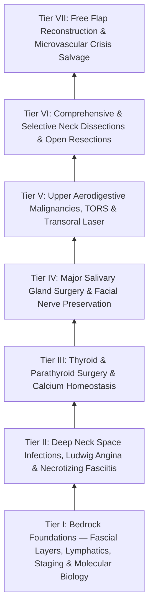

# The Head and Neck Oncology Knowledge Graph provides a structured mastery curriculum

## Linear Companion Guide
- [[Comprehensive Head & Neck Surgical Oncology, Endocrine & Microvascular Reconstruction Residency Mastery Curriculum & Self-Assessment Guide|Comprehensive Head & Neck Residency Mastery Curriculum & Self-Assessment Guide]]

---

## Tier I: Bedrock Foundations — Fascial Layers, Lymphatics, Staging & Molecular Biology
1. [[Deep cervical fascia divides into superficial, middle, and deep layers that define surgical planes]]
2. [[The retropharyngeal space extends from skull base to tracheal bifurcation and contains lymph nodes draining the nasopharynx]]
3. [[The danger space permits unrestricted infection spread from skull base to posterior mediastinum]]
4. [[Cervical lymph node levels I through VII define regional metastatic drainage basins]]
5. [[Level II lymph nodes are anatomically divided into IIA and IIB by the spinal accessory nerve]]
6. [[AJCC 8th edition incorporates depth of invasion into oral cavity T-staging]]
7. [[Extranodal extension in cervical lymph nodes upstages nodal disease and dictates adjuvant chemoradiotherapy]]
8. [[HPV-positive oropharyngeal squamous cell carcinoma exhibits distinct biological behavior and staging]]
9. [[Tobacco and alcohol carcinogenesis drives TP53 mutation and field cancerization in upper aerodigestive tract]]
10. [[Cetuximab targets EGFR overexpression while pembrolizumab and nivolumab inhibit PD-1 in head and neck SCC]]
11. [[Intensity-modulated radiation therapy and cisplatin radiosensitization form the standard definitive chemoradiation regimen]]
12. [[Post-radiation carotid vasculopathy and osteoradionecrosis represent severe late radiotherapy sequelae]]
13. [[Ludwig angina presents with bilateral submandibular cellulitis and woody floor of mouth induration compromising the airway]]
14. [[Lemierre syndrome involves Fusobacterium necrophorum internal jugular thrombophlebitis and septic emboli]]
15. [[Cervical necrotizing fasciitis requires emergent surgical debridement and broad-spectrum antimicrobial coverage]]
16. [[Referred otalgia originates from shared sensory pathways of cranial nerves V, VII, IX, X, and cervical roots C2-C3]]
17. [[Suppurative sialadenitis of the parotid and submandibular glands is treated with hydration, sialagogues, and anti-staphylococcal antibiotics]]
18. [[The carotid sheath is composed of all three layers of deep cervical fascia and forms a vertical neurovascular conduit]]

---
- **Radiation Oncology**: [[Altered radiation fractionation schemes exploit differential repair and repopulation kinetics to optimize the therapeutic ratio in head and neck cancer|Altered Radiation Fractionation]]
- **Oral Surgery**: [[Dental local anesthesia relies on anatomic landmarks to block the inferior alveolar, greater palatine, and superior alveolar nerves|Dental Local Anesthesia]]
- **Oral Surgery**: [[The Universal Numbering System and Palmer Notation designate primary and permanent dentition across four oral quadrants|Dental Numbering Systems]]
- **Skull Base**: [[Perineural tumor spread along cranial nerves V2, V3, and VII follows retrograde skull base pathways through the pterygopalatine fossa, foramen ovale, and stylomastoid foramen|Perineural Tumor Spread Pathways]]
- **Skull Base**: [[Jugular foramen masses differentiate into paraganglioma, schwannoma, and meningioma based on bone erosion patterns and MRI signal characteristics|Jugular Foramen Mass Differential]]

## Tier II: Comprehensive Cervical Lymphadenectomy (Neck Dissection Mastercraft)
16. [[Radical neck dissection removes levels I through V while sacrificing CN XI, the IJV, and the SCM]]
17. [[Modified radical neck dissection types I, II, and III preserve non-lymphatic structures]]
18. [[Selective neck dissection targets high-risk nodal basins while sparing low-risk cervical levels]]
19. [[Subplatysmal flap elevation and Martin's maneuver protect the marginal mandibular nerve]]
20. [[The spinal accessory nerve is identified at the Erb point and anterior border of the SCM]]
21. [[Level V dissection requires skeletonization of the prevertebral fascia while protecting the phrenic nerve]]
22. [[Levels II through IV internal jugular chain dissection mobilizes the carotid sheath packet]]
23. [[Level I dissection requires facial vessel ligation and preservation of the lingual and hypoglossal nerves]]
24. [[Thoracic duct anatomy in the left level IV space predisposes to intraoperative chyle fistula]]
25. [[Cervical chyle leaks are managed with MCT diet, octreotide, or surgical thoracic duct ligation]]
26. [[Carotid blowout syndrome is classified into threatened, impending, and acute hemorrhage]]
27. [[Endovascular covered stenting and coil embolization provide emergent control of carotid blowout]]
28. [[Central compartment neck dissection clears level VI nodes between the carotid sheaths and suprasternal notch]]
29. [[Postoperative neck hematoma after thyroidectomy or neck dissection requires emergent bedside wound opening for airway decompression]]
30. [[Superior mediastinal level VII dissection clears paratracheal lymph nodes below the sternal notch]]

---
- **Oral Surgery**: [[Internal derangement of the temporomandibular joint is staged by the Wilkes classification from reducing clicking to disc perforation|TMJ Internal Derangement]]
- **Neck Dissection**: [[Neck dissection incision design balances surgical exposure against carotid coverage and vascular compromise in irradiated tissue|Neck Dissection Incisions]]
- **Oral Cavity**: [[Oral pemphigus vulgaris, mucous membrane pemphigoid, and lichen planus are distinguished by suprabasilar versus subepithelial clefting and direct immunofluorescence patterns|Oral Vesiculobullous Diseases]]
- **Deep Neck Spaces**: [[Deep neck fascial spaces cross-sectional CT compartmentalization organizes suprahyoid and infrahyoid head and neck pathology|Deep Neck Spaces CT Compartmentalization]]
- **Parapharyngeal Space**: [[Parapharyngeal space fat and styloid process displacement vectors localize deep neck masses and differentiate parotid, neurogenic, and mucosal lesions|Parapharyngeal Space Displacement Vectors]]
- **Vascular Anomalies**: [[Head and neck arteriovenous malformations are staged by the Schobinger classification to guide embolization and complete surgical nidus resection|Arteriovenous Malformations of the Head and Neck]]
- **Oral Surgery**: [[Unicystic ameloblastoma luminal and intraluminal variants permit conservative enucleation while the mural subtype mandates formal segmental resection|Unicystic Ameloblastoma]]
- **Oral Surgery**: [[Calcifying epithelial odontogenic tumors, adenomatoid odontogenic tumors, odontomas, and odontogenic myxomas exhibit distinct histopathologic hallmarks and biologic behaviors|Benign Odontogenic Tumors]]
- **Pathology**: [[Craniofacial fibrous dysplasia and cherubism manifest as benign fibro-osseous jaw lesions managed with surgical contouring|Fibro-Osseous Lesions of the Jaws]]
- **Perivertebral Space**: [[The perivertebral space is enclosed by the deep layer of deep cervical fascia and divides into prevertebral and paraspinal compartments on cross-sectional imaging|Perivertebral Space Imaging]]
- **Oral Surgery**: [[Medication-related osteonecrosis of the jaw is staged by the AAOMS system to direct antiresorptive conservative and surgical therapy|Medication-Related Osteonecrosis of the Jaw (MRONJ)]]

## Tier III: Oral Cavity Carcinoma, Resection Margins, Pull-Through & Mandibulotomy
31. [[Oncologic clear margins require at least five millimeters of histological normal tissue]]
32. [[Elective neck dissection is indicated for oral cavity squamous cell carcinoma with depth of invasion exceeding four millimeters]]
33. [[Transoral resection provides oncologic access for early-stage anterior oral cavity neoplasms]]
34. [[Transcervical pull-through resection mobilizes oral tongue tumors without dividing the mandible]]
35. [[Lip-split paramedian mandibulotomy provides wide exposure for posterior oral cavity and oropharyngeal tumors]]
36. [[Step-cut chevron mandibulotomy maximizes bone surface contact and rotational stability]]
37. [[Marginal mandibulectomy preserves basilar bone height when tumor abuts but does not invade marrow]]
38. [[Segmental mandibulectomy resects full-thickness bone for medullary invasion and irradiated bone recurrence]]
39. [[Floor of mouth carcinoma requires sublingual gland excision and Wharton duct relocation]]
40. [[Retromolar trigone carcinoma invades the pterygomandibular raphe and masticator space]]
41. [[Oral tongue carcinoma spreads along intrinsic lingual musculature to bilateral cervical lymphatics]]
42. [[Buccal mucosa carcinoma exhibits high rates of local recurrence and Stensen duct involvement]]
43. [[Hard palate and upper alveolar carcinoma require partial or total maxillectomy]]
44. [[Mandibular reconstruction plates require rigid bicortical screw fixation to withstand masticatory load]]
45. [[Pre-plating the intact mandible before osteotomy preserves accurate dental occlusion and contour]]
46. [[Ameloblastoma exhibits multilocular soap-bubble radiolucency and requires segmental resection with one-centimeter bony margins]]
47. [[Odontogenic keratocysts arise from PTCH1 mutations in Gorlin syndrome and exhibit high recurrence after simple enucleation]]
48. [[Dentigerous cysts arise from the follicular epithelium surrounding the crown of an unerupted third molar]]
49. [[Stafne bone defects represent asymptomatic cortical lingual mandibular concavities containing ectopic salivary gland tissue]]
50. [[Paradise criteria define evidence-based indications for pediatric tonsillectomy in recurrent throat infections]]

---
- **Sinonasal Malignancy**: [[Midface degloving, lateral rhinotomy, and Weber-Fergusson approaches provide graded open exposure for sinonasal and skull base malignancies|Open Sinonasal Approaches]]
- **Surgical Oncology**: [[Sentinel lymph node biopsy accurately stages the clinically negative neck in early oral squamous cell carcinoma while reducing shoulder morbidity|Sentinel Lymph Node Biopsy]]

## Tier IV: Oropharyngeal (TORS), Laryngeal & Hypopharyngeal Surgical Oncology
46. [[Transoral robotic surgery TORS achieves en bloc resection of tonsillar and base of tongue neoplasms]]
47. [[TORS radical tonsillectomy requires careful identification of the internal carotid artery posterolaterally]]
48. [[Lingual artery branches require clip ligation during TORS base of tongue resection]]
49. [[Prophylactic transcervical external carotid ligation reduces fatal secondary hemorrhage after TORS]]
50. [[Transoral laser microsurgery TLM resects early glottic carcinoma with vocal cord preservation]]
51. [[Total laryngectomy achieves en bloc laryngeal resection with permanent end-stoma]]
52. [[Primary pharyngeal closure after total laryngectomy utilizes an inverting Connell technique]]
53. [[Pectoralis major muscle flap reinforcement prevents pharyngocutaneous fistula in salvage laryngectomy]]
54. [[Pharyngocutaneous fistula is managed with wound care, nutritional support, and surgical flap closure]]
55. [[Tracheoesophageal puncture TEP and voice prosthesis restore pulmonary-driven alaryngeal speech]]
56. [[Hypopharyngeal piriform sinus carcinoma requires partial or total laryngopharyngectomy]]
57. [[Circumferential laryngopharyngectomy requires tubed microvascular or visceral flap reconstruction]]
58. [[Posterior pharyngeal wall carcinoma metastasizes early to retropharyngeal and level II to IV lymph nodes]]
59. [[Postcricoid hypopharyngeal carcinoma frequently invades the cervical esophagus and bilateral RLNs]]
60. [[Subglottic carcinoma spreads to level VI central compartment lymphatics and mediastinal nodes]]
61. [[Plummer-Vinson syndrome combines iron deficiency anemia, postcricoid esophageal webs, and mucosal atrophy with malignant potential]]
62. [[Verrucous carcinoma exhibits pushing non-infiltrative margins without regional nodal metastasis and is treated with wide local surgical excision]]
63. [[Supracricoid partial laryngectomy achieves organ preservation for T2 to T3 laryngeal cancer by resecting the thyroid cartilage while preserving at least one cricoarytenoid unit]]

---
- **Salivary Gland**: [[Carcinoma ex pleomorphic adenoma arises from longstanding benign mixed tumors and is stratified by capsular invasion into noninvasive, minimally invasive, and widely invasive subtypes|Carcinoma Ex Pleomorphic Adenoma]]
- **Thyroid Cancer**: [[Differentiated thyroid carcinoma prognostic scoring systems AMES, AGES, and MACIS stratify low and high risk disease to guide the extent of thyroidectomy|AMES Staging System]]
- **Surgical Oncology**: [[Stomal recurrence after total laryngectomy is staged by the Sisson classification and requires mediastinal resection with vascularized tissue coverage|Stomal Recurrence]]

## Tier V: Thyroid & Parathyroid Surgery: RLN/EBSLN Craft & Miami Criteria
61. [[The Bethesda system for reporting thyroid cytopathology stratifies malignancy risk and guides surgical decision-making]]
62. [[BRAF V600E and TERT promoter mutations drive aggressive papillary thyroid carcinoma behavior]]
63. [[Papillary thyroid carcinoma spreads via cervical lymphatics to central and lateral neck compartments]]
64. [[Follicular thyroid carcinoma is distinguished from follicular adenoma by capsular and vascular invasion]]
65. [[Medullary thyroid carcinoma arises from parafollicular C cells and mandates RET testing with calcitonin surveillance]]
66. [[Anaplastic thyroid carcinoma is an airway and molecular emergency requiring immediate BRAF testing]]
67. [[The superior thyroid artery branches are divided flush on the thyroid capsule to protect the EBSLN]]
68. [[The recurrent laryngeal nerve is identified within Simon's triangle and followed through Berry's ligament]]
69. [[A nonrecurrent laryngeal nerve arises directly from the vagus due to an aberrant retroesophageal right subclavian artery]]
70. [[Intraoperative neuromonitoring of the RLN and EBSLN verifies nerve integrity and aids nerve identification]]
71. [[Superior and inferior parathyroid glands maintain constant anatomical relationships to the RLN and ITA]]
72. [[Devascularized parathyroid glands require confirmation biopsy and autotransplantation into the SCM]]
73. [[Primary hyperparathyroidism is caused by single adenomas, multigland hyperplasia, or parathyroid carcinoma]]
74. [[Preoperative sestamibi SPECT and 4D-CT localize hyperfunctioning parathyroid glands]]
75. [[The Miami criterion requires a fifty percent intraoperative PTH drop at ten minutes post-excision]]
76. [[Post-thyroidectomy hypocalcemia is managed with oral calcium, calcitriol, and intravenous calcium gluconate]]
77. [[The 2025 ATA guidelines establish active surveillance criteria and lobectomy preference for low-risk differentiated thyroid cancer]]
78. [[The RET proto-oncogene dictates medullary thyroid carcinoma aggression and timing of prophylactic thyroidectomy in MEN 2]]

---
- **Skull Base**: [[NUT midline carcinoma is an aggressive poorly differentiated squamous neoplasm harboring BRD4-NUT fusions with abrupt keratinization|NUT Midline Carcinoma]]
- **Skull Base**: [[Biphasic sinonasal malignancies exhibit divergent epithelial, mesenchymal, and neural differentiation requiring diagnostic immunohistochemical panels|Biphasic Sinonasal Malignancies]]
- **Endocrine Surgery**: [[Reoperative parathyroidectomy for persistent or recurrent hyperparathyroidism requires dual imaging concordance and a lateral backdoor approach to minimize nerve injury|Reoperative Parathyroidectomy]]

## Tier VI: Major Salivary Gland Oncology, Parotidectomy (CN VII) & Submandibular Excision
76. [[The facial nerve main trunk is localized using the tragal pointer, tympanomastoid suture, and digastric ridge]]
77. [[Superficial parotidectomy dissects the facial nerve branches to resect the lateral salivary lobe]]
78. [[Pleomorphic adenoma requires superficial parotidectomy with a cuff of normal tissue to prevent pseudopod recurrence]]
79. [[Warthin tumor presents as a cystic parotid neoplasm associated with smoking and bilateral occurrence]]
80. [[Mucoepidermoid carcinoma is graded by AFIP Brandwein criteria and driven by CRTC1-MAML2 translocation]]
81. [[Adenoid cystic carcinoma exhibits prominent perineural invasion and late distant hematogenous metastasis]]
82. [[Salivary duct carcinoma is an aggressive high-grade malignancy expressing androgen receptors and HER2]]
83. [[Acinic cell carcinoma presents as an indolent low-grade parotid neoplasm with serous acinar differentiation]]
84. [[Total parotidectomy with facial nerve sacrifice is indicated for direct malignant nerve invasion]]
85. [[Immediate facial nerve grafting with the great auricular or sural nerve restores facial reanimation]]
86. [[Submandibular gland excision requires preservation of the marginal mandibular, lingual, and hypoglossal nerves]]
87. [[Wharton duct sialolithiasis is managed with transoral sialodochoplasty or sialendoscopy]]
88. [[Sialendoscopy enables diagnostic visualization and stone extraction in chronic obstructive sialadenitis]]
89. [[Frey syndrome results from aberrant auriculotemporal reinnervation of sweat glands after parotidectomy]]
90. [[Intradermal botulinum toxin and topical aluminum chloride treat symptomatic Frey syndrome]]

---
- **Reconstructive Surgery**: [[Free tissue transfer donor site morbidity requires systematic risk stratification and anatomical preservation across fibular, radial forearm, and anterolateral thigh harvests|Free Flap Donor Site Morbidity]]
- **Salivary Gland**: [[Salivary clear cell neoplasms comprise a challenging diagnostic spectrum characterized by distinct immunohistochemical profiles and recurrent gene fusions|Salivary Gland Clear Cell Neoplasms]]

## Tier VII: Microvascular Free Flaps & High-Stakes Complication Rescue
91. [[The radial forearm free flap provides thin, pliable fasciocutaneous tissue for oral and pharyngeal defects]]
92. [[The anterolateral thigh flap provides versatile volume and can be harvested as a chimeric flap]]
93. [[The fibula osteocutaneous free flap provides up to twenty-five centimeters of vascularized bone for mandible reconstruction]]
94. [[Virtual surgical planning and 3D cutting guides optimize fibula contouring and dental implant rehabilitation]]
95. [[Preserving the distal five centimeters of the fibula prevents ankle instability and talar tilt]]
96. [[The subscapular system provides chimeric bone and soft tissue flaps based on the circumflex scapular artery]]
97. [[The latissimus dorsi myocutaneous free flap covers massive soft tissue and skull base defects]]
98. [[Microvascular venous couplers achieve rapid and reliable end-to-end and end-to-side anastomoses]]
99. [[Great saphenous vein interposition grafts bridge vascular defects during free flap revascularization]]
100. [[Postoperative free flap monitoring includes Doppler ultrasound, pinprick bleeding, and capillary refill checks]]
101. [[Microvascular arterial thrombosis presents with a pale, flat flap and requires immediate surgical exploration]]
102. [[Microvascular venous thrombosis presents with violaceous congestion and rapid dark bleeding on pinprick]]
103. [[Microvascular free flap salvage requires urgent re-exploration within two hours of vascular compromise]]
104. [[High-stakes head and neck surgical oncology complications require rapid structured emergency rescue]]
105. [[Postoperative free flap compromise within forty-eight hours requires emergent surgical re-exploration for pedicle salvage]]
106. [[Postoperative neck hematoma after thyroidectomy or neck dissection requires emergent bedside wound opening for airway decompression]]
107. [[The no-zone approach to penetrating neck trauma triages stable patients with CTA based on hard and soft signs]]

---
- **Endocrine**: [[High-risk papillary thyroid carcinoma histologic variants portend aggressive extrathyroidal invasion, radioiodine refractoriness, and adverse prognosis|Aggressive Papillary Thyroid Carcinoma Variants]]

## Tier S: Second-Echelon Oncology, Thyroid & Salivary Clinic
1. [[Nasopharyngeal carcinoma is an EBV-driven malignancy treated primarily with radiation and concurrent chemotherapy]]
2. [[HPV-positive carcinoma of unknown primary is localized by palatine tonsillectomy and TORS lingual mucosectomy]]
3. [[Cutaneous head and neck melanoma is staged by Breslow depth and sentinel lymph node biopsy]]
4. [[High-risk cutaneous squamous cell carcinoma drains first to parotid and perifacial nodal basins]]
5. [[Esthesioneuroblastoma arises from olfactory neuroepithelium and is staged by the Kadish classification]]
6. [[Medullary thyroid carcinoma arises from parafollicular C cells and mandates RET testing with calcitonin surveillance]]
7. [[Anaplastic thyroid carcinoma is an airway and molecular emergency requiring immediate BRAF testing]]
8. [[Bethesda cytology and molecular testing stratify thyroid nodule malignancy risk before surgery]]
9. [[Carotid body paragangliomas splay the bifurcation and are graded by the Shamblin classification]]
10. [[Suspected cervical lymphoma requires excisional or core biopsy because cytology cannot assess architecture]]
11. [[Acute suppurative sialadenitis affects dehydrated patients and is dominated by Staphylococcus aureus]]
12. [[Sjogren syndrome causes autoimmune sicca with parotid enlargement and markedly elevated MALT lymphoma risk]]
13. [[Plunging ranula is a sublingual mucus extravasation pseudocyst herniating around the mylohyoid free edge]]
14. [[Frey syndrome results from aberrant auriculotemporal reinnervation of sweat glands after parotidectomy]]
15. [[KEYNOTE-689 establishes neoadjuvant and adjuvant pembrolizumab as standard for locally advanced head and neck squamous cell carcinoma]]
16. [[Neoadjuvant cemiplimab achieves high pathological response rates in resectable locally advanced cutaneous squamous cell carcinoma]]
17. [[The ECOG-3311 and ORATOR trials establish pathological risk-stratified de-escalation and functional trade-offs in HPV-positive OPSCC]]
18. [[Vagal paragangliomas present as lateral neck masses with Fontaine sign and anteromedial carotid displacement without bifurcation splaying]]
19. [[The MSLT-1 and MSLT-2 trials establish sentinel lymph node biopsy utility and ultrasound surveillance safety in melanoma]]
20. [[Merkel cell carcinoma is an aggressive neuroendocrine cutaneous malignancy staged by SLNB and managed with wide excision and adjuvant radiotherapy]]
21. [[Nontuberculous mycobacterial lymphadenitis presents as a violaceous cervicofacial mass treated with complete surgical excision]]
