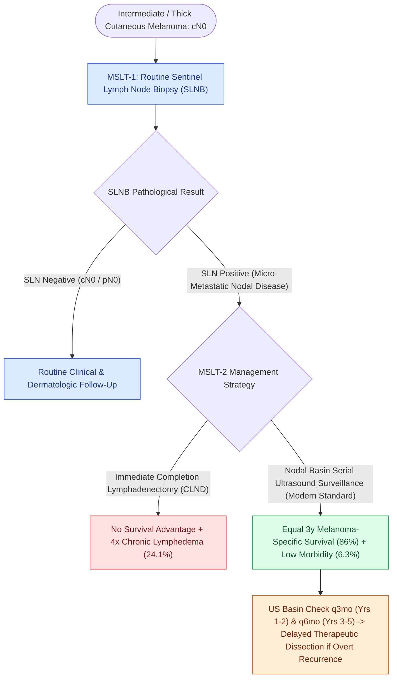

# The MSLT-1 and MSLT-2 trials establish sentinel lymph node biopsy utility and ultrasound surveillance safety in melanoma

## Active Recall

> [!question]- What was the primary clinical takeaway from the MSLT-II trial regarding completion lymph node dissection (CLND) in sentinel-node-positive melanoma?
> *Answer / Clinical Rationale*: Immediate CLND **did not improve melanoma-specific survival** compared to nodal basin ultrasound surveillance ($86\%$ at 3 years in both arms), while CLND quadrupled the rate of chronic lymphedema ($24.1\%$ vs $6.3\%$). Therefore, routine CLND has been replaced by serial nodal ultrasound surveillance.

> [!question]- According to the MSLT-I trial, what was the primary survival benefit of early sentinel lymph node biopsy over watchful waiting in node-positive intermediate-thickness melanoma?
> *Answer / Clinical Rationale*: For patients with occult nodal metastases, early SLNB-directed resection significantly improved **10-year disease-free survival ($71.3\%$ vs $64.7\%$) and distant metastasis-free survival**.

## Core Clinical & Mechanistic Principles
The management of regional lymph nodes in cutaneous melanoma was fundamentally defined by two landmark multicenter randomized phase III trials: **MSLT-I** (Morton et al., *NEJM* 2014) and **MSLT-II** (Faries et al., *NEJM* 2017).

### Mechanistic Insights & Clinical Practice Guidelines
1. **MSLT-I Core Findings**:
   - **Staging Power**: Sentinel lymph node status is the single most powerful independent prognostic indicator for recurrence and survival in clinical stage I/II melanoma.
   - **Regional Disease Control**: Biopsy-led early removal of nodal disease prevented painful, morbid, bulky regional nodal recurrences.
2. **MSLT-II Core Findings & Modern Practice Paradigm**:
   - **Survival Non-Inferiority**: Immediate completion lymphadenectomy does not confer an overall survival or melanoma-specific survival advantage over rigorous nodal ultrasonography observation.
   - **Nonsentinel Node Positivity**: Only $11.5\%$ of completion lymphadenectomy specimens contain additional metastatic nonsentinel lymph nodes.
   - **Surveillance Protocol**: High-resolution nodal basin ultrasonography every **3 months for years 1–2**, and every **6 months for years 3–5**. Therapeutic lymph node dissection is performed only if overt ultrasonographic recurrence is detected (see [[Cutaneous head and neck melanoma is staged by Breslow depth and sentinel lymph node biopsy|Head and Neck Melanoma & Breslow Staging]]).

## Connected Concepts & Graph Traversal
- **Melanoma Staging Foundation**: [[Cutaneous head and neck melanoma is staged by Breslow depth and sentinel lymph node biopsy|Head and Neck Melanoma & Breslow Staging]]
- **Cervical Nodal Drainage**: [[Cervical lymph node levels I through VII define regional metastatic drainage basins|Cervical Lymph Node Levels I–VII]]
- **Surgical Neck Dissection**: [[Selective neck dissection targets high-risk nodal basins while sparing low-risk cervical levels|Selective Neck Dissection (SND)]]
- **Perioperative Immunotherapy**: [[KEYNOTE-689 establishes neoadjuvant and adjuvant pembrolizumab as standard for locally advanced head and neck squamous cell carcinoma|KEYNOTE-689 Trial]]
- **Cutaneous Squamous Cell Immunotherapy**: [[Neoadjuvant cemiplimab achieves high pathological response rates in resectable locally advanced cutaneous squamous cell carcinoma|Neoadjuvant Cemiplimab in cSCC]]
