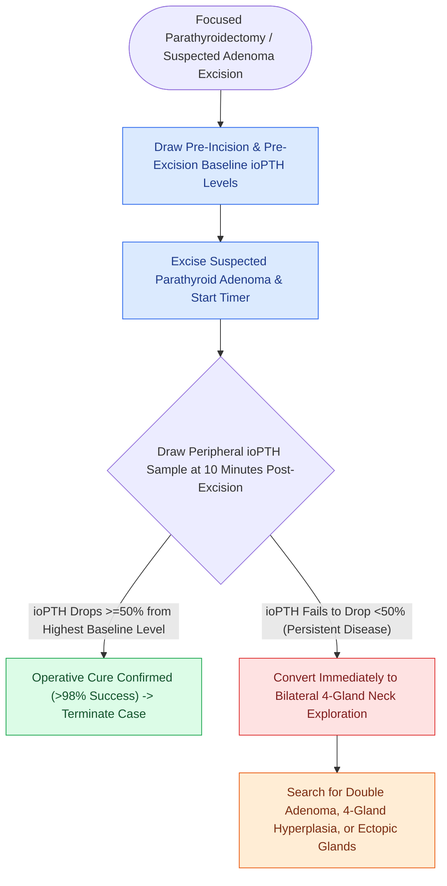

# The Miami criterion requires a fifty percent intraoperative PTH drop at ten minutes post-excision

## Active Recall

> [!question]- What is the definition of biochemical cure under the Miami ioPTH criterion?
> *Answer / Clinical Rationale*: A **$\ge 50\%$ drop in intact PTH at 10 minutes post-excision** compared to the highest pre-incision baseline value.

> [!question]- What intraoperative step is mandatory if the 10-minute post-excision ioPTH level fails to drop by 50%?
> *Answer / Clinical Rationale*: Convert immediately to a **bilateral four-gland neck exploration** to identify double adenomas or multigland hyperplasia.

## Core Clinical & Mechanistic Principles
**Intraoperative Parathyroid Hormone (ioPTH) monitoring** relies on the rapid half-life of intact PTH ($3\text{–}5\text{ minutes}$) to confirm complete biochemical excision of hyperfunctioning parathyroid tissue:
- **The Miami 50% Rule (Irvin Criterion)**:
  - Baseline blood samples drawn: (1) Pre-incision baseline, and (2) Pre-excision baseline (at time of vessel clamping).
  - Repeat samples drawn at **5 minutes and 10 minutes post-excision** of the suspected adenoma.
  - **Criterion for Cure**: A **$\ge 50\%$ drop in ioPTH at 10 minutes post-excision compared to the highest pre-incision baseline value** predicts complete operative cure in $>97\text{–}98\%$ of patients.
- **Failure to Drop Protocol**:
  - If ioPTH fails to drop by $\ge 50\%$, persistent hyperfunctioning tissue exists (multigland hyperplasia, double adenoma, or ectopic 5th gland).
  - The surgeon must convert to a **bilateral four-gland neck exploration**.

### Surgical Technique & Critical Safety Checks
- **Other ioPTH Criteria**: Vienna criterion ($>50\%$ drop from baseline at 10 min), Halle criterion ($>50\%$ drop into normal range at 15 min) (see [[Primary hyperparathyroidism is caused by single adenomas, multigland hyperplasia, or parathyroid carcinoma|Hyperparathyroidism]]).

## Connected Concepts & Graph Traversal
- **Hyperparathyroidism**: [[Primary hyperparathyroidism is caused by single adenomas, multigland hyperplasia, or parathyroid carcinoma|Hyperparathyroidism]]
- **Parathyroid Localization**: [[Preoperative sestamibi SPECT and 4D-CT localize hyperfunctioning parathyroid glands|Parathyroid Localization]]
- **Parathyroid Anatomy**: [[Superior and inferior parathyroid glands maintain constant anatomical relationships to the RLN and ITA|Parathyroid Anatomy]]
- **Anatomical Foundation**: [[Level II lymph nodes are anatomically divided into IIA and IIB by the spinal accessory nerve]]
- **Surgical Lymphadenectomy**: [[Endovascular covered stenting and coil embolization provide emergent control of carotid blowout]]
- **Oncologic Resection & Margins**: [[Retromolar trigone carcinoma invades the pterygomandibular raphe and masticator space]]
- **Aerodigestive / Pharyngolaryngeal**: [[Prophylactic transcervical external carotid ligation reduces fatal secondary hemorrhage after TORS]]
