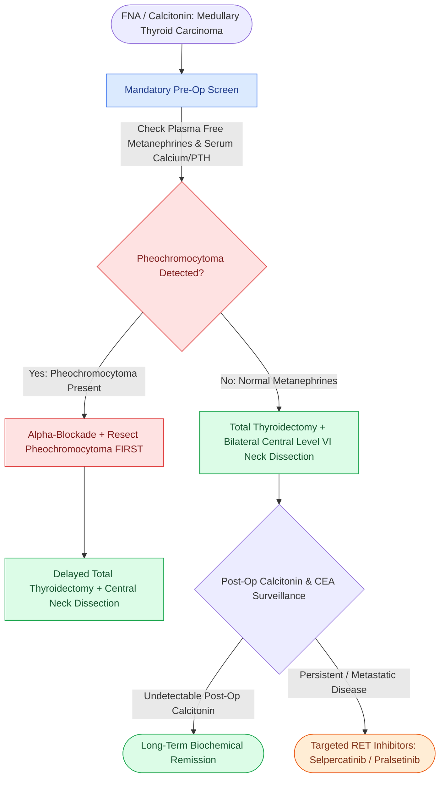
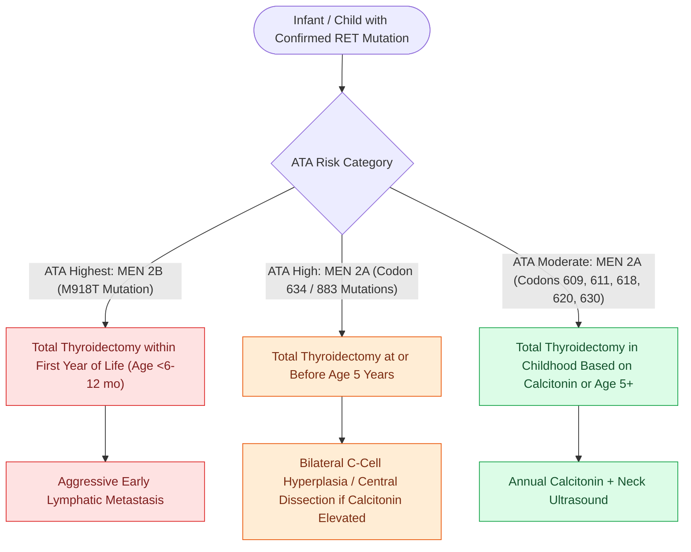

# The RET proto-oncogene dictates medullary thyroid carcinoma aggression and timing of prophylactic thyroidectomy in MEN 2

## Active Recall

> [!question]- What cell population gives rise to Medullary Thyroid Carcinoma (MTC), and what serum biomarkers track tumor burden and recurrence?
> *Answer / Clinical Rationale*: MTC arises from **calcitonin-secreting parafollicular C-cells** (derived from the neural crest / ultimobranchial body, concentrated in the upper one-third of the thyroid lobes). The primary serum tumor biomarkers are **Calcitonin** (secretory product directly reflecting C-cell mass, doubling time $<6\text{ months}$ portends poor prognosis) and **Carcinoembryonic Antigen (CEA)** (marker of dedifferentiation and tumor volume).

> [!question]- How do the ATA Risk Categories for RET mutations dictate the timing of prophylactic total thyroidectomy in MEN 2A versus MEN 2B?
> *Answer / Clinical Rationale*: - **ATA Highest Risk (MEN 2B / $M918T$ mutation)**: Prophylactic total thyroidectomy is performed **in the first year of life (ideally within the first 6 months)** due to early, fulminant metastasis in infancy. - **ATA High Risk (MEN 2A / Codon 634 mutations)**: Prophylactic total thyroidectomy is performed **at or before age 5 years**. - **ATA Moderate Risk (MEN 2A / Codons 609, 611, 618, 620, 630, etc.)**: Total thyroidectomy is performed when basal/stimulated serum calcitonin becomes elevated, or around age 5 years.

> [!question]- What critical endocrine workup is mandatory prior to performing any surgical resection on a patient with newly diagnosed MTC?
> *Answer / Clinical Rationale*: **Rule out Pheochromocytoma** (present in $50\%$ of MEN 2A and 2B cases) via **plasma free metanephrines** or 24-hour urine fractionated metanephrines and catecholamines. If present, the pheochromocytoma **MUST be resected FIRST** (or medically alpha-blocked with phenoxybenzamine) to avoid catastrophic intraoperative hypertensive crisis and cardiovascular collapse during thyroid surgery.

## Core Clinical & Mechanistic Principles

**Medullary Thyroid Carcinoma (MTC)** accounts for $3\text{–}5\%$ of all thyroid malignancies, occurring either as **sporadic disease ($75\%$)** (typically unifocal) or as part of **hereditary $MEN\ 2$ syndromes ($25\%$)** (bilateral, multicentric C-cell hyperplasia driven by germline *RET* proto-oncogene gain-of-function point mutations):

- **Surgical Mandate & Mandatory Pheochromocytoma Screening**:
  - Unlike [[Papillary thyroid carcinoma spreads via cervical lymphatics to central and lateral neck compartments|papillary]] or follicular thyroid carcinomas, MTC does not concentrate radioactive iodine and is unresponsive to TSH suppression; primary curative therapy requires comprehensive upfront surgery (**total thyroidectomy with routine bilateral [[Central compartment neck dissection clears level VI nodes between the carotid sheaths and suprasternal notch|Level VI central compartment neck dissection]]**).
  - Before neck exploration, all patients must undergo screening with plasma free metanephrines to rule out concurrent pheochromocytoma; if present, the adrenal tumor must be resected first to avert fatal intraoperative hypertensive crises.

### Hereditary RET Mutation Risk Stratification & Prophylaxis Timing

### Pathological and Diagnostic Hallmarks
- **Histopathology**: Sheets, nests, and trabeculae of polygonal to spindle-shaped cells in a vascular stroma containing **acellular, eosinophilic amyloid deposits** (derived from altered calcitonin) that demonstrate **apple-green birefringence** under polarized light with Congo red staining.
- **IHC Profile**: **Calcitonin (+), CEA (+), Chromogranin (+), Synaptophysin (+)**, TTF-1 (+); Thyroglobulin (-).

## Connected Concepts & Graph Traversal
- **Thyroidectomy & Simon's Triangle**: [[The recurrent laryngeal nerve is identified within Simon's triangle and followed through Berry's ligament|RLN Identification in Thyroidectomy]]
- **Central Compartment Neck Dissection**: [[Central compartment neck dissection clears level VI nodes between the carotid sheaths and suprasternal notch|Level VI Central Neck Dissection]]
- **Parathyroid Sparing**: [[Superior and inferior parathyroid glands maintain constant anatomical relationships to the RLN and ITA|Parathyroid Gland Preservation]]
- **EBSLN Protection**: [[The superior thyroid artery branches are divided flush on the thyroid capsule to protect the EBSLN|EBSLN Surgical Protection]]
- **Papillary Thyroid Carcinoma**: [[Papillary thyroid carcinoma spreads via cervical lymphatics to central and lateral neck compartments|Papillary vs Medullary Thyroid Carcinoma]]
- **Intraoperative PTH Kinetics**: [[The Miami criterion requires a fifty percent intraoperative PTH drop at ten minutes post-excision|Miami Criteria & Endocrine Kinetics]]
