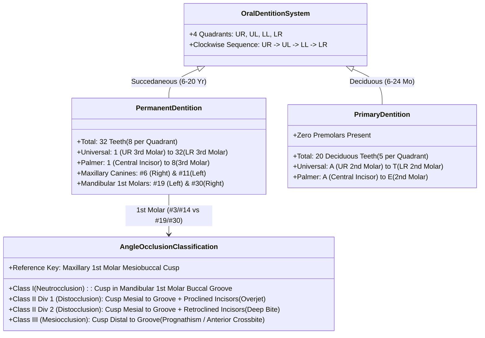

# The Universal Numbering System and Palmer Notation designate primary and permanent dentition across four oral quadrants

## Active Recall

> [!question]- How does the Universal Numbering System designate teeth across the permanent versus primary dentition, and what anatomical classes compose each arch?
> *Answer / Clinical Rationale*: In the **Universal Numbering System**, the permanent dentition consists of **32 teeth numbered 1 through 32**, beginning at the **right maxillary third molar (#1)**, traversing clockwise around the maxillary arch to the **left maxillary third molar (#16)**, dropping to the **left mandibular third molar (#17)**, and proceeding across to the **right mandibular third molar (#32)**. Each quadrant contains 8 teeth: 2 incisors, 1 canine, 2 premolars (bicuspids), and 3 molars. The primary (deciduous) dentition contains **20 teeth designated by uppercase letters A through T**, beginning at the **right maxillary second primary molar (A)**, traversing clockwise to the **left maxillary second primary molar (J)**, dropping to the **left mandibular second primary molar (K)**, and ending at the **right mandibular second primary molar (T)**. Primary dentition has **no premolars** (2 incisors, 1 canine, 2 molars per quadrant).

> [!question]- How do the Palmer Notation and the FDI World Dental Federation two-digit systems delineate tooth position compared with the Universal system?
> *Answer / Clinical Rationale*: **Palmer Notation** divides the oral cavity into four quadrants utilizing specialized graphical bracket symbols indicating quadrant orientation: ┘ (Maxillary Right), └ (Maxillary Left), ┐ (Mandibular Right), and ┌ (Mandibular Left). Permanent teeth in each quadrant are numbered **1 (central incisor) through 8 (third molar)** moving distal from the midline; primary teeth are lettered **A (central incisor) through E (second molar)**. The **FDI World Dental Federation (ISO 3950)** system uses a two-digit notation where the first digit denotes the quadrant (Permanent: 1 = Maxillary Right, 2 = Maxillary Left, 3 = Mandibular Left, 4 = Mandibular Right; Primary: 5 = Maxillary Right, 6 = Maxillary Left, 7 = Mandibular Left, 8 = Mandibular Right) and the second digit designates the tooth's position from the dental midline (1 through 8 for permanent, 1 through 5 for primary; e.g., tooth 21 is the permanent left maxillary central incisor).

> [!question]- What defines Angle Classes I, II (Divisions 1 and 2), and III malocclusions, and how do overjet and overbite differ?
> *Answer / Clinical Rationale*: Angle classification is determined by the relationship of the **mesiobuccal cusp of the permanent maxillary first molar** to the **buccal groove of the permanent mandibular first molar**:
> - **Class I (Neutrocclusion)**: The mesiobuccal cusp of the maxillary first molar aligns precisely with the buccal groove of the mandibular first molar.
> - **Class II (Distocclusion)**: The mesiobuccal cusp of the maxillary first molar lies **mesial (anterior)** to the buccal groove of the mandibular first molar. **Division 1** exhibits normal or proclined maxillary incisors with excessive horizontal **overjet** (normal overjet $\sim 2\text{ mm}$). **Division 2** exhibits retroclined central incisors ("deep bite") with excessive vertical **overbite** (normal overbite $\sim 2\text{ mm}$) and proclined lateral incisors.
> - **Class III (Mesiocclusion)**: The mesiobuccal cusp of the maxillary first molar lies **distal (posterior)** to the buccal groove of the mandibular first molar, typically presenting with a negative overjet (anterior crossbite) and mandibular prognathism.

## Core Clinical & Mechanistic Principles

Precise dental documentation is foundational for maxillofacial trauma, reconstructive surgery, and orthognathic planning. The oral cavity is anatomically partitioned into four quadrants (maxillary right, maxillary left, mandibular left, mandibular right) centered on the mid-sagittal inter-incisal dental midline:

### Dental Surface Terminology
- **Incisal**: Biting edge of anterior dentition (incisors and canines).
- **Occlusal**: Masticatory chewing surface of posterior dentition (premolars and molars).
- **Mesial**: Surface facing toward the dental midline along the curvature of the dental arch.
- **Distal**: Surface facing away from the dental midline toward the posterior aspect of the arch.
- **Labial**: Surface facing the lips (anterior dentition).
- **Buccal**: Surface facing the cheek musculature (posterior dentition).
- **Lingual**: Surface facing the tongue (mandibular dentition).
- **Palatal**: Surface facing the hard palate (maxillary dentition).
- **Apical**: Direction toward the root tip / apex embedded within alveolar bone.
- **Coronal**: Direction toward the crown surface exposed in the oral cavity.

### Dental Eruption Chronology *(CummingsReview2017, Ch10, p.200)*
1. **Primary Dentition**: Eruption commences at approximately **8 months of age** (mandibular central incisors) and is completed by **24 to 30 months** with second primary molars. Exfoliation and replacement occur between 6 and 12 years.
2. **Permanent Dentition Eruption Windows**:
   - **First Molars ("6-year molars")**: 6–7 years (erupt posterior to primary second molars without preceding tooth loss).
   - **Central & Lateral Incisors**: 6–9 years.
   - **Canines**: 9–11 years (mandibular), 11–12 years (maxillary).
   - **First & Second Premolars**: 10–12 years (replacing primary molars).
   - **Second Molars ("12-year molars")**: 11–13 years.
   - **Third Molars ("Wisdom teeth")**: 17–21 years (frequently impacted).

### Comparative Tooth Numbering Matrix

| Anatomic Tooth Class | Universal System (Permanent) | Universal System (Primary) | Palmer Notation (Per Quadrant) | FDI Two-Digit (UR / UL / LL / LR) |
| :--- | :--- | :--- | :--- | :--- |
| Central Incisor | #8, #9, #24, #25 | E, F, O, P | 1 | 11, 21, 31, 41 |
| Lateral Incisor | #7, #10, #23, #26 | D, G, N, Q | 2 | 12, 22, 32, 42 |
| Canine (Cuspid) | #6, #11, #22, #27 | C, H, M, R | 3 | 13, 23, 33, 43 |
| First Premolar (Bicuspid) | #5, #12, #21, #28 | None (Absent) | 4 | 14, 24, 34, 44 |
| Second Premolar (Bicuspid) | #4, #13, #20, #29 | None (Absent) | 5 | 15, 25, 35, 45 |
| First Molar | #3, #14, #19, #30 | B, I, L, S (Primary 1st Molar) | 6 (Perm) / D (Prim) | 16, 26, 36, 46 |
| Second Molar | #2, #15, #18, #31 | A, J, K, T (Primary 2nd Molar) | 7 (Perm) / E (Prim) | 17, 27, 37, 47 |
| Third Molar | #1, #16, #17, #32 | None (Absent) | 8 | 18, 28, 38, 48 |

### Occlusal Relationships and Dentofacial Dynamics
- **Overjet**: The horizontal distance separating the labial surface of the mandibular incisors from the incisal edge of the maxillary incisors in centric occlusion (physiologic baseline: **$1.5\text{–}2.5\text{ mm}$**). Excessive overjet ($>4\text{ mm}$) is characteristic of Class II malocclusion; negative overjet (anterior crossbite) denotes Class III.
- **Overbite**: The vertical overlap of the maxillary incisors over the mandibular incisors (physiologic baseline: **$1\text{–}3\text{ mm}$**, or roughly one-third of mandibular crown height). Under-overlap produces an **anterior open bite (apertognathia)**; excessive overlap ($>4\text{ mm}$) constitutes a **deep bite**.
- **Centric Relation (CR)**: An anatomically determined, reproducible position of the mandible where the condyles articulate with the thinnest avascular portion of their respective discs in the most anterior-superior position against the slopes of the articular eminences, independent of tooth contact.
- **Centric Occlusion (CO)**: The occlusion of opposing teeth when the mandible is in centric relation.
- **Maximal Intercuspal Position (MIP)**: Complete interdigitation of opposing teeth independent of condylar positioning ("best fit"). In a minority of individuals, MIP coincides with CR; discrepancies between CR and MIP must be unmasked during surgical orthognathic workup.
- **Dental Compensation and Decompensation**: Severe skeletal discrepancies induce compensatory dentoalveolar tilting (e.g., in skeletal Class III prognathism, mandibular incisors naturally retrocline and maxillary incisors procline to achieve edge-to-edge contact). Presurgical orthodontics must **decompensate** these dental vectors—worsening the malocclusion transiently—so that subsequent orthognathic osteotomies can move the skeletal bases into normal anatomic balance.

Comprehensive physiological and surgical principles connect these findings directly to [[Dental local anesthesia relies on anatomic landmarks to block the inferior alveolar, greater palatine, and superior alveolar nerves|dental local anesthesia]].

## Connected Concepts & Graph Traversal
- **🔗 Mandibular Trauma (FPRS)**: [[Mandible fractures require anatomical reduction and load-sharing miniplate fixation along Champy lines of ideal osteosynthesis|Champy Lines & Occlusal Reduction]]
- **🔗 Orthognathic Surgery (Pediatrics)**: [[Le Fort I osteotomy and bilateral sagittal split osteotomy BSSO achieve rigid skeletal advancement in MMA|BSSO & Le Fort I Advancement]]
- **Surgical Occlusal Planning**: [[Pre-plating the intact mandible before osteotomy preserves accurate dental occlusion and contour|Mandibular Pre-Plating & Occlusion]]
- **Prosthetic Rehabilitation**: [[Virtual surgical planning and 3D cutting guides optimize fibula contouring and dental implant rehabilitation|VSP & Dental Implants]]
- **Surgical Access**: [[Step-cut chevron mandibulotomy maximizes bone surface contact and rotational stability|Chevron Mandibulotomy]]
