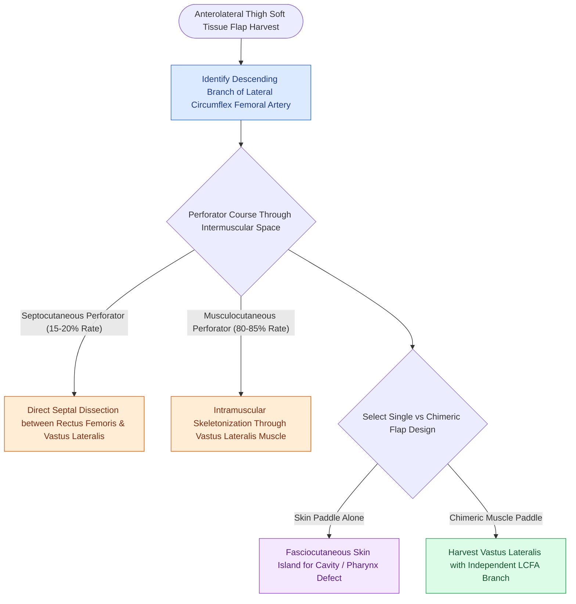

# The anterolateral thigh flap provides versatile volume and can be harvested as a chimeric flap

## Active Recall

> [!question]- What is the main vascular pedicle of the Anterolateral Thigh (ALT) flap?
> *Answer / Clinical Rationale*: The **descending branch of the Lateral Circumflex Femoral Artery (LCFA)**.

> [!question]- What percentage of ALT perforators are musculocutaneous (traversing the vastus lateralis muscle)?
> *Answer / Clinical Rationale*: Approximately **$80\text{ to }85\%$** of perforators.

## Core Clinical & Mechanistic Principles
The **Anterolateral Thigh (ALT) Flap** (Song, 1984) is a versatile soft tissue flap providing moderate-to-large skin paddles and muscular volume with minimal donor site morbidity:
- **Vascular Anatomy & Perforators**:
  - **Vascular Pedicle**: **Descending branch of the lateral circumflex femoral artery (LCFA)**, running between the rectus femoris (RF) and vastus lateralis (VL) muscles. Pedicle length: $8.0\text{–}14.0\text{ cm}$; caliber: $2.0\text{–}3.0\text{ mm}$.
  - **Perforator Anatomy**:
    - **Musculocutaneous Perforators ($80\text{–}85\%$)**: Pierce the vastus lateralis muscle belly, requiring meticulous intramuscular dissection.
    - **Septocutaneous Perforators ($15\text{–}20\%$)**: Course through the intermuscular septum between RF and VL.
- **Chimeric & Bipaddle Capabilities**:
  - Multiple independent skin paddles or muscle components (vastus lateralis, tensor fasciae latae) can be harvested on separate branches of the LCFA to reconstruct complex, multi-dimensional defects (e.g., cheek through-and-through).

### Surgical Technique & Critical Safety Checks
- **Primary Donor Site Closure**: Skin defects up to **$8.0\text{–}9.0\text{ cm}$ width** can be closed primarily without skin grafting.
- **Sensory Innervation**: Lateral femoral cutaneous nerve of the thigh (see [[The radial forearm free flap provides thin, pliable fasciocutaneous tissue for oral and pharyngeal defects|RFFF Free Flap]]).

## Connected Concepts & Graph Traversal
- **RFFF Flap**: [[The radial forearm free flap provides thin, pliable fasciocutaneous tissue for oral and pharyngeal defects|RFFF Free Flap]]
- **Tubed Pharyngectomy**: [[Circumferential laryngopharyngectomy requires tubed microvascular or visceral flap reconstruction|Tubed ALT Reconstruction]]
- **Venous Couplers**: [[Microvascular venous couplers achieve rapid and reliable end-to-end and end-to-side anastomoses|Microvascular Couplers]]
- **Anatomical Foundation**: [[Cetuximab targets EGFR overexpression while pembrolizumab and nivolumab inhibit PD-1 in head and neck SCC]]
- **Surgical Lymphadenectomy**: [[Level V dissection requires skeletonization of the prevertebral fascia while protecting the phrenic nerve]]
- **Oncologic Resection & Margins**: [[Segmental mandibulectomy resects full-thickness bone for medullary invasion and irradiated bone recurrence]]
- **Aerodigestive / Pharyngolaryngeal**: [[Pectoralis major muscle flap reinforcement prevents pharyngocutaneous fistula in salvage laryngectomy]]
