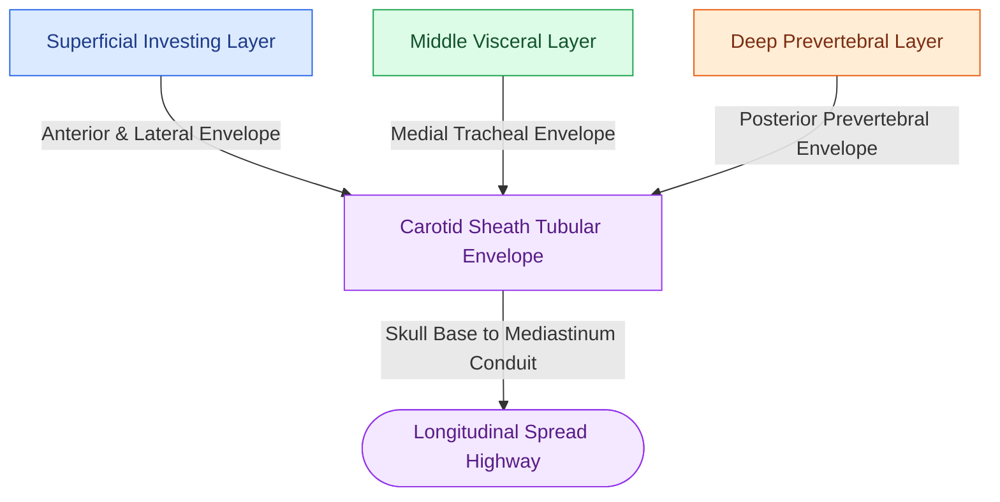

# The carotid sheath is composed of all three layers of deep cervical fascia and forms a vertical neurovascular conduit

## Active Recall

> [!question]- Which specific layers of the deep cervical fascia contribute to the formation of the carotid sheath, and what are its four principal contents from medial to lateral and posterior?
> *Answer / Clinical Rationale*: The carotid sheath is uniquely composed of contributions from **all three layers of deep cervical fascia**: the superficial (investing) layer laterally/anteriorly, the middle (visceral/pretracheal) layer medially, and the deep (prevertebral/alar) layer posteriorly. Its contents include: (1) **Common / Internal Carotid Artery** (medial); (2) **Internal Jugular Vein** (lateral); (3) **Vagus Nerve (CN X)** (posterior in the tracheoesophageal/carotid groove); and (4) deep cervical lymph nodes along the IJV, with the sympathetic trunk embedded in the posterior sheath wall.

> [!question]- Why is the carotid sheath historically termed the 'Lincoln Highway of the Neck' in the context of deep neck space infections?
> *Answer / Clinical Rationale*: Because the carotid sheath extends uninterrupted from the **skull base to the superior mediastinum and pericardium**, purulent infections or suppurative thrombophlebitis tracking within the sheath have a direct, unresisted longitudinal pathway to produce descending mediastinitis, empyema, and pericardial tamponade without needing to violate intervening horizontal fascial barriers.

## Core Clinical & Mechanistic Principles
The **carotid sheath** is a dense, tubular condensation of deep cervical fascia running along the lateral aspect of the neck. It serves as both a protective envelope for the major cervical neurovascular structures and a critical surgical conduit during [[Levels II through IV internal jugular chain dissection mobilizes the carotid sheath packet|neck dissections]] and drainage of [[The parapharyngeal space is an inverted pyramid connecting peritonsillar, masticator, parotid, and retropharyngeal spaces|parapharyngeal space]] infections.

### Anatomic Organization and Spatial Relationships
1. **Fascial Trilaminar Fusion**:
   - The superficial investing layer forms the anterior and anterolateral wall.
   - The middle (visceral/pretracheal) layer forms the anteromedial wall adjacent to the thyroid and trachea.
   - The deep layer (alar and prevertebral fascia) forms the posterior wall.
2. **Internal Compartmentalization**:
   - **Common / Internal Carotid Artery**: Lies **medially**; less distensible with thick muscular tunica.
   - **Internal Jugular Vein (IJV)**: Lies **laterally** and slightly superficial; highly compliant and collapses with hypovolemia or elevated intrathoracic pressure.
   - **Vagus Nerve (CN X)**: Courses longitudinally in the **posterior groove** between the artery and vein.
   - **Sympathetic Trunk**: Courses posteriorly, embedded within or immediately deep to the posterior prevertebral fascia of the sheath (vulnerable during carotid endarterectomy or radical neck dissection).
3. **Infectious & Thrombotic Spread**:
   - Suppurative infections originating in the [[Lemierre syndrome involves Fusobacterium necrophorum internal jugular thrombophlebitis and septic emboli|retropharyngeal, peritonsillar, or parapharyngeal spaces]] can erode through the thin medial wall of the sheath, leading to internal jugular vein thrombosis (Lemierre syndrome) or carotid pseudoaneurysm.

## Connected Concepts & Graph Traversal
- **Surgical Mobilization**: [[Levels II through IV internal jugular chain dissection mobilizes the carotid sheath packet|Carotid Sheath Packet Dissection]]
- **Adjacent Inverted Pyramid**: [[The parapharyngeal space is an inverted pyramid connecting peritonsillar, masticator, parotid, and retropharyngeal spaces|Parapharyngeal Poststyloid Compartment]]
- **Septic Thrombosis**: [[Lemierre syndrome involves Fusobacterium necrophorum internal jugular thrombophlebitis and septic emboli|Lemierre Syndrome & IJV Thrombophlebitis]]
- **Posterior Conduit**: [[The danger space permits unrestricted infection spread from skull base to posterior mediastinum|Danger Space to Posterior Mediastinum]]
- **Medial Boundary**: [[Central compartment neck dissection clears level VI nodes between the carotid sheaths and suprasternal notch|Level VI Central Compartment Dissection]]
