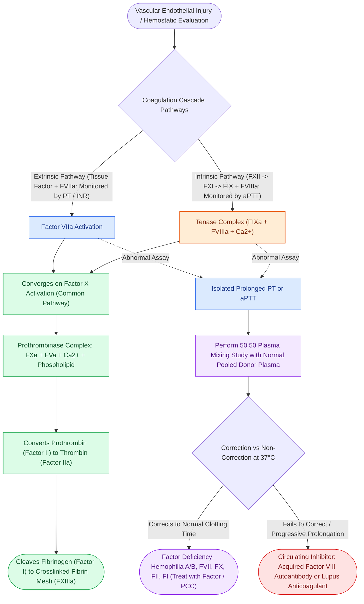

# The coagulation cascade is organized into extrinsic, intrinsic, and common pathways evaluated by PT and aPTT

## Active Recall

> [!question]- Which coagulation factors comprise the extrinsic, intrinsic, and common pathways, and what laboratory assays evaluate each?
> *Answer / Clinical Rationale*: - **Extrinsic Pathway (evaluated by Prothrombin Time [PT] / INR)**: Initiated by subendothelial **Tissue Factor (TF)** binding to activated **Factor VII (FVIIa)**. - **Intrinsic Pathway (evaluated by activated Partial Thromboplastin Time [aPTT])**: Comprises **Factors XII, XI, IX, and VIII** (contact activation complex). - **Common Pathway (evaluated by both PT and aPTT)**: Converges at **Factor X**, which combines with **Factor V, platelet phospholipid, and calcium ($Ca^{2+}$)** (the prothrombinase complex) to convert **Prothrombin (Factor II) into Thrombin (Factor IIa)**, which cleaves **Fibrinogen (Factor I) into Fibrin (Factor Ia)**, stabilized by **Factor XIIIa**.

> [!question]- How does a 50:50 plasma mixing study differentiate a coagulation factor deficiency from an acquired circulating factor inhibitor?
> *Answer / Clinical Rationale*: Patient plasma is mixed 1:1 with normal pooled donor plasma containing $100\%$ normal factor activity: - **Factor Deficiency (e.g., Hemophilia A, B, or Factor VII deficiency)**: The mixing study **corrects the prolonged PT or aPTT back to normal** ($>50\%$ factor activity is sufficient to normalize clotting times). - **Circulating Inhibitor (e.g., Acquired Factor VIII autoantibody or Lupus Anticoagulant)**: The mixing study **fails to correct (remains prolonged)** because the circulating autoantibody neutralizes the factors supplied in the normal donor plasma (often showing progressive prolongation after 1–2 hours of incubation at $37^\circ\text{C}$).

> [!question]- Why is a structured bleeding history vastly superior to routine preoperative screening coagulation tests in predicting surgical hemorrhage?
> *Answer / Clinical Rationale*: Routine screening tests (PT/INR, aPTT, platelet count) fail to evaluate **platelet function (e.g., aspirin/clopidogrel inhibition, mild von Willebrand disease), vessel wall integrity (e.g., Ehlers-Danlos, scurvy), or the fibrinolytic system (e.g., PAI-1 deficiency)**. A history of uncomplicated prior surgical or dental extractions acts as a true physiological "hemostatic stress test."

## Core Clinical & Mechanistic Principles
Surgical hemostasis operates through four interdependent phases: **(1) Vascular Spasm**, **(2) Primary Hemostasis (Platelet Adhesion via GPIb-vWF and Aggregation via GPIIb/IIIa)**, **(3) Secondary Hemostasis (Coagulation Cascade & Thrombin Burst)**, and **(4) Fibrinolysis (Plasminogen/Plasmin Cleavage)**:

### High-Yield Clinical Traps in Otolaryngology
- **Acquired Factor VIII Inhibitor**: Presents as spontaneous, extensive soft tissue or deep neck hematomas in elderly patients with no prior bleeding history. Requires immediate hematology consultation, bypassing agents (recombinant Factor VIIa [rFVIIa] or Activated Prothrombin Complex Concentrate [FEIBA]), and immunosuppression.
- **Lupus Anticoagulant**: Prolongs the baseline aPTT *in vitro* by binding phospholipid reagents, but represents a **hypercoagulable, prothrombotic state *in vivo*** (antiphospholipid syndrome) rather than a bleeding disorder (see [[Targeted reversal of direct oral anticoagulants and antiplatelet agents is required for emergent head and neck surgery|Anticoagulant & Antiplatelet Reversal]]).

## Connected Concepts & Graph Traversal
- **Anticoagulant Reversal**: [[Targeted reversal of direct oral anticoagulants and antiplatelet agents is required for emergent head and neck surgery|Anticoagulant & Antiplatelet Reversal]]
- **Congenital Coagulopathies**: [[Congenital bleeding disorders in otolaryngology encompass hemophilia A, hemophilia B, and von Willebrand disease subtypes|Hemophilia & vWD Subtypes]]
- **Neck Hematoma Emergency**: [[Postoperative neck hematoma after thyroidectomy or neck dissection requires emergent bedside wound opening for airway decompression|Post-Thyroidectomy Neck Hematoma]]
- **Local Hemostasis Matrix**: [[Topical hemostatic matrix agents and nasal packing mitigate postoperative epistaxis and synechiae|Topical Hemostatic Agents]]
- **SPA Ligation**: [[The crista ethmoidalis guides endoscopic sphenopalatine artery ligation|Endoscopic SPA Ligation]]
