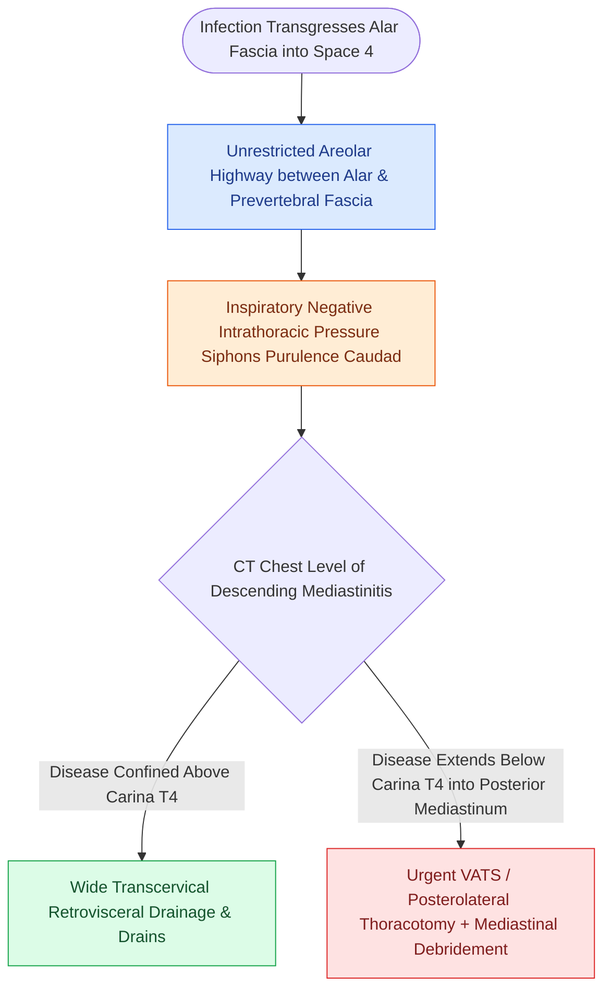

# The danger space permits unrestricted infection spread from skull base to posterior mediastinum

## Active Recall

> [!question]- What fascial layers define the anterior and posterior walls of the danger space, and how far inferiorly does it extend compared to the retropharyngeal space?
> *Answer / Clinical Rationale*: The **alar fascia** forms the anterior wall and the **prevertebral fascia proper** forms the posterior wall. Unlike the retropharyngeal space (which ends at **T1–T4**), the danger space extends continuously to the **diaphragm (T12–L1)**.

> [!question]- Why is prompt thoracotomy or VATS required when deep neck infection descends below the level of the tracheal carina (T4)?
> *Answer / Clinical Rationale*: Transcervical drainage cannot adequately decompress or irrigate the subcarinal and retrocardiac posterior mediastinum; below T4, extensive purulence and mediastinal necrosis cause tamponade, empyema, and septic shock unless directly drained via a thoracic approach.

## Core Clinical & Mechanistic Principles
The **Danger Space** (historically designated **Space 4** by Grodinsky and Holyoke in 1938) is an anatomical potential space situated between the alar fascia anteriorly and the prevertebral fascia posteriorly. Because it contains only loose areolar tissue and lacks any transverse compartmentalization or inferior anatomic barrier, infections traversing the alar fascia spread rapidly downward into the posterior mediastinum, predisposing patients to life-threatening **Descending Necrotizing Mediastinitis (DNM)**:

- **Fascial Boundaries**:
  - **Anterior**: **Alar fascia** (which separates the danger space from the retropharyngeal space).
  - **Posterior**: **Prevertebral fascia** (which adheres tightly to the anterior longitudinal ligament and vertebral bodies).
  - **Superior**: Clivus and basiocciput at the cranial base.
  - **Inferior**: Unrestricted communication extending through the posterior mediastinum down to the **level of the diaphragm (T12/L1)**.
  - **Lateral**: Transverse processes of cervical vertebrae and carotid sheath attachments.

- **Mechanisms of Descending Spread**:
  - **Negative Intrathoracic Pressure**: Inspiratory respiratory dynamics generate negative intrathoracic pressure, actively drawing purulent exudate and gas from the neck into the mediastinum.
  - **Gravity & Sinking Exudate**: Upright and semi-recumbent positioning accelerates the downward gravitation of polymicrobial purulence.
  - **Absence of Fibrous Barricades**: Unlike the [[The retropharyngeal space extends from skull base to tracheal bifurcation and contains lymph nodes draining the nasopharynx|retropharyngeal space]] (which terminates at T1–T4), the danger space provides an uninterrupted highway directly into the cardiac and pulmonary posterior mediastinal beds.

### Surgical Technique & Critical Safety Checks
1. **Clinical Presentation of Mediastinal Extension**: Patients present with severe retrosternal chest pain, dyspnea, "picket-fence" fevers, back pain, pleural effusion, and mediastinal widening or air on CT/chest radiography.
2. **Surgical Approach Mandate**:
   - *Superior Mediastinal Disease (Above Carina / T4)*: Can often be evacuated via a wide transcervical approach along the anterior border of the sternocleidomastoid with blunt retrovisceral dissection.
   - *Inferior Mediastinal Extension (Below Carina / T4)*: Mandates urgent multidisciplinary Thoracic Surgery involvement for **posterolateral thoracotomy, median sternotomy, or Video-Assisted Thoracoscopic Surgery (VATS)** with pleural debridement and dual-chest tube placement. Mortality exceeds 30%–40% if thoracotomy is delayed.

## Connected Concepts & Graph Traversal
- **Anterior Neighbor**: [[The retropharyngeal space extends from skull base to tracheal bifurcation and contains lymph nodes draining the nasopharynx|Retropharyngeal Space Anatomy]]
- **Lateral Communication**: [[The parapharyngeal space is an inverted pyramid connecting peritonsillar, masticator, parotid, and retropharyngeal spaces|Parapharyngeal Space Crossroad]]
- **Systemic Antimicrobial Therapy**: [[Empiric antimicrobial therapy for deep neck space infections targets polymicrobial oral flora and MRSA|Deep Neck Infection Antibiotic Regimens]]
- **Surgical Airway Protection**: [[Standard open tracheotomy utilizes horizontal intersinusoidal or Bjork flap entry|Emergency Open Tracheotomy]]
- **Severe Vascular Thrombophlebitis**: [[Lemierre syndrome involves Fusobacterium necrophorum internal jugular thrombophlebitis and septic emboli|Lemierre Syndrome]]
- **Posterior Fascial Compartment**: [[The perivertebral space is enclosed by the deep layer of deep cervical fascia and divides into prevertebral and paraspinal compartments on cross-sectional imaging|Perivertebral Space Compartments]]
