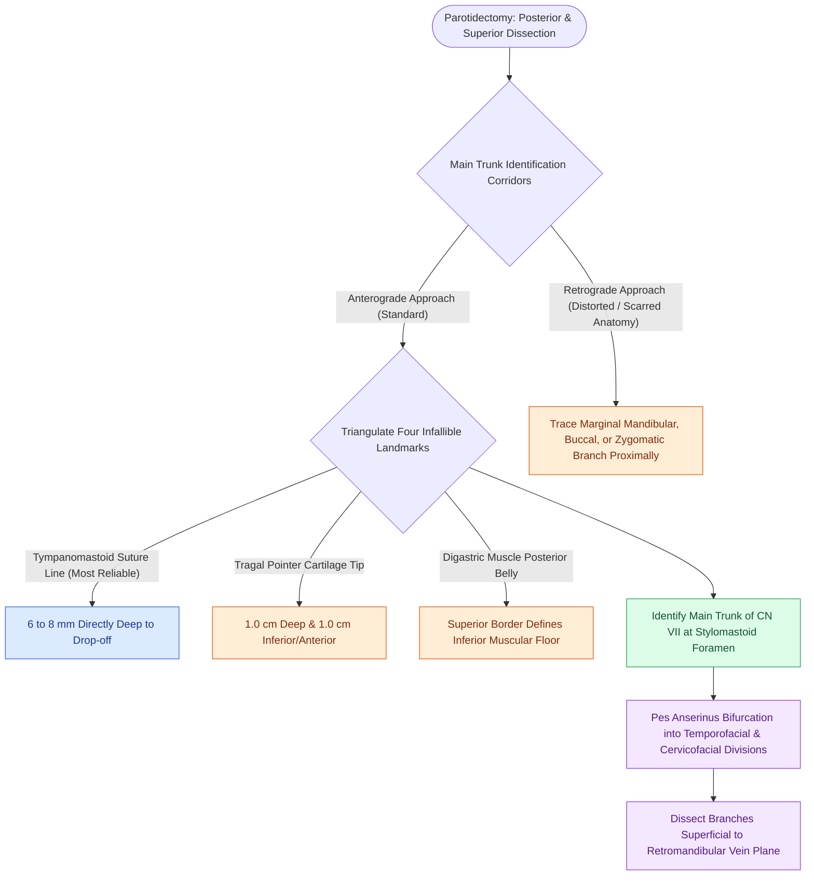

# The facial nerve main trunk is localized using the tragal pointer, tympanomastoid suture, and digastric ridge

## Active Recall

> [!question]- What is the spatial relationship between the facial nerve branches and the retromandibular vein within the parotid gland?
> *Answer / Clinical Rationale*: The facial nerve branches lie **superficial and lateral to the retromandibular vein**. The vein runs in a deeper plane within the parotid parenchyma.

> [!question]- Where is the facial nerve main trunk located relative to the tragal pointer and tympanomastoid suture?
> *Answer / Clinical Rationale*: Approximately **$1.0\text{ cm}$ deep and inferior** to the tragal pointer, and **$6\text{–}8\text{ mm}$ directly deep** to the tympanomastoid suture line.

> [!question]- Why is the posterior belly of the digastric muscle an essential landmark during parotidectomy?
> *Answer / Clinical Rationale*: The main trunk of CN VII runs immediately superior and parallel to the upper border of the digastric muscle; the nerve **never courses deep or inferior to the digastric belly**, making the muscle an infallible floor landmark.

## Core Clinical & Mechanistic Principles
Locating the main trunk of the **facial nerve (CN VII)** as it exits the stylomastoid foramen is the defining technical milestone during parotidectomy:
- **The Four Infallible Surgical Landmarks**:
  1. **Tympanomastoid Suture Line**: The **most consistent and reliable bony landmark**. The main trunk lies **$6.0\text{–}8.0\text{ mm}$ directly deep** to the inferior drop-off of the tympanomastoid suture.
  2. **Tragal Pointer (Cartilaginous Pointer)**: The main trunk lies **$1.0\text{ cm}$ deep and $1.0\text{ cm}$ inferior/anterior** to the sharp tip of the tragal cartilage pointing into the wound.
  3. **Posterior Belly of Digastric Muscle**: The main trunk lies immediately superior and parallel to the upper border of the digastric muscle where it attaches to the digastric ridge of the mastoid.
  4. **Styloid Process**: The nerve courses directly superficial/lateral to the base of the styloid process (the styloid bone is deep to the nerve).
- **The Retromandibular Vein Relationship**:
  - Formed by the confluence of the **superficial temporal vein** and **maxillary vein**, the retromandibular vein (RMV) traverses the substance of the parotid gland **deep and medial to the facial nerve branches**.
  - *Surgical Warning*: Torrential venous bleeding from RMV tributaries can quickly flood the field; control with gentle pressure and bipolar electrocautery—**never apply blind hemostatic clamps** across the RMV plane as the overlying facial nerve branches will be crushed.
- **The Four Anatomical Safety Invariants (What CN VII Never Enters)**:
  1. CN VII **never enters the sternocleidomastoid (SCM) muscle** (SCM is retracted laterally).
  2. CN VII **never crosses inferior or deep to the posterior belly of the digastric muscle** (digastric muscle acts as a deep muscular floor protecting the carotid sheath).
  3. CN VII **never enters or penetrates the cartilaginous external auditory canal** (staying on cartilaginous EAC is safe during posterior mobilization).
  4. CN VII **never crosses superficial to the tympanomastoid suture** (it always emerges deep to this bony fusion line).
- **Retrograde Dissection Alternatives**: If a massive tumor or previous scar distorts the main trunk, locate a peripheral branch:
  - *Marginal mandibular branch*: Crossing the anterior facial vein at the lower mandibular border.
  - *Buccal branch*: Running parallel to and $1.0\text{ cm}$ superior/inferior to [[Buccal mucosa carcinoma exhibits high rates of local recurrence and Stensen duct involvement|Stensen]]'s duct.
  - *Eye branch (Zygomatic)*: Over the zygomatic arch.

### Surgical Technique & Critical Safety Checks
- **Pes Anserinus**: The main trunk bifurcates into the **temporofacial** (temporal, zygomatic, buccal) and **cervicofacial** (buccal, marginal mandibular, cervical) divisions within the parotid isthmus.

## Connected Concepts & Graph Traversal
- **Superficial Parotidectomy**: [[Superficial parotidectomy dissects the facial nerve branches to resect the lateral salivary lobe|Superficial Parotidectomy Craft]]
- **Great Auricular Nerve Preservation**: [[The great auricular nerve emerges at Erb's point and is vulnerable during rhytidectomy|Great Auricular Nerve & Sensation]]
- **Benign Parotid Neoplasms**: [[Pleomorphic adenoma requires superficial parotidectomy with a cuff of normal tissue to prevent pseudopod recurrence|Pleomorphic Adenoma Resection]]
- **Malignant Parotid Infiltration**: [[Total parotidectomy with facial nerve sacrifice is indicated for direct malignant nerve invasion|Total Parotidectomy & CN VII Sacrifice]]
- **Submandibular Preservation**: [[Submandibular gland excision requires preservation of the marginal mandibular, lingual, and hypoglossal nerves|Submandibular Gland Excision Craft]]
- **Sialendoscopy Interventions**: [[Sialendoscopy enables diagnostic visualization and stone extraction in chronic obstructive sialadenitis|Sialendoscopy & Ductal Architecture]]
