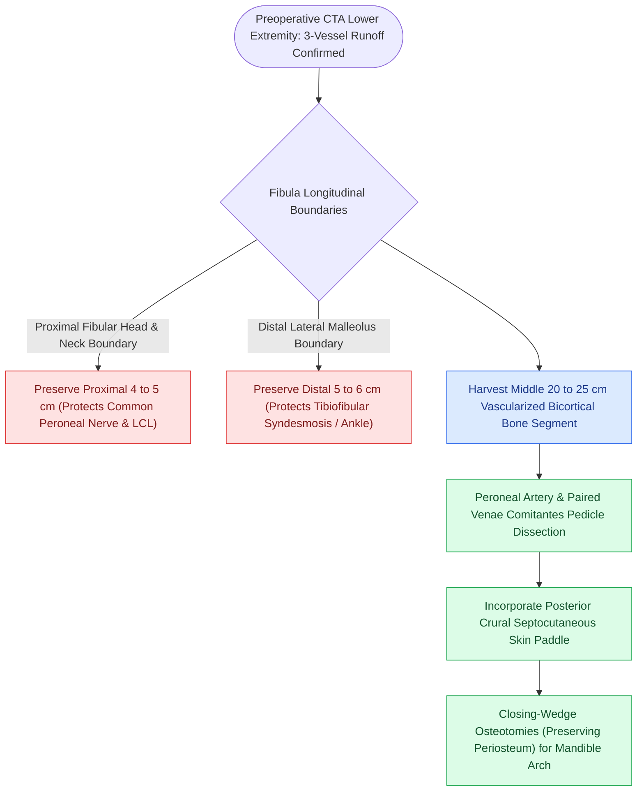

# The fibula osteocutaneous free flap provides up to twenty-five centimeters of vascularized bone for mandible reconstruction

## Active Recall

> [!question]- Why must the distal 5 cm of the fibula be preserved during flap harvest?
> *Answer / Clinical Rationale*: To preserve the **inferior tibiofibular syndesmosis** and prevent **ankle mortise instability and lateral talar tilt**.

> [!question]- What major nerve is at risk if the proximal head and neck of the fibula are resected?
> *Answer / Clinical Rationale*: The **common peroneal nerve**, leading to **foot drop (loss of ankle dorsiflexion and eversion)**.

## Core Clinical & Mechanistic Principles
The **Fibula Osteocutaneous Free Flap (FFF)** (Hidalgo, 1989) is the premier standard of care for composite osseous defects of the mandible and maxilla:
- **Vascular Architecture**:
  - **Arterial Pedicle**: **Peroneal (fibular) artery**, arising from the tibioperoneal trunk.
  - **Venous Drainage**: Paired peroneal venae comitantes.
  - **Vascular Bone Length**: Provides up to **$20\text{–}25\text{ cm}$ of straight, dense bicortical bone**, allowing multiple osteotomies for total mandibular arch contouring and osseointegrated dental implants.
  - **Septocutaneous / Musculocutaneous Perforators**: Supply the lateral calf skin paddle via the posterior crural intermuscular septum.
- **Critical Safe Harvesting Rules**:
  1. **Preserve Distal $5\text{–}6\text{ cm}$ of Fibula**: Preserves the inferior tibiofibular syndesmosis to prevent ankle mortise instability and talar tilt.
  2. **Preserve Proximal $4\text{–}5\text{ cm}$ of Fibula**: Protects the **common peroneal nerve** (courses around the fibular neck) and lateral collateral ligament insertion.

### Surgical Technique & Critical Safety Checks
- **Osteotomy Craft**: Closing-wedge osteotomies must preserve the periosteum on the vascularized side; bone segments must be $\ge 1.5\text{–}2.0\text{ cm}$ long to maintain blood supply (see [[Preserving the distal five centimeters of the fibula prevents ankle instability and talar tilt|Distal Fibula Preservation]]).

## Connected Concepts & Graph Traversal
- **Distal Fibula Safety**: [[Preserving the distal five centimeters of the fibula prevents ankle instability and talar tilt|Distal Fibula Preservation]]
- **Virtual Surgical Planning**: [[Virtual surgical planning and 3D cutting guides optimize fibula contouring and dental implant rehabilitation|Virtual Surgical Planning]]
- **Segmental Mandibulectomy**: [[Segmental mandibulectomy resects full-thickness bone for medullary invasion and irradiated bone recurrence|Segmental Mandibulectomy]]
- **Anatomical Foundation**: [[The retropharyngeal space extends from skull base to tracheal bifurcation and contains lymph nodes draining the nasopharynx]]
- **Surgical Lymphadenectomy**: [[The spinal accessory nerve is identified at the Erb point and anterior border of the SCM]]
- **Oncologic Resection & Margins**: [[Elective neck dissection is indicated for oral cavity squamous cell carcinoma with depth of invasion exceeding four millimeters]]
- **Aerodigestive / Pharyngolaryngeal**: [[Primary pharyngeal closure after total laryngectomy utilizes an inverting Connell technique]]
- **Donor Site Morbidity**: [[Free tissue transfer donor site morbidity requires systematic risk stratification and anatomical preservation across fibular, radial forearm, and anterolateral thigh harvests|Free Flap Donor Site Morbidity]]
