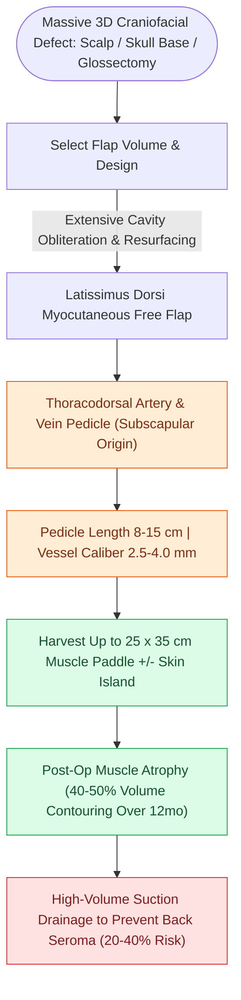

# The latissimus dorsi myocutaneous free flap covers massive soft tissue and skull base defects

## Active Recall

> [!question]- What is the vascular pedicle of the Latissimus Dorsi free flap?
> *Answer / Clinical Rationale*: The **thoracodorsal artery and vein** (branches of the subscapular system).

> [!question]- What is the most common donor site complication following latissimus dorsi flap harvest?
> *Answer / Clinical Rationale*: **Donor site seroma formation** (occurring in $20\text{–}40\%$ of patients).

## Core Clinical & Mechanistic Principles
The **Latissimus Dorsi (LD) Myocutaneous Free Flap** is the premier choice for reconstructing massive three-dimensional head and neck soft tissue defects:
- **Indications**:
  - Total scalp and calvarial defects.
  - Massive lateral skull base and temporal bone resection cavities.
  - Extensive total glossectomy defects.
  - Radical orbital exenteration and [[Hard palate and upper alveolar carcinoma require partial or total maxillectomy|maxillectomy]] soft tissue obliteration.
- **Vascular Anatomy**:
  - **Vascular Pedicle**: **Thoracodorsal artery and vein** (terminal branch of the subscapular system).
  - Pedicle length: $8.0\text{–}15.0\text{ cm}$; vessel caliber: $2.5\text{–}4.0\text{ mm}$.
  - **Motor Innervation**: Thoracodorsal nerve (can be coapted for functional muscle restoration).
- **Tissue Characteristics**: Provides a massive muscle surface area ($25\times 35\text{ cm}$) and large overlying skin territory; muscle undergoes progressive atrophy ($40\text{–}50\%$ volume loss) over 12 months, producing a smooth contour.

### Surgical Technique & Critical Safety Checks
- **Harvest Craft**: Harvest in lateral decubitus; preserve serratus branch if muscle-sparing flap; drain donor bed with large suction drains to prevent seroma (seroma rate $20\text{–}40\%$).

## Connected Concepts & Graph Traversal
- **Subscapular System**: [[The subscapular system provides chimeric bone and soft tissue flaps based on the circumflex scapular artery|Subscapular System]]
- **ALT Free Flap**: [[The anterolateral thigh flap provides versatile volume and can be harvested as a chimeric flap|ALT Free Flap]]
- **Venous Couplers**: [[Microvascular venous couplers achieve rapid and reliable end-to-end and end-to-side anastomoses|Microvascular Couplers]]
- **Anatomical Foundation**: [[Intensity-modulated radiation therapy and cisplatin radiosensitization form the standard definitive chemoradiation regimen]]
- **Surgical Lymphadenectomy**: [[Carotid blowout syndrome is classified into threatened, impending, and acute hemorrhage]]
- **Oncologic Resection & Margins**: [[Segmental mandibulectomy resects full-thickness bone for medullary invasion and irradiated bone recurrence]]
- **Aerodigestive / Pharyngolaryngeal**: [[Subglottic carcinoma spreads to level VI central compartment lymphatics and mediastinal nodes]]
