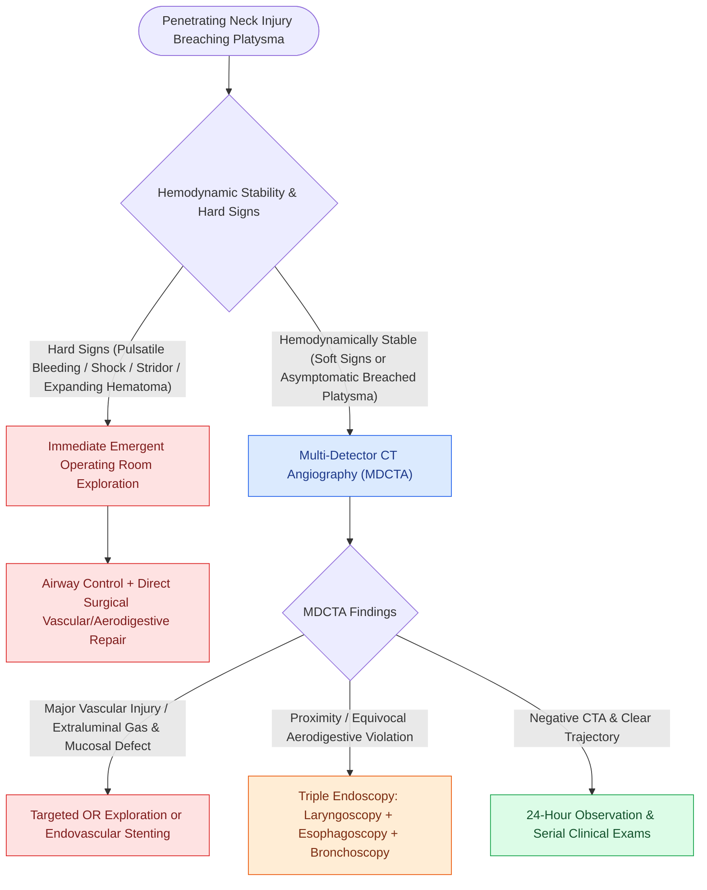

# The no-zone approach to penetrating neck trauma triages stable patients with CTA based on hard and soft signs

## Active Recall

> [!question]- What "hard signs" of vascular or aerodigestive injury mandate immediate emergent operating room exploration in penetrating neck trauma without pre-operative imaging?
> *Answer / Clinical Rationale*: (1) **Active, pulsatile arterial hemorrhage**; (2) **Expanding or pulsatile hematoma**; (3) **Palpable thrill or audible bruit**; (4) **Refractory hemodynamic instability / shock**; (5) **Massive hemoptysis or hematemesis**; (6) **Rapidly progressing airway compromise or stridor**.

> [!question]- What diagnostic imaging modality is the cornerstone of the modern "no-zone" selective non-operative management paradigm for hemodynamically stable patients?
> *Answer / Clinical Rationale*: **Multi-detector CT angiography (MDCTA) of the neck and chest** (sensitivity and specificity $>98\text{–}100\%$), which visualizes vascular injuries, aerodigestive tract violation, bony disruption, and trajectory in a single scan regardless of anatomical zone.

> [!question]- How does the presence of "soft signs" (e.g., non-expanding hematoma, dysphagia, stable hoarseness) alter management in a hemodynamically stable patient?
> *Answer / Clinical Rationale*: Soft signs mandate **urgent MDCTA**; if CTA demonstrates proximity without definitive mucosal or vascular violation, secondary targeted endoscopy (flexible laryngoscopy, rigid esophagoscopy, or bronchoscopy) is performed to rule out occult aerodigestive tears.

## Core Clinical & Mechanistic Principles
The historical paradigm of mandatory surgical exploration for all penetrating injuries traversing the platysma in [[Penetrating neck trauma anatomical zones I, II, and III dictate surgical exposure corridors|Zone II]] resulted in negative exploration rates exceeding $50\%$. The modern **"No-Zone" selective non-operative management algorithm** prioritizes hemodynamic stability and clinical signs over rigid anatomical boundaries:

- **The Clinical Triaging Binary**:
  1. **Unstable Patients or Hard Signs $\rightarrow$ Immediate Operating Room**:
     - *Hard Vascular Signs*: External pulsatile hemorrhage, rapidly expanding hematoma, palpable thrill, audible bruit, loss of distal temporal/facial pulses, progressive focal cerebral ischemia / stroke signs.
     - *Hard Aerodigestive Signs*: Massive subcutaneous emphysema with acute [[Awake fiberoptic intubation is the preferred airway technique for angioedema with impending obstruction|airway compromise]], bubbling wound, extensive hemoptysis/hematemesis, or suspected [[External laryngeal trauma is staged by the Schaefer classification directing tracheostomy and open repair|laryngeal framework disruption]].
     - *Action*: Direct transport to OR for emergency surgical exploration, definitive airway control, and primary vascular/visceral repair.
  2. **Hemodynamically Stable Patients $\rightarrow$ Multi-Detector CTA**:
     - *Soft Signs*: Non-expanding hematoma, minor venous oozing, focal cranial nerve deficit ($\text{CN VII, IX, X, XI, XII}$), hoarseness, odynophagia/dysphagia, localized subcutaneous air.
     - *Asymptomatic Penetration (Platysma Breached)*: Evaluated with MDCTA from skull base to aortic arch.
     - *Diagnostic Yield of MDCTA*: Negative predictive value $>99\%$; reliably detects intimal flaps, pseudoaneurysms, transections, arteriovenous fistulas, and extraluminal gas indicating aerodigestive perforation.

### Critical Resuscitation Protocols & Pitfalls
- **Never Probe or Clot Dislodge**: Wounds deep to the platysma must never be blindly probed, clamped, or cannulated in the trauma bay; blind instrumentation can disrupt a contained pseudoaneurysm or dislodge a tamponading thrombus.
- **Foley Balloon Catheter Tamponade**: For torrential bleeding in difficult-to-expose anatomical zones (Zone I thoracic inlet or Zone III skull base), a $12\text{–}14\text{ Fr}$ Foley catheter can be inserted directly into the wound tract and inflated with $5\text{–}10\text{ mL}$ of saline to achieve temporary balloon tamponade en route to the OR or interventional radiology suite.

## Connected Concepts & Graph Traversal
- **Anatomical Exposure Zones**: [[Penetrating neck trauma anatomical zones I, II, and III dictate surgical exposure corridors|Penetrating Neck Trauma Zones]]
- **Carotid Artery Injury & Reconstruction**: [[Carotid blowout syndrome management includes throat packing, endovascular embolization, and carotid stenting|Carotid Blowout Rescue]]
- **Emergency Airway Management**: [[Awake fiberoptic intubation is the preferred airway technique for angioedema with impending obstruction|Emergency Trauma Airway]]
- **Laryngeal Trauma Staging**: [[External laryngeal trauma is staged by the Schaefer classification directing tracheostomy and open repair|Laryngeal Trauma Staging]]
- **Deep Cervical Fascial Anatomy**: [[Deep cervical fascia divides into superficial, middle, and deep layers that define surgical planes|Deep Cervical Fascia]]
