# The parapharyngeal space is an inverted pyramid connecting peritonsillar, masticator, parotid, and retropharyngeal spaces

## Active Recall

> [!question]- How does radiographic displacement of the internal carotid artery differentiate a pre-styloid from a post-styloid parapharyngeal space mass?
> *Answer / Clinical Rationale*: A **pre-styloid mass** (e.g., pleomorphic adenoma) pushes the internal carotid artery **posterolaterally**, whereas a **post-styloid mass** (e.g., schwannoma or paraganglioma) displaces the internal carotid artery **anteriorly or anteromedially**.

> [!question]- Why can an uncontrolled infection in the peritonsillar space easily spread into the parapharyngeal space?
> *Answer / Clinical Rationale*: The thin superior pharyngeal constrictor muscle and buccopharyngeal fascia form the only barrier separating the peritonsillar space from the medial boundary of the pre-styloid parapharyngeal space.

## Core Clinical & Mechanistic Principles
The **Parapharyngeal Space (PPS)** is a central crossroad of deep cervical anatomy configured as an inverted pyramid. Its **base** corresponds to the petrous temporal bone and sphenoid skull base, while its **apex** terminates at the junction of the posterior belly of the digastric muscle and the greater cornu of the hyoid bone. The PPS communicates directly with all major surrounding compartments—peritonsillar space medially, parotid space laterally, masticator space anterolaterally, submandibular space inferiorly, and retropharyngeal space posteromedially—making it a primary highway for odontogenic and pharyngeal infection dissemination, as well as a crossroads for benign and malignant neoplasms:

- **Fascial Boundaries**:
  - **Superior (Base)**: Greater wing of sphenoid, foramen lacerum, foramen ovale, and petrous temporal bone.
  - **Inferior (Apex)**: Greater cornu of the hyoid bone.
  - **Medial**: Buccopharyngeal fascia overlying the superior and middle pharyngeal constrictor muscles and tonsillar fossa.
  - **Lateral**: Superficial layer of deep cervical fascia covering the medial pterygoid muscle, ramus of the mandible, and the deep lobe of the parotid gland.
  - **Posterior**: Prevertebral layer of deep cervical fascia and the alar fascia.

- **The Five Communicating Doors of the Parapharyngeal Space**:
  1. *Medially*: Communicates through the constrictor gap with the **peritonsillar space** (why quinsy ruptures directly into the PPS).
  2. *Laterally*: Communicates through a superomedial dehiscence in parotid fascia with the **parotid space** and anterolaterally with the **masticator space**.
  3. *Inferiorly*: Communicates around the free posterior edge of the mylohyoid muscle with the **submandibular space**.
  4. *Posteromedially*: Communicates around the alar-buccopharyngeal junction with the **retropharyngeal space**.
  5. *Along the Carotid Sheath*: Communicates directly inferiorly into the **superior mediastinum** (Lincoln's highway).
  *This 5-door architecture explains why PPS abscess is the common final pathway of odontogenic, tonsillar, and parotid infections, and why drainage is performed transcervically rather than transorally next to the ICA.*

- **The Stylomandibular Tunnel & Dumbbell Tumors**:
  - The investing fascia over the deep parotid lobe is dehiscent superomedially.
  - Deep lobe parotid neoplasms grow through the **stylomandibular tunnel** (bounded by the mandibular ramus anteriorly, and the styloid process and stylomandibular ligament posteriorly), which acts as a rigid waist that molds the neoplasm into a **dumbbell tumor** (producing a large oropharyngeal/palatal bulge with a normal-appearing external parotid).

- **Pre-Styloid vs. Post-Styloid Compartmentalization**:
  The space is bisected by the **styloid process** and its attached musculature (stylopharyngeus, stylohyoid, styloglossus) and the tensor-vascular-styloid fascia (fascia of Riolan):
  1. **Pre-Styloid (Anterior) Compartment**:
     - *Contents*: Retromandibular parotid tissue (deep lobe), internal maxillary artery, ascending pharyngeal artery branches, fat, and minor salivary tissue.
     - *Clinical Significance*: Displaced anteromedially by deep lobe parotid tumors or prestyloid pleomorphic adenomas, producing medial bulging of the lateral pharyngeal wall and tonsillar fossa without trismus.
  2. **Post-Styloid (Retrostyloid / Posterior) Compartment**:
     - *Contents*: **Internal Carotid Artery (ICA)**, **Internal Jugular Vein (IJV)**, **Cranial Nerves IX, X, XI, XII**, the **cervical sympathetic chain**, and lymph node chain.
     - *Clinical Significance*: Lesions here (schwannomas, paragangliomas/glomus vagale) displace the ICA anteriorly on cross-sectional imaging and cause Horner syndrome or lower cranial neuropathies when involved by [[Deep neck space infections spread along cervical fascial planes between the pharynx, mediastinum, and skull base|deep neck space infections]] or invasive tumors.

```mermaid
%% Parapharyngeal Space Compartments and ICA Vector Triage
flowchart TD
  N1(["Parapharyngeal Space Inverted Pyramid Mass"]) --> N2{"Assess Styloid Process & Fascia of Riolan Boundary"}
  N2 -->|"Pre-Styloid Compartment Mass (Salivary / Lipoma)"| N3{"Evaluate ICA Displacement on Axial CT/MRI"}
  N3 -->|"Displaces ICA Posterolaterally & Medial Tonsil Bulge"| N4["Pre-Styloid Pathology: Deep Parotid Lobe Tumor / Pleomorphic Adenoma"]
  N3 --> N5["Transcervical-Transparotid Approach with CN VII Dissection"]
  N2 -->|"Post-Styloid Compartment Mass (Neurogenic / Vascular)"| N3
  N3 -->|"Displaces ICA Anteriorly / Anteromedially"| N6["Post-Styloid Pathology: Schwannoma / Paraganglioma / Glomus Vagale"]
  N3 --> N7["Transcervical Approach (Working Inferior to Submandibular Gland)"]
  N7 --> N8["Preserve CN IX, X, XI, XII & Sympathetic Chain"]
  classDef blue fill:#dbeafe,stroke:#2563eb,color:#1e3a8a
  class N4 blue
  classDef green fill:#dcfce7,stroke:#16a34a,color:#14532d
  class N5,N7 green
  classDef orange fill:#ffedd5,stroke:#ea580c,color:#7c2d12
  class N6 orange
  classDef red fill:#fee2e2,stroke:#dc2626,color:#7f1d1d
  class N8 red
```

### Surgical Technique & Craft Nuances
- **Surgical Approaches**:
  - **Transcervical Approach**: Primary workhorse for post-styloid neurogenic tumors and inferior prestyloid tumors; avoids facial nerve dissection by working inferior to the submandibular gland.
  - **Transcervical-Transparotid Approach**: Indicated for deep lobe parotid neoplasms extending into the prestyloid PPS, requiring formal superficial parotidectomy with facial nerve skeletonization.
  - **Transmandibular (Mandibulotomy) Approach**: Reserved for massive (>5 cm) vascular or malignant tumors abutting the skull base to obtain circumferential vascular control of the high internal carotid artery.

## Connected Concepts & Graph Traversal
- **Fascial Hierarchy**: [[Deep neck space infections spread along cervical fascial planes between the pharynx, mediastinum, and skull base|Cervical Fascial Planes]]
- **Adjacent Space Anatomy**: [[The retropharyngeal space extends from skull base to tracheal bifurcation and contains lymph nodes draining the nasopharynx|Retropharyngeal Space Anatomy]]
- **Surgical Approach**: [[Radical neck dissection removes levels I through V while sacrificing CN XI, the IJV, and the SCM|Cervical Dissection Planes]]
- **Vascular Danger**: [[Carotid blowout syndrome is classified into threatened, impending, and acute hemorrhage|Carotid Artery Exposure & Blowout]]
- **Salivary Pathology**: [[Superficial parotidectomy dissects the facial nerve branches to resect the lateral salivary lobe|Parotidectomy & Deep Lobe Excision]]
- **Cross-Sectional Imaging Correlate**: [[Deep neck fascial spaces cross-sectional CT compartmentalization organizes suprahyoid and infrahyoid head and neck pathology|Deep Neck Space CT Compartmentalization]]
- **Mass Localization Vectors**: [[Parapharyngeal space fat and styloid process displacement vectors localize deep neck masses and differentiate parotid, neurogenic, and mucosal lesions|Parapharyngeal Displacement Vectors]]
