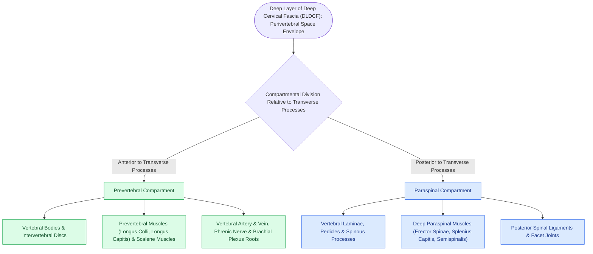
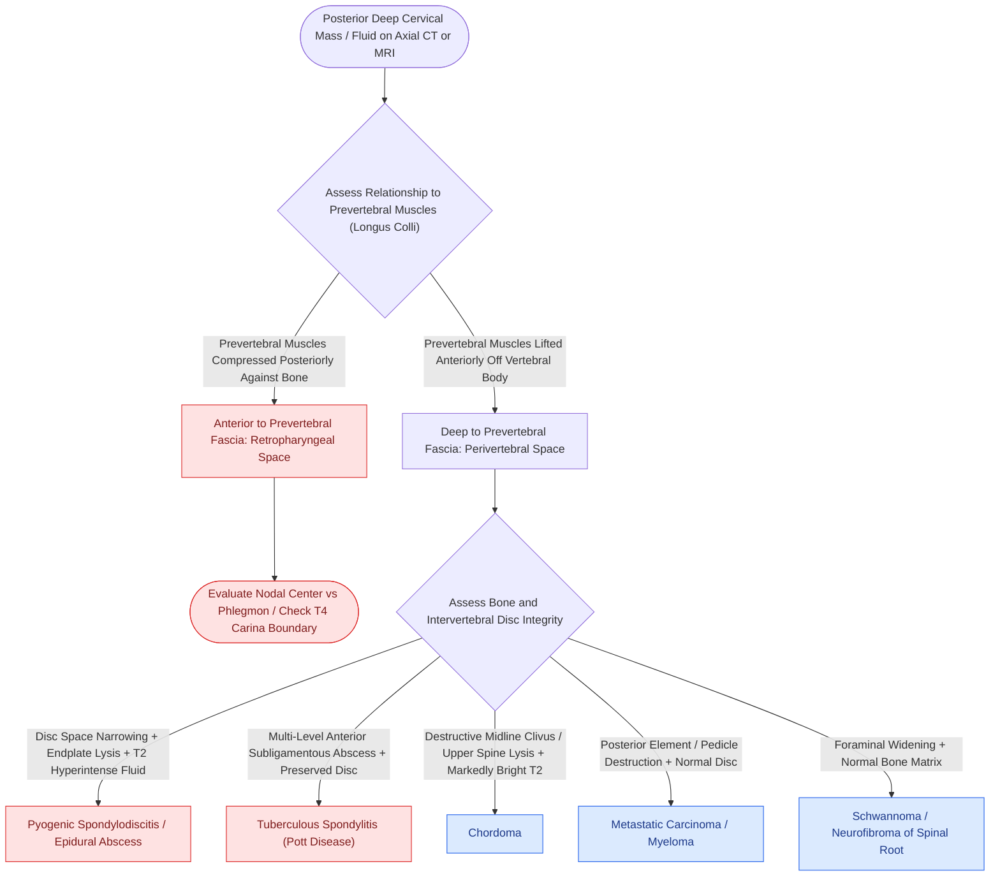

# The perivertebral space is enclosed by the deep layer of deep cervical fascia and divides into prevertebral and paraspinal compartments on cross-sectional imaging

## Active Recall

> [!question]- What fascial envelope defines the perivertebral space, and what anatomical landmark divides it into prevertebral and paraspinal compartments?
> *Answer / Clinical Rationale*: The **perivertebral space (PVS)** is enclosed entirely by the **deep (prevertebral) layer of the deep cervical fascia (DLDCF)**, extending continuously from the clivus/skull base down to the coccyx. It is divided anatomically into two distinct compartments by the **cervical transverse processes** and their associated fascial attachments: (1) The **prevertebral compartment** anteriorly, containing the vertebral bodies, intervertebral discs, anterior longitudinal ligament, longus colli and longus capitis muscles, scalene muscles, phrenic nerve, brachial plexus roots, and vertebral artery and vein; and (2) The **paraspinal compartment** posteriorly, containing the posterior vertebral arches, laminae, spinous processes, facet joints, and the deep paraspinal musculature (erector spinae, splenius capitis/cervicis, semispinalis, and transversospinalis).

> [!question]- How does cross-sectional contrast-enhanced CT or MRI reliably differentiate a perivertebral space abscess from a retropharyngeal space abscess?
> *Answer / Clinical Rationale*: The critical distinguishing landmark is the position of the **prevertebral muscles (longus colli and longus capitis)** relative to the fluid collection: (1) A **retropharyngeal space abscess** lies *anterior* to the prevertebral fascia, compressing the prevertebral muscles **posteriorly against the vertebral bodies** while displacing the posterior pharyngeal wall anteriorly; (2) A **perivertebral space abscess** lies *deep* to the prevertebral fascia, lifting and displacing the prevertebral muscles **anteriorly away from the vertebral bodies**, often accompanied by endplate cortical erosion, disc space loss, or vertebral osteomyelitis.

> [!question]- What are the key radiographic and MRI signal differences between pyogenic spondylodiscitis, tuberculous spondylitis (Pott disease), and chordoma within the perivertebral space?
> *Answer / Clinical Rationale*: (1) **Pyogenic spondylodiscitis** demonstrates rapid destructive loss of intervertebral disc height with prominent fluid-like T2 hyperintensity in the disc, contiguous destruction of adjacent vertebral endplates, and marked contrast enhancement of marrow and epidural space; (2) **Tuberculous spondylitis (Pott disease)** characteristically displays subligamentous spread beneath the anterior longitudinal ligament across multiple non-contiguous levels, large cold calcified abscesses, with **relative preservation of the disc space** until late stages; (3) **Chordoma** presents as an expansile, destructively lytic, gelatinous mass centered at the midline clivus or upper cervical spine with **striking T2 hyperintensity** ("lightbulb bright"), bone fragmentation, and heterogeneous enhancement without primary disc destruction.

## Core Clinical & Mechanistic Principles

The perivertebral space (PVS) is a cylindrical longitudinal compartment extending from the skull base to the coccyx. It is completely enclosed by the prevertebral division of the deep layer of deep cervical fascia (DLDCF), making it an impenetrable barrier against anterior infectious spread unless fascial necrosis occurs *(Cummings p.247–284)*.

Cross-sectional imaging divides the PVS into two functional zones:

### Deep Posterior Neck Spaces Cross-Sectional Comparison

| Feature | Perivertebral Space (Prevertebral) | Retropharyngeal Space (RPS) | Danger Space |
| :--- | :--- | :--- | :--- |
| **Anterior Boundary** | Prevertebral fascia (DLDCF) | Buccopharyngeal fascia (MLDCF) | Alar fascia (DLDCF) |
| **Posterior Boundary** | Vertebral body / anterior longitudinal ligament | Alar fascia (DLDCF) | Prevertebral fascia (DLDCF) |
| **Craniocaudal Extent** | Skull base to coccyx | Skull base to T4 (alar fusion) | Skull base to diaphragm (posterior mediastinum) |
| **Muscle Relationship** | **Lifts prevertebral muscles anteriorly** off bone | **Compresses prevertebral muscles posteriorly** against bone | Lies posterior to alar fascia; does not involve longus colli |
| **Involvement of Bone/Disc** | **Frequent** (spondylodiscitis, osteomyelitis, chordoma) | **Absent** (strictly soft tissue / nodal) | **Absent** (areolar tissue conduit) |
| **Lateral Limits** | Transverse processes (paraspinal continuum) | Carotid sheaths laterally | Carotid sheaths / transverse processes |
| **Dominant Pathologies** | Spondylodiscitis, Pott disease, chordoma, metastasis, primary bone tumors | Retropharyngeal lymphadenitis/abscess, nodal metastasis (NPC, sinus) | Descending necrotizing mediastinitis from breached RPS or odontogenic source |

### Critical Radiologic Pitfalls

1. **The Dangerous Fallacy of the "Retropharyngeal" Fluid Collection**:
   - Extensive fluid tracking along the anterior cervical spine on CT is frequently misdiagnosed by junior clinicians as a retropharyngeal abscess. 
   - If the prevertebral muscles are displaced *anteriorly* rather than *posteriorly*, the fluid is intra-perivertebral (subligamentous or subfascial). Attempting transoral incision and drainage of a perivertebral abscess exposes the patient to iatrogenic instability, disc contamination, and spinal meningitis; such lesions require an open anterolateral transcervical orthopedic/neurosurgical approach.

2. **Vertebral Artery Vulnerability**:
   - The prevertebral compartment contains the vertebral artery traversing the transverse foramina of C6 through C1. Aggressive destructive lesions (osteomyelitis or sarcomas) within the lateral perivertebral compartment can cause pseudoaneurysms or septic thrombosis of the vertebral artery, precipitating posterior circulation stroke.

Comprehensive anatomical and therapeutic integration links these principles directly to [[Descending necrotizing mediastinitis from deep neck infections mandates urgent surgical drainage and broad-spectrum antimicrobial escalation|Descending Mediastinitis]].

## Connected Concepts & Graph Traversal
- **Fascial Architecture**: [[Deep cervical fascia divides into superficial, middle, and deep layers that define surgical planes|Deep Cervical Fascial Architecture]]
- **Mediastinal Danger Conduit**: [[The danger space permits unrestricted infection spread from skull base to posterior mediastinum|Danger Space Differentiation]]
- **Anterior Neighboring Space**: [[The retropharyngeal space extends from skull base to tracheal bifurcation and contains lymph nodes draining the nasopharynx|Retropharyngeal Space]]
- **Fascial Infection Dynamics**: [[Deep neck space infections spread along cervical fascial planes between the pharynx, mediastinum, and skull base|Deep Neck Infection Dynamics]]
- **Surgical Dissection Boundary**: [[Level V dissection requires skeletonization of the prevertebral fascia while protecting the phrenic nerve|Prevertebral Fascia Dissection]]
