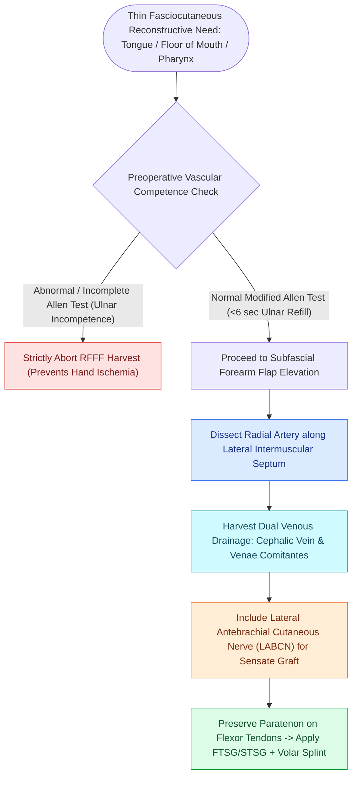

# The radial forearm free flap provides thin, pliable fasciocutaneous tissue for oral and pharyngeal defects

## Active Recall

> [!question]- What clinical test is mandatory prior to harvesting a radial forearm free flap?
> *Answer / Clinical Rationale*: The **Modified Allen's Test** (or Doppler evaluation) to verify adequate collateral ulnar arterial perfusion to the hand.

> [!question]- What nerve is harvested with the radial forearm flap to provide sensate reconstruction?
> *Answer / Clinical Rationale*: The **Lateral Antebrachial Cutaneous Nerve (LABCN)**.

## Core Clinical & Mechanistic Principles
The **Radial Forearm Free Flap (RFFF)** is the workhorse thin fasciocutaneous microvascular free flap for reconstructing mucosal defects of the oral cavity, oropharynx, and hypopharynx:
- **Vascular Anatomy**:
  - **Arterial Pedicle**: **Radial artery**, giving off multiple fasciocutaneous perforators along the lateral intermuscular septum between the brachioradialis (BR) and flexor carpi radialis (FCR). Pedicle length: $8.0\text{–}12.0\text{ cm}$; vessel caliber: $2.0\text{–}3.0\text{ mm}$.
  - **Venous Drainage**: Dual system: (1) **Cephalic vein** (superficial subcutaneous, large caliber), and (2) **Venae comitantes** of the radial artery (deep system).
  - **Sensory Innervation**: **Lateral antebrachial cutaneous nerve (LABCN)** (can be coapted to the lingual or mental nerve for sensate restoration).
- **Mandatory Preoperative Assessment**:
  - **Modified Allen's Test** and Doppler ultrasound to verify complete palmar arch patency and adequate ulnar collateral perfusion before sacrificing the radial artery.

### Surgical Technique & Critical Safety Checks
- **Harvest Craft**: Elevate flap subfascially over flexor tendons; preserve paratenon over FCR and BR to ensure 100% skin graft take on the donor forearm bed; immobilize wrist in a volar splint for 5–7 days (see [[Oral tongue carcinoma spreads along intrinsic lingual musculature to bilateral cervical lymphatics|Oral Tongue SCC]]).

## Connected Concepts & Graph Traversal
- **Oral Tongue SCC**: [[Oral tongue carcinoma spreads along intrinsic lingual musculature to bilateral cervical lymphatics|Oral Tongue SCC]]
- **ALT Free Flap**: [[The anterolateral thigh flap provides versatile volume and can be harvested as a chimeric flap|ALT Free Flap]]
- **Venous Couplers**: [[Microvascular venous couplers achieve rapid and reliable end-to-end and end-to-side anastomoses|Microvascular Couplers]]
- **Anatomical Foundation**: [[Ludwig angina presents with bilateral submandibular cellulitis and woody floor of mouth induration compromising the airway]]
- **Surgical Lymphadenectomy**: [[The spinal accessory nerve is identified at the Erb point and anterior border of the SCM]]
- **Oncologic Resection & Margins**: [[Buccal mucosa carcinoma exhibits high rates of local recurrence and Stensen duct involvement]]
- **Aerodigestive / Pharyngolaryngeal**: [[Primary pharyngeal closure after total laryngectomy utilizes an inverting Connell technique]]
- **Donor Site Morbidity**: [[Free tissue transfer donor site morbidity requires systematic risk stratification and anatomical preservation across fibular, radial forearm, and anterolateral thigh harvests|Free Flap Donor Site Morbidity]]
