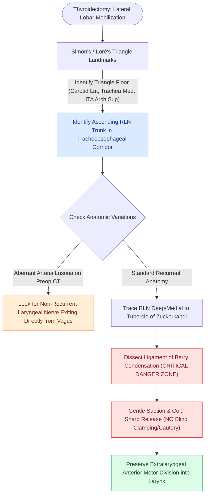

# The recurrent laryngeal nerve is identified within Simon's triangle and followed through Berry's ligament

## Active Recall

> [!question]- If the recurrent laryngeal nerve bifurcates extralaryngeally, which branch must be preserved to maintain vocal fold mobility?
> *Answer / Clinical Rationale*: The **anterior branch**, which carries all motor axons to the intrinsic laryngeal musculature (the posterior branch is primarily sensory and contributes to Galen's anastomosis).

> [!question]- What preoperative finding warns the surgeon of a nonrecurrent laryngeal nerve on the right side?
> *Answer / Clinical Rationale*: An **aberrant retroesophageal right subclavian artery (arteria lusoria)** on CT angiography or axial imaging.

> [!question]- What anatomical boundaries form Simon's (Loré's) triangle?
> *Answer / Clinical Rationale*: The **common carotid artery laterally**, the **trachea/esophagus medially**, and the **inferior thyroid artery arch superiorly/base**.

> [!question]- Why is the ligament of Berry the most common site of recurrent laryngeal nerve injury during thyroidectomy?
> *Answer / Clinical Rationale*: Because the RLN passes within **$1\text{–}2\text{ mm}$** of the thyroid capsule at this dense fibrous condensation, where aggressive medial traction or blind clamping can easily damage the anterior motor division.

## Core Clinical & Mechanistic Principles
Identification and preservation of the **Recurrent Laryngeal Nerve (RLN)** is the cornerstone of safe thyroid and parathyroid surgery:
- **Anatomical Course & Asymmetry**:
  - **Left RLN**: Loops under the embryonic 6th arch (**ductus arteriosus / ligamentum arteriosum**) beneath the aortic arch, ascending vertically in the true **tracheoesophageal groove**.
  - **Right RLN**: Loops under the embryonic 4th arch (**subclavian artery**), ascending more **obliquely** from lateral to medial across the carotid sheath.
  - **Non-Recurrent Laryngeal Nerve (~0.5–1% on right)**: Caused by failure of the right 4th arch, resulting in an aberrant retroesophageal subclavian artery (**arteria lusoria**); the nerve courses directly medially from the vagus at the level of the larynx. (A left nonrecurrent nerve requires situs inversus with a right-sided aortic arch).
- **Simon's Triangle (Loré's Triangle)**:
  - **Lateral Boundary**: Common carotid artery.
  - **Medial Boundary**: Trachea / Esophagus.
  - **Superior / Base**: Inferior thyroid artery (ITA) arch.
  - *The RLN runs in the floor of this triangle (more constant on the left).*
- **Branching Architecture & Galen's Anastomosis**:
  - **Extralaryngeal Branching**: Occurs in 30–60% of nerves prior to entry into the larynx. The **anterior division carries the motor fibers** to intrinsic laryngeal adductors/abductors, while the posterior division is primarily sensory.
  - **Galen's Anastomosis (Anastomosis of Galen)**: A neural connection between the posterior sensory branch of the RLN and the internal branch of the superior laryngeal nerve (iSLN) across the posterior larynx.
- **Tubercle of Zuckerkandl & Ligament of Berry**:
  - **Tubercle of Zuckerkandl**: A lateral posterolateral projection of the thyroid lobe representing the ultimobranchial fusion scar; the RLN passes **deep/medial** to the tubercle in $>90\%$ of cases.
  - **Berry's Ligament (Suspensory Ligament of the Thyroid)**: Dense fibrous condensation attaching the posteromedial thyroid lobe to the cricoid cartilage and upper tracheal rings. The RLN passes immediately deep to or through the lateral fibers of Berry's ligament ($\le 1\text{–}2\text{ mm}$ from thyroid tissue), representing the **maximal danger zone for traction, transection, or thermal injury**.
  - **Packaging Rule**: The RLN enters the larynx beneath the inferior pharyngeal constrictor muscle adjacent to the inferior laryngeal artery.

### Surgical Technique & Critical Safety Checks
- **Avoid Blind Clamping at Berry's**: Bleeding from the venous plexus at Berry's ligament must be controlled with **gentle direct pressure, suction, and further medial lobe mobilization** — never apply blind hemoclips or electrocautery, as the anterior motor division is within the bite radius.
- **Traction Vectors**: Medial traction on the thyroid lobe during Berry's dissection is the most common mechanism of neuropraxia (see [[The superior thyroid artery branches are divided flush on the thyroid capsule to protect the EBSLN|EBSLN Protection]]).

## Connected Concepts & Graph Traversal
- **EBSLN Protection**: [[The superior thyroid artery branches are divided flush on the thyroid capsule to protect the EBSLN|EBSLN Protection]]
- **Anatomical Anomaly**: [[A nonrecurrent laryngeal nerve arises directly from the vagus due to an aberrant retroesophageal right subclavian artery|Nonrecurrent Laryngeal Nerve]]
- **Neuromonitoring**: [[Intraoperative neuromonitoring of the RLN and EBSLN verifies nerve integrity and aids nerve identification|Neuromonitoring]]
- **Parathyroid Anatomy**: [[Superior and inferior parathyroid glands maintain constant anatomical relationships to the RLN and ITA|Parathyroid Anatomy]]
- **Anatomical Foundation**: [[Level II lymph nodes are anatomically divided into IIA and IIB by the spinal accessory nerve]]
- **Surgical Lymphadenectomy**: [[Level I dissection requires facial vessel ligation and preservation of the lingual and hypoglossal nerves]]
- **Oncologic Resection & Margins**: [[Elective neck dissection is indicated for oral cavity squamous cell carcinoma with depth of invasion exceeding four millimeters]]
- **Aerodigestive / Pharyngolaryngeal**: [[Tracheoesophageal puncture TEP and voice prosthesis restore pulmonary-driven alaryngeal speech]]
