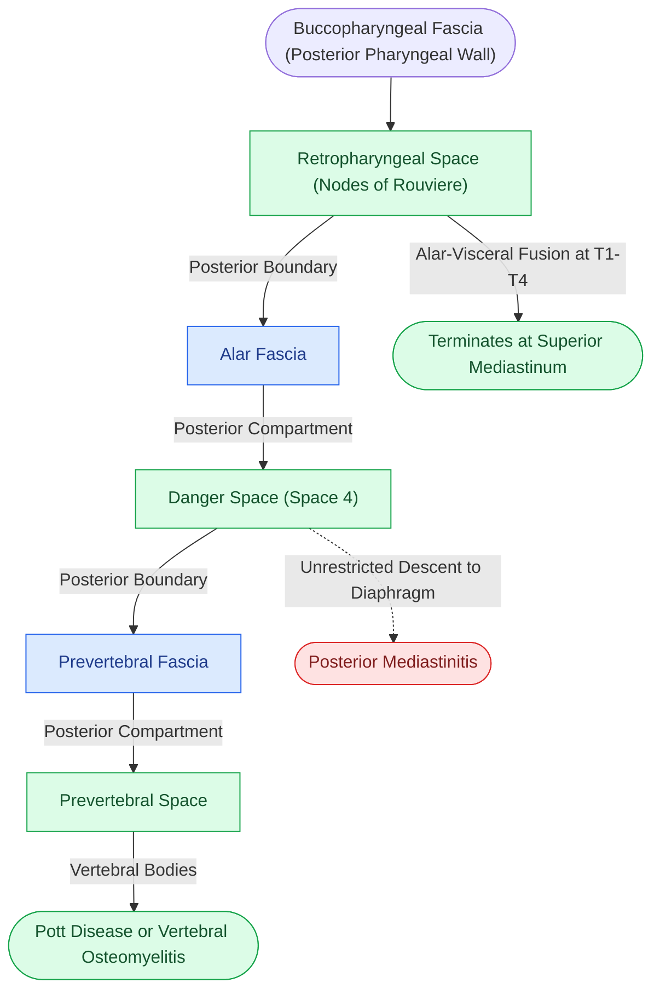

# The retropharyngeal space extends from skull base to tracheal bifurcation and contains lymph nodes draining the nasopharynx

## Active Recall

> [!question]- Why does an infection confined strictly to the retropharyngeal space terminate in the upper chest, whereas an infection in the danger space can reach the diaphragm?
> *Answer / Clinical Rationale*: The **retropharyngeal space terminates at T1–T4** where its posterior boundary (the alar fascia) fuses with its anterior boundary (the buccopharyngeal fascia). In contrast, the **danger space lies posterior to the alar fascia** (between alar and prevertebral fascia) and has no inferior anatomic barrier, extending freely into the posterior mediastinum down to the diaphragm.

> [!question]- Why do non-traumatic retropharyngeal abscesses occur far more frequently in toddlers than in adults?
> *Answer / Clinical Rationale*: The **Nodes of Rouvière** in the retropharyngeal space are prominent in young children and receive heavy lymphatic drainage from the adenoids and nasopharynx, predisposing them to suppurative lymphadenitis; in adults, these nodes undergo progressive fibrous involution.

## Core Clinical & Mechanistic Principles
The **Retropharyngeal Space (RPS)** is a midline potential space situated behind the pharynx and esophagus. Understanding its vertical and horizontal boundaries is critical because it forms a direct conduit for descending inflammatory disease and harbors key regional lymphatics draining the upper aerodigestive tract:

- **Fascial Boundaries & Dimensions**:
  - **Anterior**: Buccopharyngeal fascia (visceral division of the middle layer of deep cervical fascia) lining the posterior pharyngeal constrictors and esophagus.
  - **Posterior**: **Alar fascia** (anterior layer of the deep layer of deep cervical fascia).
  - **Superior**: Clivus and basiocciput at the skull base.
  - **Inferior**: Level of T1 to T4 (tracheal bifurcation / carina), where the alar fascia fuses with the visceral fascia of the middle layer.
  - **Lateral**: Carotid sheaths and parapharyngeal spaces on either side.

- **Nodal Architecture & Drainage**:
  - Contains loose areolar connective tissue and two paramedian chains of **Retropharyngeal Lymph Nodes (Nodes of Rouvière)**.
  - These nodes receive primary lymphatic drainage from the **nasopharynx, adenoids, posterior nasal cavity, paranasal sinuses, Eustachian tube, and posterior oropharyngeal wall**.
  - **Age-Dependent Epidemiology**: In infants and young children (<4–5 years), these nodes are prominent and richly vascularized, commonly undergoing suppurative breakdown into a **retropharyngeal abscess (RPA)** following upper respiratory tract infections. In older children and adults, these lymph nodes undergo progressive physiologic atrophy and involution; consequently, adult retropharyngeal infections typically arise from penetrating foreign body trauma (e.g., fish bones, wire grill brushes) or direct tracking from [[The parapharyngeal space is an inverted pyramid connecting peritonsillar, masticator, parotid, and retropharyngeal spaces|parapharyngeal space infections]].

### Surgical Technique & Drainage Craft
- **Radiographic Gate Numbers (Lateral Plain Neck Film)**:
  - *At C2*: Prevertebral soft tissue thickness should measure **$\le 7\text{ mm}$** (true for children and adults).
  - *At C6*: Prevertebral soft tissue thickness should measure **$\le 14\text{ mm}$ in children** and **$\le 22\text{ mm}$ in adults** (roughly matching the width of the adjacent vertebral body).
  - *Pitfall*: Neck flexion and expiratory crying during infant radiography can artificially double soft tissue thickness, producing a false-positive reading; contrast CT neck adjudicates equivocal findings.
- **Transoral Drainage**: Safe for discrete, medialized pediatric retropharyngeal abscesses with a stable airway. Performed with the patient in slight Trendelenburg position under general anesthesia with an endotracheal tube in place. A mucosal incision over the area of maximal fluctuance allows blunt entry and aspiration with continuous high-volume suction to prevent pulmonary aspiration of purulence.
- **Transcervical Drainage**: Mandatory when the abscess extends lateral to the great vessels, abuts the carotid sheath, tracks inferior to the hyoid bone, or when [[The danger space permits unrestricted infection spread from skull base to posterior mediastinum|the danger space]] or mediastinum is threatened.

## Connected Concepts & Graph Traversal
- **Posterior Spread**: [[The danger space permits unrestricted infection spread from skull base to posterior mediastinum|Danger Space & Mediastinitis]]
- **Lateral Communication**: [[The parapharyngeal space is an inverted pyramid connecting peritonsillar, masticator, parotid, and retropharyngeal spaces|Parapharyngeal Space Anatomy]]
- **Antimicrobial Therapy**: [[Empiric antimicrobial therapy for deep neck space infections targets polymicrobial oral flora and MRSA|Deep Space Antibiotic Algorithms]]
- **Posterior Pharyngeal Wall SCC**: [[Posterior pharyngeal wall carcinoma metastasizes early to retropharyngeal and level II to IV lymph nodes|Pharyngeal Wall SCC & Retropharyngeal Nodes]]
- **Posterior Fascial Compartment**: [[The perivertebral space is enclosed by the deep layer of deep cervical fascia and divides into prevertebral and paraspinal compartments on cross-sectional imaging|Perivertebral Space Compartments]]
- **🔗 Pediatric Airway Differential (Laryngology)**: [[Acute epiglottitis presents with rapid-onset odynophagia, fever, and the tripod sign requiring immediate airway protection|Pediatric Airway Infections]]
