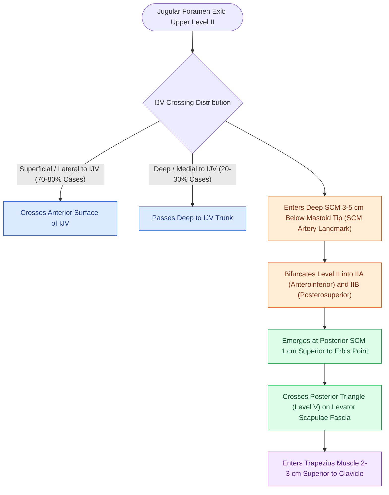

# The spinal accessory nerve is identified at the Erb point and anterior border of the SCM

## Active Recall

> [!question]- What is the most common anatomical relationship of CN XI to the internal jugular vein in Level II?
> *Answer / Clinical Rationale*: CN XI passes **superficial (lateral)** to the internal jugular vein in approximately **$70\text{–}80\%$** of individuals, and deep (medial) in $20\text{–}30\%$.

> [!question]- What nerves compose "Erb's cluster" at the posterior border of the sternocleidomastoid?
> *Answer / Clinical Rationale*: The **spinal accessory nerve (CN XI)** and the four superficial cervical plexus branches: **great auricular**, **lesser occipital**, **transverse cervical**, and **supraclavicular** nerves.

> [!question]- What vascular landmark marks the entrance of CN XI into the anterior border of the SCM?
> *Answer / Clinical Rationale*: A branch of the **occipital artery** (the sternocleidomastoid artery) that crosses or runs adjacent to the nerve approximately $3\text{–}5\text{ cm}$ below the mastoid tip.

## Core Clinical & Mechanistic Principles
The **Spinal Accessory Nerve (CN XI)** provides motor innervation to the sternocleidomastoid (SCM) and trapezius muscles. Rapid and safe identification during neck dissection relies on constant anatomical landmarks and crossing distributions:
- **IJV Crossing Distribution & Upper Neck Entry**:
  - Exits the jugular foramen and crosses the **Internal Jugular Vein (IJV)**:
    - **Superficial (Lateral) to IJV**: In **$\sim 67\text{–}80\%$ (two-thirds to four-fifths)** of cases.
    - **Deep (Medial) to IJV**: In **$\sim 20\text{–}33\%$** of cases.
    - *Piercing the IJV*: A rare anatomic curiosity ($<1\%$).
  - Enters the deep surface of the anterior border of the SCM approximately **$3.0\text{–}5.0\text{ cm}$ inferior to the tip of the mastoid process** (at the junction of the upper 1/3 and lower 2/3 of the muscle), accompanied by the SCM branch of the **occipital artery**.
- **Erb's Cluster & Posterior Triangle Crossing (Level V)**:
  - Emerges from the posterior border of the SCM approximately **$1.0\text{ cm}$ superior to Erb's point** (punctum nervosum).
  - **The "Erb's Cluster" Five-Nerve Neighborhood**: The emergence zone at the posterior SCM border is a dense cluster of five distinct neural structures: **great auricular nerve, lesser occipital nerve, transverse cervical nerve, supraclavicular nerves, and CN XI**. A posterior-triangle lymph node biopsy in this zone carries extreme risk to CN XI if this 5-nerve clustering is not respected.
  - Traverses the posterior triangle (Level V) obliquely across the levator scapulae and splenius capitis within the investing layer of deep cervical fascia, diving deep to the anterior border of the trapezius $2.0\text{–}3.0\text{ cm}$ superior to the clavicle.

### Surgical Technique & Critical Safety Checks
- **Surgical Craft**: Skeletonize the nerve along its entire course with fine scissors or bipolar cautery; avoid excessive traction or vessel loop tethering (causes ischemic traction neuropraxia).
- **Level IIB Clearance**: Retracting CN XI anteromedially allows en bloc clearance of the submuscular fat packet; in cN0 larynx cancer, omitting IIB avoids shoulder morbidity (see [[Level II lymph nodes are anatomically divided into IIA and IIB by the spinal accessory nerve|Level II Subdivisions]]).

## Connected Concepts & Graph Traversal
- **Level IIA/IIB**: [[Level II lymph nodes are anatomically divided into IIA and IIB by the spinal accessory nerve|Level II Subdivisions]]
- **MRND**: [[Modified radical neck dissection types I, II, and III preserve non-lymphatic structures|MRND]]
- **Level V Dissection**: [[Level V dissection requires skeletonization of the prevertebral fascia while protecting the phrenic nerve|Level V Dissection]]
- **Anatomical Foundation**: [[The danger space permits unrestricted infection spread from skull base to posterior mediastinum]]
- **Surgical Lymphadenectomy**: [[Superior mediastinal level VII dissection clears paratracheal lymph nodes below the sternal notch]]
- **Oncologic Resection & Margins**: [[Marginal mandibulectomy preserves basilar bone height when tumor abuts but does not invade marrow]]
- **Aerodigestive / Pharyngolaryngeal**: [[Circumferential laryngopharyngectomy requires tubed microvascular or visceral flap reconstruction]]
