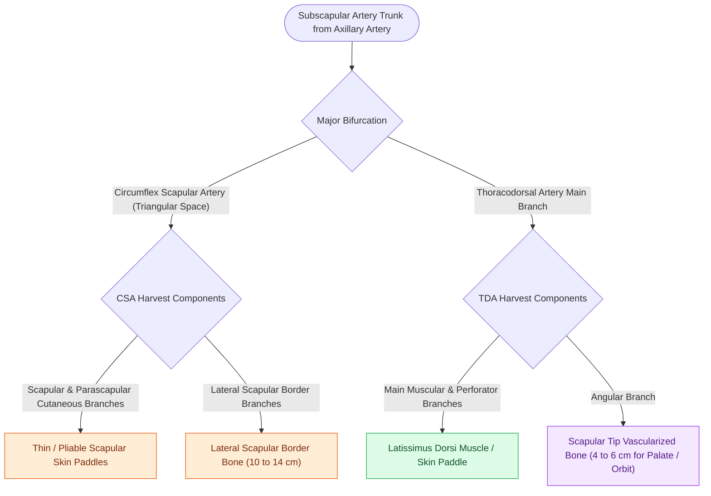

# The subscapular system provides chimeric bone and soft tissue flaps based on the circumflex scapular artery

## Active Recall

> [!question]- What specific artery supplies the vascularized scapular tip bone flap?
> *Answer / Clinical Rationale*: The **angular branch of the thoracodorsal artery** (or direct branch from the thoracodorsal).

> [!question]- What is the major clinical advantage of a subscapular bone flap over a fibula flap in elderly vasculopathic patients?
> *Answer / Clinical Rationale*: The subscapular axis is **spared from peripheral atherosclerotic disease**, providing reliable bone when lower extremity runoff is compromised.

## Core Clinical & Mechanistic Principles
The **subscapular arterial system** provides the most versatile chimeric composite free flaps in reconstructive head and neck surgery:
- **Arterial Branching Tree**:
  - **Subscapular Artery** (from 3rd part of axillary artery) bifurcates into:
    1. **Circumflex Scapular Artery (CSA)**: Traverses triangular space; divides into horizontal and transverse cutaneous branches supplying the **scapular and parascapular skin paddles**, and branches to the **lateral scapular border bone** ($10\text{–}14\text{ cm}$ of bone).
    2. **Thoracodorsal Artery (TDA)**: Supplies the **latissimus dorsi muscle**; gives off the **angular branch** supplying the **scapular tip** ($4\text{–}6\text{ cm}$ of highly vascular bone, ideal for orbital floor/palate maxillectomy reconstruction), and the branch to the **serratus anterior muscle**.
- **Chimeric Versatility**: Allows independent 3D orientation of bone (lateral border or scapular tip), massive muscle (latissimus), and multiple skin paddles on a single vascular pedicle.

### Surgical Technique & Critical Safety Checks
- **Patient Positioning**: Requires lateral decubitus or semi-lateral positioning (limits simultaneous two-team resection and harvest).
- **Major Advantage**: Scapular bone is resistant to atherosclerosis and ideal for patients with severe peripheral vascular disease in whom fibula flaps are contraindicated (see [[The latissimus dorsi myocutaneous free flap covers massive soft tissue and skull base defects|Latissimus Dorsi Flap]]).

## Connected Concepts & Graph Traversal
- **Latissimus Flap**: [[The latissimus dorsi myocutaneous free flap covers massive soft tissue and skull base defects|Latissimus Dorsi Flap]]
- **Maxillectomy Reconstruction**: [[Hard palate and upper alveolar carcinoma require partial or total maxillectomy|Maxillectomy Reconstruction]]
- **Fibula Free Flap**: [[The fibula osteocutaneous free flap provides up to twenty-five centimeters of vascularized bone for mandible reconstruction|Fibula Free Flap]]
- **Anatomical Foundation**: [[Deep cervical fascia divides into superficial, middle, and deep layers that define surgical planes]]
- **Surgical Lymphadenectomy**: [[Postoperative neck hematoma after thyroidectomy or neck dissection requires emergent bedside wound opening for airway decompression]]
- **Oncologic Resection & Margins**: [[Step-cut chevron mandibulotomy maximizes bone surface contact and rotational stability]]
- **Aerodigestive / Pharyngolaryngeal**: [[Pharyngocutaneous fistula is managed with wound care, nutritional support, and surgical flap closure]]
