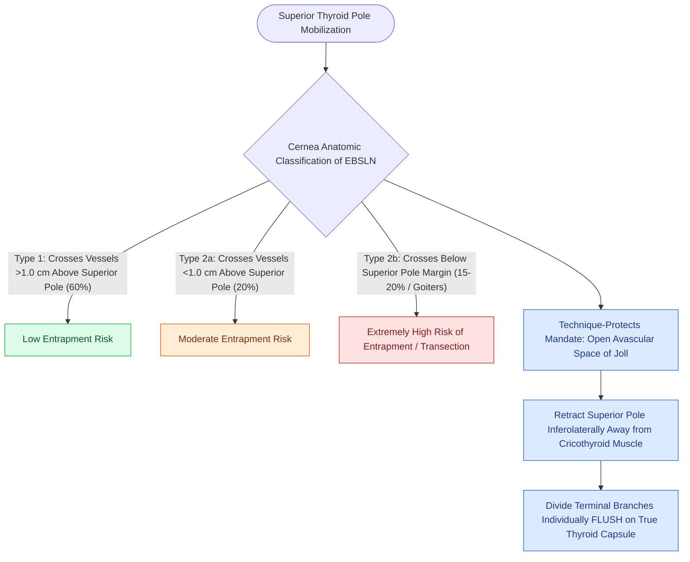

# The superior thyroid artery branches are divided flush on the thyroid capsule to protect the EBSLN

## Active Recall

> [!question]- Why does a large substernal or superiorly extending goiter increase the risk of EBSLN injury?
> *Answer / Clinical Rationale*: Superior enlargement of the thyroid pole elevates the superior margin of the gland relative to the nerve crossing point, converting baseline anatomy into a high-risk **Cernea Type 2b** pattern where the nerve crosses below the superior pole.

> [!question]- What is the physiological mechanism of preoperative Lugol's iodine in Graves' thyroidectomy?
> *Answer / Clinical Rationale*: It exploits the **Wolff-Chaikoff effect**, acutely downregulating thyroid hormone synthesis and **dramatically decreasing parenchymal vascularity and blood flow**, preventing torrential intraoperative capsular bleeding.

> [!question]- Why should the sternothyroid muscle be divided high near its thyroid cartilage insertion if strap muscle transection is necessary?
> *Answer / Clinical Rationale*: Because the **ansa cervicalis motor innervation enters the sternothyroid muscle inferiorly** (low); high transection preserves muscular innervation and functional reapproximation.

## Core Clinical & Mechanistic Principles
Mobilization of the superior pole of the thyroid gland requires precise identification and protection of the **External Branch of the Superior Laryngeal Nerve (EBSLN)**:
- **Functional Anatomy & Vascular Relationships**:
  - *Innervation*: Innervates the **cricothyroid (CT) muscle**, the primary vocal fold tensor responsible for longitudinal tension, pitch elevation, vocal projection, and high-frequency phonation.
  - *Spatial Relationship to Superior Thyroid Artery*: As the EBSLN descends along the lateral surface of the inferior pharyngeal constrictor muscle toward the cricothyroid muscle, it characteristically lies **dorsal (deep and posterior) to the superior thyroid artery**. When dividing the superior pole pedicle, mass ligation traps the deeply seated dorsal nerve; dissecting individual anterior and posterior tertiary branches directly on the true thyroid capsule preserves this dorsal relationship.
- **Cernea Classification & Large Goiter Dynamics**:
- **Cernea Classification & Large Goiter Dynamics**:
  - **Type 1 (~60%)**: Nerve crosses the superior thyroid vessels **$>1.0\text{ cm}$ above the upper border of the superior thyroid pole** (low risk of injury).
  - **Type 2a (~20%)**: Nerve crosses the vessels **$<1.0\text{ cm}$ above the upper border of the superior pole**.
  - **Type 2b (~15–20%)**: Nerve crosses the vessels **below the upper border of the superior pole** (highest risk of surgical entrapment).
  - *Goiter Enrichment*: Large goiters expand cephalad, dragging the superior pole above the horizontal nerve crossing, which converts what would be a Type 1 or 2a anatomy into a high-risk **Cernea Type 2b**.
- **The "Technique Protects" Rule in Joll's Triangle**:
  - A significant percentage of EBSLN trunks run **subfascially within the fibers of the inferior pharyngeal constrictor** and are entirely invisible during standard dissection.
  - Relying on direct visual nerve confirmation alone leads to nerve injury; surgical safety is achieved by adhering strictly to the **technique-protects rule**:
    1. Retract the superior pole inferolaterally to open the **avascular space of Joll** (sternothyroid-laryngeal triangle, bounded by the sternothyroid muscle laterally, inferior constrictor medially, and superior thyroid pole inferiorly).
    2. Divide the deep fascia to separate the superior pole from the cricothyroid muscle.
    3. Skeletonize and divide each individual terminal branch of the superior thyroid artery **flush on the true thyroid capsule**.
- **The Deep Strap Layer & Superior Pole Exposure**:
  - The strap muscles sit in two distinct laminae: superficial (sternohyoid, omohyoid) and deep (**sternothyroid and thyrohyoid**).
  - The **sternothyroid muscle inserts on the oblique line of the thyroid cartilage and caps the superior thyroid pole**. In massive goiters, transecting the sternothyroid muscle **high near its insertion** provides unobstructed superior pole access without denervating the muscle (since ansa cervicalis motor branches enter low from its deep surface).

- **Graves' Disease Thyroidectomy & Hemithyroidectomy Nuances**:
  - *Hypervascularity & Friability*: Graves' disease features extreme parenchymal hypervascularity, venous engorgement, and capsular friability.
  - *Preoperative Preparation (Wolff-Chaikoff Effect)*: Administer **Lugol's iodine or Saturated Solution of Potassium Iodide (SSKI, 3–5 drops TID for 10–14 days)** preoperatively. High-dose inorganic iodide inhibits thyroid hormone synthesis/release and induces acute involution of thyroid follicular vascularity, drastically reducing intraoperative blood loss. Combine with methimazole and beta-blockers (propranolol) to establish complete clinical euthyroidism before general anesthesia.
  - *True Capsular Dissection*: In Graves', mass clamping or blunt stripping shears capsule-penetrating vessels. Dissect strictly on the **true thyroid capsule**, dividing vessels individually with fine bipolar electrocautery or ultrasonic shears.
  - *Isthmusectomy & Pyramidal Lobe Mobilization*: During hemithyroidectomy or total thyroidectomy, transect the isthmus over the 2nd–3rd tracheal rings and trace any **pyramidal lobe** cephalad to the hyoid bone to prevent recurrent hyperthyroidism.

### Surgical Technique & Critical Safety Checks
- **Clinical Presentation of EBSLN Injury**: Loss of upper vocal pitch range ("Amelita Galli-Curci deformity", vocal fatigue in professional voice users/singers), decreased vocal projection, and subtle bowing/flaccidity of the ipsilateral vocal cord on stroboscopy (see [[The 2025 ATA guidelines establish active surveillance criteria and lobectomy preference for low-risk differentiated thyroid cancer|2025 ATA Guidelines & Lobectomy]]).

## Connected Concepts & Graph Traversal
- **2025 ATA Surgical De-escalation**: [[The 2025 ATA guidelines establish active surveillance criteria and lobectomy preference for low-risk differentiated thyroid cancer|2025 ATA Guidelines & Lobectomy]]
- **RLN Identification**: [[The recurrent laryngeal nerve is identified within Simon's triangle and followed through Berry's ligament|RLN & Simon's Triangle]]
- **Postoperative Hypocalcemia**: [[Post-thyroidectomy hypocalcemia is managed with oral calcium, calcitriol, and intravenous calcium gluconate|Post-Thyroidectomy Hypocalcemia]]
- **Parathyroid Blood Supply**: [[Superior and inferior parathyroid glands maintain constant anatomical relationships to the RLN and ITA|Parathyroid Glands & ITA Branches]]
- **Intraoperative Neuromonitoring**: [[Intraoperative neuromonitoring of the RLN and EBSLN verifies nerve integrity and aids nerve identification|IONM of RLN & EBSLN]]
