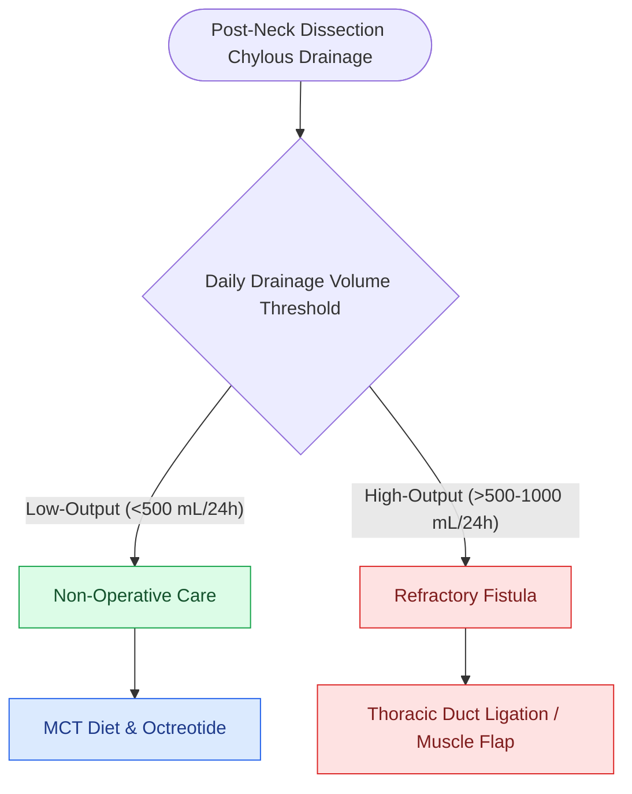

# Thoracic duct anatomy in the left level IV space predisposes to intraoperative chyle fistula

## Active Recall

> [!question]- Can a chyle fistula occur following a right-sided neck dissection?
> *Answer / Clinical Rationale*: **Yes**; terminal lymphatic trunks or a distinct **right lymphatic duct** enter the right jugular-subclavian venous angle in many individuals, placing them at risk during right Level IV dissection.

> [!question]- What are the branches of the thyrocervical trunk, and why are they clinically relevant in neck dissection?
> *Answer / Clinical Rationale*: The **inferior thyroid artery**, **transverse cervical artery**, and **suprascapular artery**; the latter two cross the floor of Level VB over the prevertebral fascia and serve as the vascular pedicle for the supraclavicular flap or sources of deep bleeding if injured.

> [!question]- What midline anomalous artery can cause brisk unexpected hemorrhage during tracheostomy or lower central neck clearance?
> *Answer / Clinical Rationale*: The **thyroidea ima artery**, which arises directly from the brachiocephalic (innominate) trunk or aortic arch to ascend vertically over the anterior trachea to the thyroid isthmus.

## Core Clinical & Mechanistic Principles
The **thoracic duct** is the largest lymphatic conduit in the body, transporting $2.0\text{–}4.0\text{ L/day}$ of chyle from the abdomen and lower extremities into the venous system. Level IV and lower neck clearance requires mastery of both lymphatic and deep vascular plumbing:

- **Cervical Course & Arch of the Thoracic Duct**:
  - Ascends through the superior mediastinum along the left border of the esophagus.
  - Enters the left neck medial to the carotid sheath, arching **$3.0\text{–}5.0\text{ cm}$ superior to the clavicle** behind the common carotid artery and IJV.
  - Passes anterior to the vertebral artery, phrenic nerve, and thyrocervical trunk over the prevertebral fascia.
  - Dives inferiorly and anteriorly to insert into the **venous angle (confluence of the left internal jugular and subclavian veins)**.
  - *Delta-like Variations & Gossamer Wall*: The duct often divides into 2–4 terminal branches. Its walls are gossamer-thin, easily sheared by traction. Unipolar cautery is strictly contraindicated; safe sealing requires titanium clips or fine silk suture ligatures.
  - *The Right Lymphatic Duct*: Terminal lymphatic trunks or a discrete right lymphatic duct enter the right venous angle in many patients, disproving the misconception that "right Level IV dissection cannot cause a chyle leak."

- **Deep Vascular Plumbing — Subclavian Branches & Floor Vessels**:
  - The **subclavian artery branches** (mnemonic: **VIT C, D**):
    1. **V** - Vertebral artery
    2. **I** - Internal thoracic (internal mammary) artery
    3. **T** - **Thyrocervical trunk** (gives off the **Inferior Thyroid Artery**, **Transverse Cervical Artery**, and **Suprascapular Artery**)
    4. **C** - Costocervical trunk
    5. **D** - Dorsal scapular artery
  - *Level V Floor Vessels*: The **transverse cervical** and **suprascapular arteries** course laterally across the prevertebral fascia in Level VB (serving as pedicles for the supraclavicular artery island flap and sources of vigorous floor hemorrhage if prevertebral fascia is breached).
  - *Midline Anomalies*: The **thyroidea ima artery** (present in 3–10%, arising directly from the innominate trunk or aortic arch) ascends the anterior trachea to the thyroid isthmus, presenting as an unexpected high-pressure arterial bleeder during low tracheostomy or central neck dissection.

### Surgical Technique & Critical Safety Checks
- **Intraoperative Safeguards**:
  - Carefully clip or suture-ligate all lymphatic tissue in left and right Level IV using 3-0/4-0 silk or non-absorbable hemoclips. Avoid unipolar cautery (causes lymphatic eschar that sloughs postoperatively).
  - Perform **Valsalva maneuver / Trendelenburg positioning** before closure to detect milky or clear lymphatic pooling (see [[Cervical lymph node levels I through VII define regional metastatic drainage basins|Cervical Lymph Node Levels]]).

## Connected Concepts & Graph Traversal
- **Cervical Lymph Node Levels**: [[Cervical lymph node levels I through VII define regional metastatic drainage basins|Cervical Lymph Node Levels]]
- **Chyle Leak Protocol**: [[Cervical chyle leaks are managed with MCT diet, octreotide, or surgical thoracic duct ligation|Chyle Leak Management]]
- **Level IV Dissection**: [[Levels II through IV internal jugular chain dissection mobilizes the carotid sheath packet|Jugular Chain Dissection]]
- **Modified Radical Neck Dissection**: [[Modified radical neck dissection types I, II, and III preserve non-lymphatic structures|MRND Techniques]]
- **Selective Neck Dissection**: [[Selective neck dissection targets high-risk nodal basins while sparing low-risk cervical levels|Selective Lymphadenectomy]]
- **Pharyngocutaneous Fistula**: [[Pharyngocutaneous fistula is managed with wound care, nutritional support, and surgical flap closure|Pharyngocutaneous Fistula Management]]
