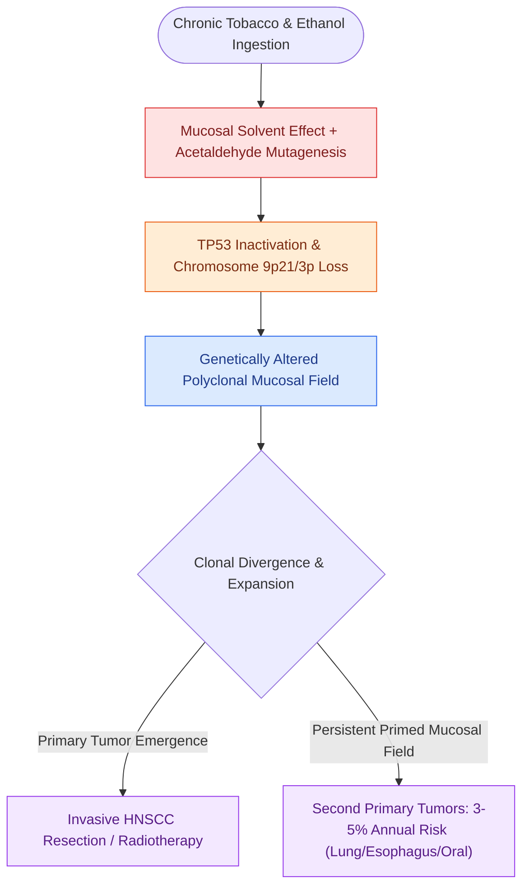

# Tobacco and alcohol carcinogenesis drives TP53 mutation and field cancerization in upper aerodigestive tract

## Active Recall

> [!question]- What is the clinical definition of 'field cancerization' in head and neck oncology?
> *Answer / Clinical Rationale*: Diffuse mucosal exposure to carcinogens resulting in widespread subclinical genetic alterations and a high risk of multiple independent primary tumors.

> [!question]- What is the annual incidence rate of second primary malignancies in tobacco-exposed head and neck cancer survivors?
> *Answer / Clinical Rationale*: Approximately **3% to 5% per year**.

## Core Clinical & Mechanistic Principles
In [[HPV-positive oropharyngeal squamous cell carcinoma exhibits distinct biological behavior and staging|HPV-negative head and neck squamous cell carcinoma]], chronic exposure to tobacco smoke and alcohol drives diffuse mucosal carcinogenesis across the entire upper aerodigestive tract:

- **Molecular Pathogenesis**:
  - Polycyclic aromatic hydrocarbons and tobacco-specific nitrosamines (NNK, NNN) generate covalent DNA adducts, driving early loss of heterozygosity at chromosome **9p21 ($p16^{INK4A}$/CDKN2A)** and point mutations in the **$TP53$ tumor suppressor gene** on chromosome 17p.
  - Ethanol acts synergistically as a mucosal solvent, increasing epithelial permeability to tobacco carcinogens, while its primary metabolite **acetaldehyde** inhibits DNA methyltransferases and DNA repair machinery.
- **Slaughter's Field Cancerization Theory (1953)**:
  - Carcinogen exposure creates a continuous "condemned field" of genetically altered, morphologically normal or mildly dysplastic mucosal epithelium spanning the oral cavity, pharynx, larynx, esophagus, and tracheobronchial tree.
  - **Second Primary Malignancies (SPMs)**: Occur at a steady annual rate of **$3\text{–}5\%$ per year** throughout survivorship, representing the leading cause of late mortality in early-stage HNSCC.
  - **Locoregional Recurrence**: Clonal microscopic fields extending beyond surgical margins explain high local failure rates even in the setting of [[Oncologic clear margins require at least five millimeters of histological normal tissue|histologically clear margins ($>5\text{ mm}$)]].

### Surveillance & Secondary Prevention
- **Surveillance Protocol**: Long-term annual low-dose chest CT and comprehensive head and neck endoscopic surveillance to detect early second primary lung, esophageal, or synchronous mucosal lesions.
- **Smoking Cessation**: Continued smoking during radiation therapy diminishes locoregional control, impairs tissue oxygenation, and accelerates radiation-induced microvascular damage.

## Connected Concepts & Graph Traversal
- **Viral Carcinogenesis Contrast**: [[HPV-positive oropharyngeal squamous cell carcinoma exhibits distinct biological behavior and staging|HPV-Positive vs Tobacco-Driven OPSCC]]
- **Surgical Margin Clearance**: [[Oncologic clear margins require at least five millimeters of histological normal tissue|Histological Clear Margin Standards]]
- **Molecular Targeting**: [[Cetuximab targets EGFR overexpression while pembrolizumab and nivolumab inhibit PD-1 in head and neck SCC|Anti-EGFR and Immune Checkpoint Blockade]]
- **Nodal Staging Foundation**: [[Cervical lymph node levels I through VII define regional metastatic drainage basins|Cervical Lymph Node Basin Mapping]]
- **Oral Premalignancy & Resection**: [[Transoral resection provides oncologic access for early-stage anterior oral cavity neoplasms|Early Oral Cavity Neoplasms & Field Resection]]
