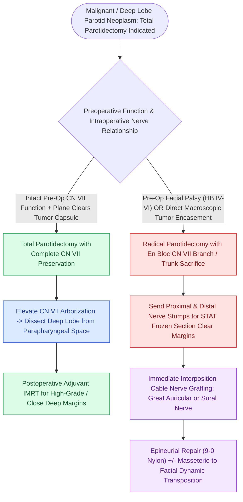

# Total parotidectomy with facial nerve sacrifice is indicated for direct malignant nerve invasion

## Active Recall

> [!question]- What are the two definitive indications for sacrificing the facial nerve during parotidectomy?
> *Answer / Clinical Rationale*: **Preoperative facial nerve paralysis** caused by tumor invasion, or **direct macroscopic tumor encasement** of the nerve.

> [!question]- What step is mandatory when a segment of facial nerve is sacrificed for oncologic clearance?
> *Answer / Clinical Rationale*: Send **frozen section margins** from proximal and distal nerve stumps, followed by **immediate interposition cable nerve grafting**.

## Core Clinical & Mechanistic Principles
**Total [[The facial nerve main trunk is localized using the tragal pointer, tympanomastoid suture, and digastric ridge|parotidectomy]]** involves the complete excision of both the superficial and deep parotid lobes, with selective sacrifice or preservation of the facial nerve:
- **Oncologic Principles of Facial Nerve Management**:
  - **Preserve the Nerve**: If the facial nerve has normal preoperative function and can be dissected cleanly off the tumor capsule, it **MUST be preserved**, even in high-grade malignancies.
  - **Sacrifice the Nerve (Radical Parotidectomy)**: Indicated ONLY when there is:
    1. Preoperative facial paralysis (House-Brackmann Grade IV–VI) indicating tumor neurotropism.
    2. Direct macroscopic tumor encasement or perineural invasion where tumor cannot be separated without leaving gross residual cancer.
- **Deep Lobe Dissection Technique**:
  - Mobilize and elevate all facial nerve branches off the deep lobe.
  - Dissect deep lobe out of the **[[Deep neck space infections spread along cervical fascial planes between the pharynx, mediastinum, and skull base|parapharyngeal space]]** between the styloid process and mandible, ligating the internal maxillary artery branches.

### Surgical Technique & Critical Safety Checks
- **Immediate Reconstruction Mandate**: Any segment of facial nerve sacrificed must undergo **immediate interposition cable nerve grafting** (using the great auricular nerve or sural nerve).

## Connected Concepts & Graph Traversal
- **Cable Nerve Grafting**: [[Immediate facial nerve grafting with the great auricular or sural nerve restores facial reanimation|Immediate Cable Nerve Grafting]]
- **Perineural Invasion Malignancy**: [[Adenoid cystic carcinoma exhibits prominent perineural invasion and late distant hematogenous metastasis|Adenoid Cystic Carcinoma]]
- **High-Grade AR+ Malignancy**: [[Salivary duct carcinoma is an aggressive high-grade malignancy expressing androgen receptors and HER2|Salivary Duct Carcinoma]]
- **Lateral Lobectomy**: [[Superficial parotidectomy dissects the facial nerve branches to resect the lateral salivary lobe|Superficial Parotidectomy]]
- **Parapharyngeal Space Topography**: [[The parapharyngeal space is an inverted pyramid connecting peritonsillar, masticator, parotid, and retropharyngeal spaces|Parapharyngeal Space Boundaries]]
- **Facial Nerve Grading**: [[The House-Brackmann facial nerve grading system standardizes facial paralysis severity|House-Brackmann Facial Nerve Grading]]
- **Skull Base Spread Pathways**: [[Perineural tumor spread along cranial nerves V2, V3, and VII follows retrograde skull base pathways through the pterygopalatine fossa, foramen ovale, and stylomastoid foramen|Perineural Spread Pathways]]
