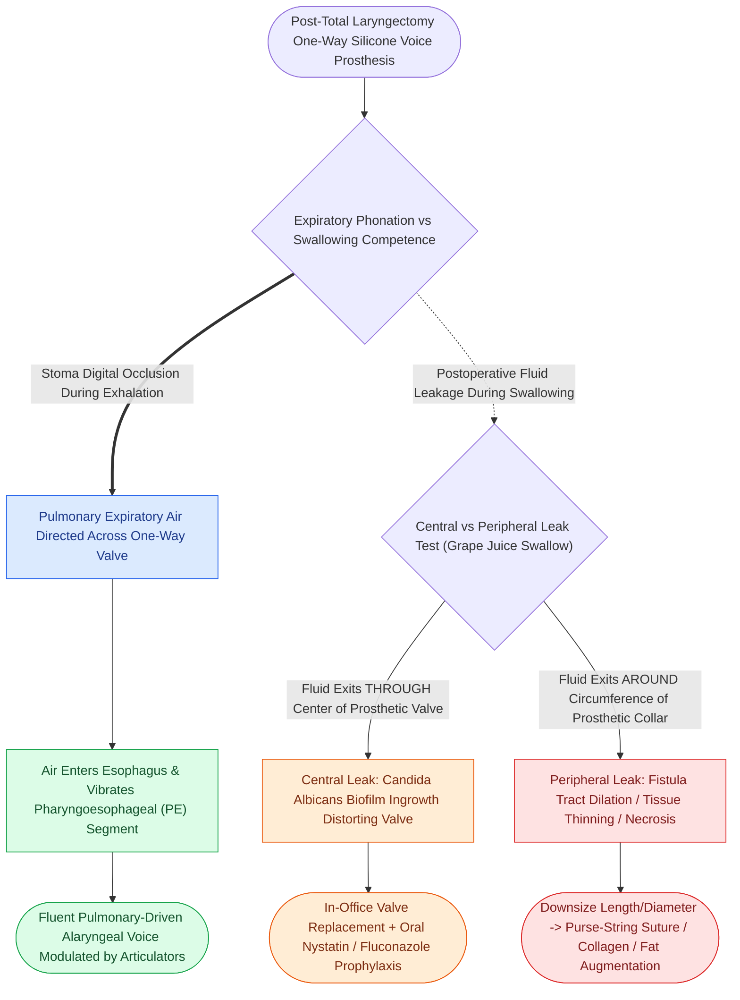

# Tracheoesophageal puncture TEP and voice prosthesis restore pulmonary-driven alaryngeal speech

## Active Recall

> [!question]- How does a tracheoesophageal voice prosthesis produce sound?
> *Answer / Clinical Rationale*: Exhaled pulmonary air is diverted through the one-way valve into the esophagus, vibrating the mucosa of the **pharyngoesophageal (PE) segment**.

> [!question]- What is the difference between central and peripheral voice prosthesis leakage?
> *Answer / Clinical Rationale*: **Central leakage** occurs *through* the valve due to Candida biofilm degradation; **peripheral leakage** occurs *around* the prosthesis due to tract dilation.

## Core Clinical & Mechanistic Principles
**Tracheoesophageal Puncture (TEP)** with insertion of a one-way silicone voice prosthesis is the gold standard for voice rehabilitation following total laryngectomy:
- **Physiological Mechanism**:
  - The patient occludes the tracheostoma during exhalation; pulmonary air is diverted through the one-way valve into the neopharynx.
  - The air column vibrates the mucosal folds of the **pharyngoesophageal (PE) segment**, producing fluent, pulmonary-driven alaryngeal sound modulated by articulators into natural speech.
- **Timing of Placement**:
  - **Primary TEP**: Performed at the time of total laryngectomy (placed $5\text{–}10\text{ mm}$ below the posterosuperior tracheal rim); stent placed with red rubber catheter or primary prosthesis.
  - **Secondary TEP**: Performed months later under local or general anesthesia after complete healing and radiation.
- **Cricopharyngeal Myotomy**: Performed during laryngectomy to prevent hypertonicity/spasm of the PE segment, which causes failed phonation.

### Surgical Technique & Critical Safety Checks
- **Complications & Troubleshooting**:
  - *Central Leakage (Through Prosthesis)*: Caused by *Candida* colonization and fungal biofilm disrupting valve closure; treated with replacement and oral antifungals.
  - *Peripheral Leakage (Around Prosthesis)*: Caused by fistula tract dilation from radiation, malnutrition, or reflux; treated with downsizing, purse-string suture, or tissue augmentation (see [[Total laryngectomy achieves en bloc laryngeal resection with permanent end-stoma|Total Laryngectomy Craft]]).

## Connected Concepts & Graph Traversal
- **Total Laryngectomy Standards**: [[Total laryngectomy achieves en bloc laryngeal resection with permanent end-stoma|Total Laryngectomy Craft]]
- **Connell Neopharyngeal Closure**: [[Primary pharyngeal closure after total laryngectomy utilizes an inverting Connell technique|Primary Pharyngeal Closure]]
- **Pectoralis Flap Reinforcement**: [[Pectoralis major muscle flap reinforcement prevents pharyngocutaneous fistula in salvage laryngectomy|PMMF Reinforcement]]
- **PCF Management**: [[Pharyngocutaneous fistula is managed with wound care, nutritional support, and surgical flap closure|Pharyngocutaneous Fistula Protocol]]
- **Hypopharyngeal Oncology**: [[Hypopharyngeal piriform sinus carcinoma requires partial or total laryngopharyngectomy|Piriform Sinus Carcinoma]]
- **Cricopharyngeal Spasm**: [[LEMG denervation potentials indicate axonal injury within one to six months|Pharyngoesophageal Dynamics]]
