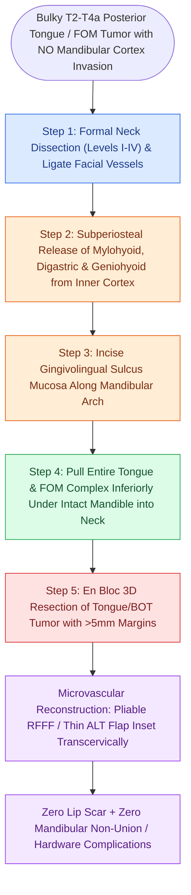

# Transcervical pull-through resection mobilizes oral tongue tumors without dividing the mandible

## Active Recall

> [!question]- What is the major clinical advantage of a pull-through resection over a lip-split mandibulotomy?
> *Answer / Clinical Rationale*: It avoids dividing the mandible, eliminating the risks of **mandibulotomy non-union, hardware extrusion, and lower lip scar**.

> [!question]- What is the primary contraindication to performing a pull-through resection?
> *Answer / Clinical Rationale*: **Tumor involvement of the mandibular bone or lingual periosteum**, which requires bone resection.

## Core Clinical & Mechanistic Principles
The **transcervical 'pull-through' resection** provides wide oncologic exposure for posterior oral cavity and base of tongue carcinomas without requiring a mandibulotomy:
- **Indications**: T2, T3, and select T4a tumors of the posterior oral tongue, floor of mouth, or base of tongue that do **NOT** involve the mandibular bone or periosteum.
- **Surgical Execution**:
  1. Complete formal neck dissection (Levels I–III or I–IV), ligating the facial vessels and mobilizing the submandibular contents.
  2. Release the floor of mouth musculature (mylohyoid, anterior digastric, geniohyoid, and hyoglossus) off the inner lingual cortex of the mandible.
  3. Enter the oral cavity mucosa along the inner mandibular gingivolingual sulcus.
  4. Pull the entire mobile oral tongue and floor-of-mouth complex inferiorly into the cervical wound under the mandibular arch.
  5. Resect the tumor en bloc under direct 3D visualization with wide three-dimensional margins.

### Surgical Technique & Critical Safety Checks
- **Major Advantages**: Avoids lip-split cosmetic deformity, avoids osteotomy non-union, plate infection, and mandibular hardware complications.
- **Reconstruction**: The resulting large soft tissue defect is reconstructed with a **Radial Forearm Free Flap (RFFF)** or **Anterolateral Thigh (ALT)** free flap (see [[Lip-split paramedian mandibulotomy provides wide exposure for posterior oral cavity and oropharyngeal tumors|Lip-Split Mandibulotomy]]).

## Connected Concepts & Graph Traversal
- **Mandibulotomy Alternative**: [[Lip-split paramedian mandibulotomy provides wide exposure for posterior oral cavity and oropharyngeal tumors|Lip-Split Mandibulotomy]]
- **Transoral Resection**: [[Transoral resection provides oncologic access for early-stage anterior oral cavity neoplasms|Transoral Resection Standards]]
- **Thin Pliable Tissue Transfer**: [[The radial forearm free flap provides thin, pliable fasciocutaneous tissue for oral and pharyngeal defects|Radial Forearm Free Flap]]
- **Oral Cavity T-Staging & DOI**: [[AJCC 8th edition incorporates depth of invasion into oral cavity T-staging|Oral Cavity Staging & DOI]]
- **Intrinsic Musculature Spread**: [[Oral tongue carcinoma spreads along intrinsic lingual musculature to bilateral cervical lymphatics|Oral Tongue Muscular Anatomy]]
- **Five-Millimeter Margins**: [[Oncologic clear margins require at least five millimeters of histological normal tissue|Five-Millimeter Margin Rules]]
