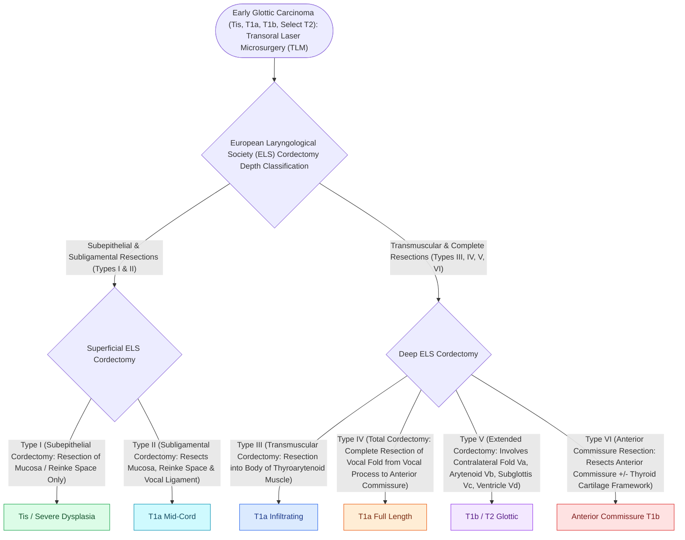

# Transoral laser microsurgery TLM resects early glottic carcinoma with vocal cord preservation

## Active Recall

> [!question]- What is an ELS Type IV cordectomy?
> *Answer / Clinical Rationale*: A **total cordectomy**, resecting the entire vocal fold from the vocal process to the anterior commissure, exposing the internal thyroid perichondrium.

> [!question]- Why does tumor involvement of the anterior commissure (Broyles ligament) increase the risk of thyroid cartilage invasion?
> *Answer / Clinical Rationale*: Because Broyles ligament inserts directly into the thyroid cartilage **without intervening internal perichondrium**, providing an unhindered pathway for cartilage invasion.

## Core Clinical & Mechanistic Principles
**Transoral Laser Microsurgery (TLM)** using a line-of-sight CO2 laser ($10.6\ \mu\text{m}$) coupled to an operating microscope is an oncologically sound, organ-preserving modality for early glottic carcinoma (Tis, T1a, T1b, select T2):
- **European Laryngological Society (ELS) Cordectomy Classification**:
  - **Type I (Subepithelial Cordectomy)**: Resection of vocal fold epithelium into Reinke space (for severe dysplasia / Tis).
  - **Type II (Subligamental Cordectomy)**: Resection of epithelium, Reinke space, and vocal ligament down to thyroarytenoid muscle.
  - **Type III (Transmuscular Cordectomy)**: Resection through the thyroarytenoid muscle.
  - **Type IV (Total Cordectomy)**: Resection from vocal process to anterior commissure, exposing inner thyroid perichondrium.
  - **Type V (Extended Cordectomy)**: Includes contralateral vocal cord (Va), arytenoid (Vb), subglottis (Vc), or ventricular fold (Vd).
  - **Type VI (Anterior Commissure Cordectomy)**: Bilateral anterior cordectomy including anterior commissure and Broyles ligament.

### Surgical Technique & Critical Safety Checks
- **Laser Safety Protocol**: Wet cottonoids protecting endotracheal cuff; laser-safe endotracheal tube; $\text{FiO}_2 < 30\%$; eye protection for all OR personnel.
- **Anterior Commissure Hazard**: Broyles ligament attaches vocal cords directly to thyroid cartilage without intervening perichondrium, facilitating early cartilage invasion (see [[Total laryngectomy achieves en bloc laryngeal resection with permanent end-stoma|Total Laryngectomy Standards]]).

## Connected Concepts & Graph Traversal
- **Total Laryngectomy**: [[Total laryngectomy achieves en bloc laryngeal resection with permanent end-stoma|Total Laryngectomy Standards]]
- **Oncologic Margins**: [[Oncologic clear margins require at least five millimeters of histological normal tissue|Surgical Margin Principles]]
- **Airway Fire Prevention**: [[Airway fire prevention requires FiO2 below 30 percent and laser-safe tubes|Airway Laser Safety Protocols]]
- **Paraglottic Invasion**: [[The paraglottic space facilitates transglottic tumor spread|Paraglottic Space Transglottic Spread]]
- **Preepiglottic Invasion**: [[The pre-epiglottic space enables rapid supraglottic cancer spread|Preepiglottic Space Topography]]
- **TEP Voice Restoration**: [[Tracheoesophageal puncture TEP and voice prosthesis restore pulmonary-driven alaryngeal speech|TEP Voice Rehabilitation]]
