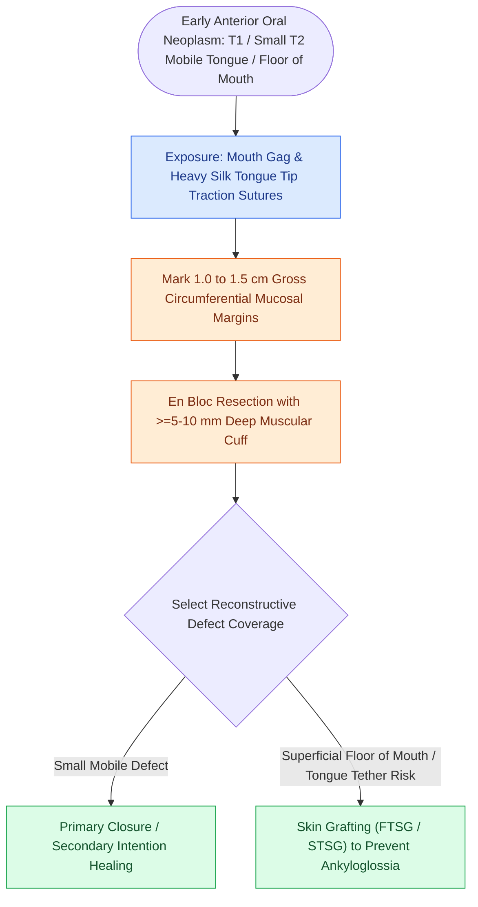

# Transoral resection provides oncologic access for early-stage anterior oral cavity neoplasms

## Active Recall

> [!question]- What are the ideal candidates for transoral resection of oral cavity squamous cell carcinoma?
> *Answer / Clinical Rationale*: **T1 and early T2 tumors** of the anterior mobile tongue, floor of mouth, and buccal mucosa with adequate transoral visualization.

> [!question]- How is the tongue mobilized intraoperatively during transoral resection?
> *Answer / Clinical Rationale*: Using **heavy silk traction sutures** placed through the tongue tip and lateral borders.

## Core Clinical & Mechanistic Principles
**Transoral (per-oral) resection** is the preferred surgical approach for early-stage (T1 and small T2) neoplasms of the anterior oral cavity:
- **Appropriate Subsites**:
  - Anterior two-thirds of the mobile oral tongue.
  - Anterior floor of mouth.
  - Upper and lower labial mucosa.
  - Buccal mucosa.
  - Anterior hard palate and upper alveolar ridge.
- **Surgical Execution**:
  1. Place a bite block or Dingman / Jennings mouth gag.
  2. Place traction sutures (2-0 Silk) through the oral tongue tip and lateral borders for exposure.
  3. Mark a **$1.0\text{–}1.5\text{ cm}$ gross circumferential margin** around the palpable tumor.
  4. Perform hydrodissection with epinephrine-containing local anesthetic.
  5. Resect the specimen en bloc using needle-tip electrocautery or cold knife, maintaining a deep muscular cuff $\ge 5\text{–}10\text{ mm}$ below the tumor base.

### Surgical Technique & Critical Safety Checks
- **Reconstruction Options for Transoral Defects**:
  - *Primary Closure*: For small defects with adequate mobile tissue.
  - *Secondary Intention*: Excellent for superficial floor-of-mouth or buccal defects without exposing bone.
  - *Skin Grafting (FTSG / STSG)*: Prevents tethering of the mobile tongue tip (ankyloglossia) (see [[Transcervical pull-through resection mobilizes oral tongue tumors without dividing the mandible|Pull-Through Resection]]).

## Connected Concepts & Graph Traversal
- **Pull-Through Resection**: [[Transcervical pull-through resection mobilizes oral tongue tumors without dividing the mandible|Pull-Through Resection]]
- **Clear Margins**: [[Oncologic clear margins require at least five millimeters of histological normal tissue|Oncologic Margins]]
- **Elective Neck Dissection**: [[Elective neck dissection is indicated for oral cavity squamous cell carcinoma with depth of invasion exceeding four millimeters|Elective Neck Dissection]]
- **Anatomical Foundation**: [[Cervical necrotizing fasciitis requires emergent surgical debridement and broad-spectrum antimicrobial coverage]]
- **Surgical Lymphadenectomy**: [[Superior mediastinal level VII dissection clears paratracheal lymph nodes below the sternal notch]]
- **Oncologic Resection & Margins**: [[Marginal mandibulectomy preserves basilar bone height when tumor abuts but does not invade marrow]]
- **Aerodigestive / Pharyngolaryngeal**: [[Pharyngocutaneous fistula is managed with wound care, nutritional support, and surgical flap closure]]
