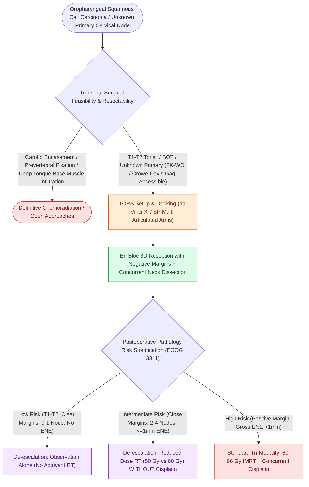

# Transoral robotic surgery TORS achieves en bloc resection of tonsillar and base of tongue neoplasms

## Active Recall

> [!question]- What are the primary indications for Transoral Robotic Surgery (TORS) in head and neck oncology?
> *Answer / Clinical Rationale*: **T1/T2 carcinomas of the palatine tonsil and base of tongue**, and identification of occult primary carcinomas via diagnostic palatine/lingual tonsillectomy.

> [!question]- What trial demonstrated the oncologic safety of radiotherapy dose de-escalation following TORS in p16+ OPSCC?
> *Answer / Clinical Rationale*: The **ECOG 3311 prospective randomized trial**.

## Core Clinical & Mechanistic Principles
**Transoral Robotic Surgery (TORS)** (using the da Vinci surgical system or single-port SP system) provides 3D stereoscopic magnification, tremor filtration, and multi-articulated wristed instruments for oropharyngeal resection:
- **Core Indications**:
  - T1 and T2 squamous cell carcinomas of the palatine tonsil and base of tongue (BOT).
  - Unknown primary carcinoma of the head and neck (diagnostic lingual tonsillectomy).
  - Select supraglottic laryngeal carcinomas.
- **Oncologic Principles**:
  - Allows en bloc resection with negative margins while avoiding mandibulotomy and extensive lip-split incisions.
  - Core component of **treatment de-escalation protocols (e.g., ECOG 3311)** for intermediate-risk p16+ OPSCC, allowing reduced adjuvant radiation dose ($50\text{ Gy}$ vs. $60\text{–}66\text{ Gy}$) and omission of concurrent chemotherapy.

### Surgical Technique & Critical Safety Checks
- **Exposure & Setup**: Feyh-Kastenbauer (FK-WO) or Crow-Davis retractor; tooth guards to protect dentition; monitor for lingual neuropraxia or tongue edema.
- **Contraindications**: Inability to achieve transoral exposure (severe trismus, retrognathia), carotid artery encasement, prevertebral fascia fixation, or extensive tongue base cross-midline invasion (see [[TORS radical tonsillectomy requires careful identification of the internal carotid artery posterolaterally|TORS Radical Tonsillectomy]]).

## Connected Concepts & Graph Traversal
- **TORS Tonsillectomy Craft**: [[TORS radical tonsillectomy requires careful identification of the internal carotid artery posterolaterally|TORS Radical Tonsillectomy]]
- **TORS Lingual Artery Control**: [[Lingual artery branches require clip ligation during TORS base of tongue resection|TORS Lingual Artery Hemostasis]]
- **Prophylactic ECA Ligation**: [[Prophylactic transcervical external carotid ligation reduces fatal secondary hemorrhage after TORS|Transcervical ECA Ligation]]
- **HPV Oropharynx Biology**: [[HPV-positive oropharyngeal squamous cell carcinoma exhibits distinct biological behavior and staging|HPV-Positive OPSCC Biology]]
- **Extranodal Extension Impact**: [[Extranodal extension in cervical lymph nodes upstages nodal disease and dictates adjuvant chemoradiotherapy|Extranodal Extension (ENE)]]
- **Five-Millimeter Margins**: [[Oncologic clear margins require at least five millimeters of histological normal tissue|Clear Margin Standards]]
