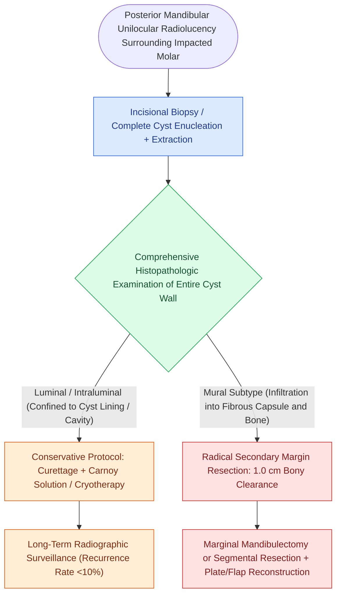

# Unicystic ameloblastoma luminal and intraluminal variants permit conservative enucleation while the mural subtype mandates formal segmental resection

## Active Recall

> [!question]- How do the luminal, intraluminal, and mural variants of unicystic ameloblastoma diverge histologically, and how does this dictate the extent of bone resection?
> *Answer / Clinical Rationale*: **Luminal** variants have neoplastic ameloblastic epithelium confined strictly to the cyst lining; **intraluminal** variants display nodular plexiform projections into the lumen without capsular invasion; **mural** variants exhibit invasive follicular or plexiform tumor nests infiltrating through the fibrous capsule into adjacent trabecular bone. Luminal and intraluminal variants are cured with conservative enucleation and chemical cautery (<10% recurrence), whereas mural variants require formal marginal or segmental mandibulectomy with 1.0 cm bony margins to prevent a 60% to 80% recurrence rate.
>
> [!question]- Why is preoperative incisional biopsy frequently misleading in patients presenting with unilocular radiolucencies around impacted mandibular third molars?
> *Answer / Clinical Rationale*: Incisional biopsy often samples only the superficial luminal cyst lining, falsely diagnosing a benign non-invasive cyst or simple luminal ameloblastoma while missing deep **mural invasion** within other regions of the cyst wall. Pathologic staging requires examination of the entire gross specimen; any histologic evidence of mural capsular invasion mandates secondary surgical re-resection with formal bony margins.

## Core Clinical & Mechanistic Principles

**Unicystic ameloblastoma** represents a distinct clinical and biologic variant accounting for 10% to 15% of all intraosseous ameloblastomas, exhibiting unique demographic, radiographic, and behavioral differences from classic [[Ameloblastoma exhibits multilocular soap-bubble radiolucency and requires segmental resection with one-centimeter bony margins|solid and multicystic ameloblastoma]]:
- **Demographic & Radiographic Presentation**:
  - Affects a younger patient population, peaking in the second and third decades of life (mean age ~22 years).
  - Predominantly localized to the posterior mandible, with >90% occurring in the molar-ramus region.
  - Appears radiographically as a well-defined, unilocular radiolucency frequently surrounding the crown of an unerupted or impacted third molar tooth, clinically mimicking a benign [[Dentigerous cysts arise from the follicular epithelium surrounding the crown of an unerupted third molar|dentigerous cyst]].
- **The Ackermann / Robinson-Martinez Histopathologic Classification**:
  1. *Luminal Unicystic Ameloblastoma*: The lesion is cystic with a fibrous connective tissue wall lined entirely or partially by ameloblastic epithelium displaying hyperchromatic palisading columnar basal cells with reverse nuclear polarity and subnuclear vacuolization.
  2. *Intraluminal (Plexiform) Unicystic Ameloblastoma*: One or more polypoid or nodular masses of ameloblastomatous epithelium project into the cystic lumen, resembling plexiform ameloblastoma, but without invading the underlying fibrous capsule.
  3. *Mural Unicystic Ameloblastoma*: Islands of ameloblastomatous epithelium invade deeply through the fibrous cyst wall, penetrating into the surrounding cancellous bone trabeculae and marrow spaces.

### Surgical Nuance, Chemical Cauterization, & Margin Control

1. **Conservative Management for Luminal and Intraluminal Variants**:
   - Complete enucleation of the cyst with curettage of the bony bed preserves the structural continuity of the mandible and protects the inferior alveolar nerve.
   - **Carnoy's Solution Chemical Cautery**: Following enucleation, the bony cavity is treated with Carnoy's solution (absolute alcohol, chloroform, glacial acetic acid, ferric chloride) for 3 to 5 minutes to chemically devitalize residual microscopic epithelial cells up to 1.5 mm into bone. The inferior alveolar neurovascular bundle must be protected or isolated, as direct contact causes neurolysis.
   - Recurrence rates following enucleation combined with chemical cautery or peripheral ostectomy are exceptionally low (<3% to 10%).
2. **Aggressive Resection Mandate for Mural Variants**:
   - Simple enucleation of mural unicystic ameloblastoma results in a prohibitive recurrence rate of **60% to 80%**, reflecting deep cancellous microinvasion identical to solid ameloblastoma.
   - When mural invasion is identified on permanent pathology, immediate secondary resection is indicated. If the inferior border cortical bone is uninvolved, a marginal mandibulectomy with 1.0 cm linear margins is performed; if the cortical plates or inferior border are violated, segmental mandibulectomy with rigid reconstruction is mandatory.

## Connected Concepts & Graph Traversal

- **Histopathologic Differential**: [[Odontogenic keratocysts arise from PTCH1 mutations in Gorlin syndrome and exhibit high recurrence after simple enucleation|Odontogenic Keratocyst Mimicry]]
- **Conservative Bone Resection**: [[Marginal mandibulectomy preserves basilar bone height when tumor abuts but does not invade marrow|Marginal Mandibulectomy Technique]]
- **Definitive Oncologic Resection**: [[Segmental mandibulectomy resects full-thickness bone for medullary invasion and irradiated bone recurrence|Segmental Mandibulectomy]]
- **Microvascular Mandibular Reconstruction**: [[The fibula osteocutaneous free flap provides up to twenty-five centimeters of vascularized bone for mandible reconstruction|Fibula Free Flap Reconstruction]]
- **Ectopic Salivary Pseudotumor**: [[Stafne bone defects represent asymptomatic cortical lingual mandibular concavities containing ectopic salivary gland tissue|Stafne Defect Radiographic Distinction]]
