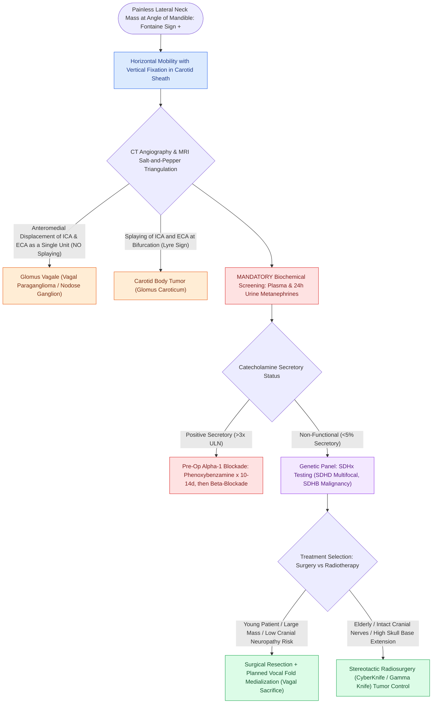

# Vagal paragangliomas present as lateral neck masses with Fontaine sign and anteromedial carotid displacement without bifurcation splaying

## Active Recall

> [!question]- How does cross-sectional vascular imaging reliably differentiate a vagal paraganglioma from a carotid body tumor?
> *Answer / Clinical Rationale*: A vagal paraganglioma **displaces both the ICA and ECA anteromedially as a single unit without splaying them**, whereas a carotid body tumor sits directly within the carotid bifurcation and **splays the ICA and ECA apart (the Lyre sign)**.

> [!question]- What biochemical workup is mandatory for every patient with a suspected head and neck paraganglioma before invasive procedures?
> *Answer / Clinical Rationale*: **Plasma free metanephrines and 24-hour urinary fractionated metanephrines/normetanephrines** to rule out catecholamine-secreting functional tumors and prevent lethal intraoperative hypertensive crises.

> [!question]- Which succinate dehydrogenase mutation confers the highest risk of malignant progression and metastasis in paraganglioma syndromes?
> *Answer / Clinical Rationale*: **$SDHB$ mutations**, which carry a high risk ($30\text{–}50\%$) of malignant transformation and distant metastatic spread.

## Core Clinical & Mechanistic Principles
**Vagal Paragangliomas (Glomus Vagale)** are rare, highly vascular, slow-growing neuroendocrine neoplasms arising from paraganglionic chromaffin tissue along the course of the **vagus nerve (cranial nerve X)**, most commonly from the **inferior vagal ganglion (nodose ganglion)** in the post-styloid [[Deep neck space infections spread along cervical fascial planes between the pharynx, mediastinum, and skull base|parapharyngeal space]]:

- **Clinical Presentation & Physical Signs**:
  - *Painless Lateral Neck Mass*: Located deep to the anterior border of the sternocleidomastoid muscle at the level of the mandibular angle.
  - *The Fontaine Sign*: The mass is **mobile in the horizontal (lateral) plane but fixed in the vertical plane**, pathognomonic of tumors originating within the longitudinally running carotid sheath.
  - *Cranial Neuropathies*: Vagal involvement presents with **hoarseness and vocal fold paralysis** (recurrent laryngeal nerve / vagus sacrifice), breathy phonation, dysphagia, aspiration, and Horner's syndrome (ptosis, miosis, anhidrosis from cervical sympathetic chain compression).
- **Diagnostic Cross-Sectional Imaging**:
  - *Contrast-Enhanced MRI*: Demonstrates a characteristic **"salt-and-pepper" pattern** on T1- and T2-weighted sequences:
    - *"Pepper"*: Multiple serpentine signal voids representing high-flow intratumoral vessels.
    - *"Salt"*: Hyperintense foci representing subacute microhemorrhages or slow flow.
  - *CT Angiography / MRA (The Carotid Splaying Rule)*:
    - Vagal paragangliomas **displace both the Internal Carotid Artery (ICA) and External Carotid Artery (ECA) anteromedially as a single unit without splaying the carotid bifurcation**.
    - *Distinction from Carotid Body Tumors*: Carotid body tumors arise within the bifurcation, splaying the ICA and ECA apart (the classic **"Lyre sign"**).
- **Endocrine Workup & Catecholamine Screening**:
  - Although $<5\%$ of head and neck paragangliomas are functionally active, **all patients must be screened prior to biopsy, angiography, or surgery** with **fractionated plasma free metanephrines** and **24-hour urine metanephrines / normetanephrines**.
  - *Preoperative Alpha-Blockade*: In biochemically functional tumors, initiate **phenoxybenzamine (alpha-1 receptor blockade)** titrated for 10–14 days, followed by beta-blockers, to prevent fatal intraoperative hypertensive crises.
- **Genetic Testing & Hereditary Predisposition**:
  - Hereditary paraganglioma-pheochromocytoma syndromes account for $30\text{–}40\%$ of cases, driven by mutations in the **Succinate Dehydrogenase (*SDHx*) complex**:
    - ***SDHD* (Maternally Imprinted)**: Highest rate of multifocal/bilateral head and neck paragangliomas (transmitted almost exclusively from the father).
    - ***SDHB***: Highest risk of malignant transformation and distant metastatic disease.
    - ***SDHC* & *SDHA***: Lower frequency; complete multigene panel testing is recommended for all diagnosed patients.

### Surgical Technique & Critical Safety Checks
- **Surgical Morbidity & Reanimation Planning**: Complete surgical excision of a vagal paraganglioma inevitably results in **ipsilateral vagal nerve sacrifice**. Preoperatively counsel all patients regarding hoarseness, swallowing rehabilitation, and the necessity of immediate or delayed **vocal fold medialization injection or type I thyroplasty** to restore glottic closure and prevent pulmonary aspiration.

## Connected Concepts & Graph Traversal
- **Parapharyngeal Space Anatomy**: [[The parapharyngeal space is an inverted pyramid connecting peritonsillar, masticator, parotid, and retropharyngeal spaces|Parapharyngeal Space Boundaries]]
- **Carotid Sheath Architecture**: [[Deep cervical fascia divides into superficial, middle, and deep layers that define surgical planes|Deep Cervical Fascia & Carotid Sheath]]
- **🔗 Vocal Fold Medialization (Laryngology)**: [[Type I thyroplasty medializes the vocal fold with conscious voice tuning|Type I Thyroplasty for Vagal Paralysis]]
- **Carotid Paraganglioma Differential**: [[Carotid body paragangliomas splay the bifurcation and are graded by the Shamblin classification|Carotid Body Tumor Differential (Lyre Sign)]]
- **🔗 Skull Base Paraganglioma (Otology)**: [[Jugular paragangliomas arise from the glomus body in the adventitia of the jugular bulb|Jugular Paraganglioma (Glomus Jugulare)]]
- **Neurogenic Displacement Localization**: [[Parapharyngeal space fat and styloid process displacement vectors localize deep neck masses and differentiate parotid, neurogenic, and mucosal lesions|Parapharyngeal Displacement Vectors]]
- **🔗 Pediatric Horner Differential (Pediatrics)**: [[Pediatric head and neck neuroblastoma originates from neural crest sympathoadrenal precursors and carries prognosis dictated by MYCN amplification|Neuroblastoma as Pediatric Horner Mimic]]
