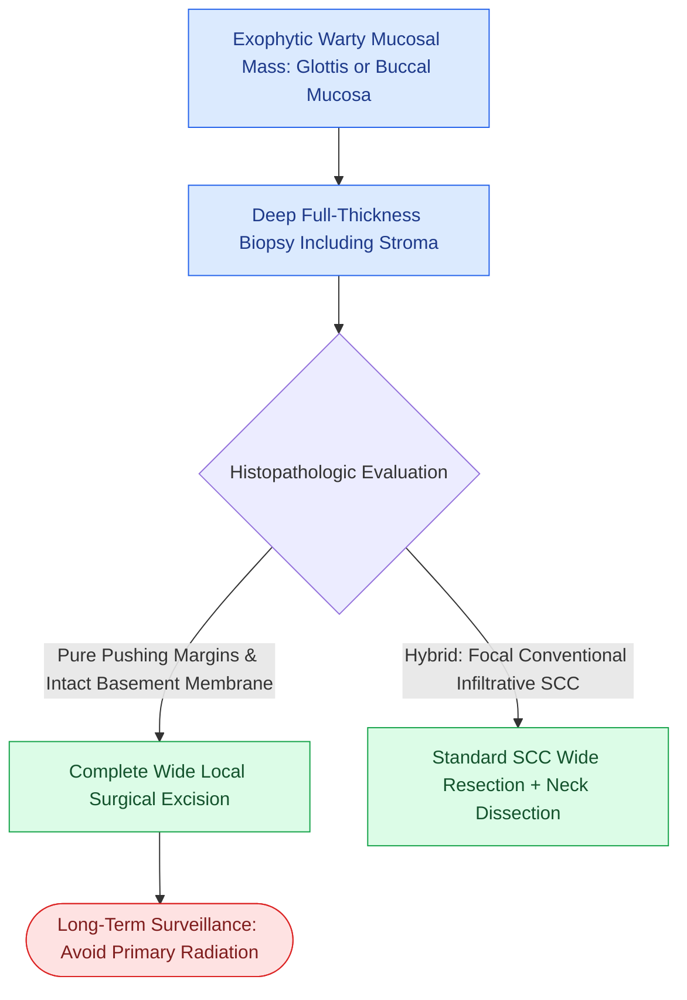

# Verrucous carcinoma exhibits pushing non-infiltrative margins without regional nodal metastasis and is treated with wide local surgical excision

## Active Recall

> [!question]- What are the pathognomonic histologic features of verrucous carcinoma (Ackerman tumor), and why is neck dissection generally omitted?
> *Answer / Clinical Rationale*: Verrucous carcinoma is characterized by **heavily keratinized, exophytic, papillary/cauliflower-like architecture with bulbous rete ridges that exhibit broad, pushing ("elephant-foot") non-infiltrative margins** and a well-differentiated squamous cytologic appearance with minimal atypia. Because pure verrucous carcinoma has **zero intrinsic potential for lymphatic invasion or regional nodal metastasis**, routine elective cervical lymphadenectomy is not indicated.

> [!question]- What is the primary treatment modality for pure verrucous carcinoma, and why is definitive radiation therapy traditionally avoided?
> *Answer / Clinical Rationale*: **Complete surgical wide local excision** with clear margins is the definitive first-line curative modality. Radiation therapy is avoided due to historically lower local control rates compared to surgery and the documented risk of **anaplastic transformation (dedifferentiation into high-grade, aggressive, spindle cell/spindled squamous cell carcinoma)** with high metastatic lethality.

## Core Clinical & Mechanistic Principles
First characterized by Lauren Ackerman in 1948, **verrucous carcinoma** (Ackerman tumor) represents 1% to 3% of all head and neck squamous malignancies, arising most frequently in the oral cavity (buccal mucosa and gingiva, particularly associated with betel nut chewing and tobacco/snuff dipping) and the larynx (true vocal folds and glottic subsites).

### Diagnostic Pitfalls, Staging & Surgical Craft
1. **Biopsy Depth Requirement**:
   - Superficial shave biopsies frequently yield a false-negative diagnosis of benign hyperkeratosis or pseudoepitheliomatous hyperplasia because cytologic atypia and mitoses are exceedingly rare in superficial epithelial layers. A **deep, full-thickness incisional biopsy** extending into the underlying submucosal connective tissue is mandatory to demonstrate the bulbous pushing margin.
2. **Hybrid / Mixed Tumors**:
   - Up to 20% of clinically diagnosed verrucous carcinomas harbor occult foci of conventional invasive [[AJCC 8th edition incorporates depth of invasion into oral cavity T-staging|squamous cell carcinoma]]. If infiltrative stromal invasion is identified, the tumor is classified as a hybrid verrucous-SCC and managed aggressively with standard [[Elective neck dissection is indicated for oral cavity squamous cell carcinoma with depth of invasion exceeding four millimeters|elective neck dissection]].
3. **Surgical Craft Nuance**:
   - **Glottic Subsite**: Managed via [[Transoral resection provides oncologic access for early-stage anterior oral cavity neoplasms|transoral endoscopic excision]] or partial laryngeal resection with organ preservation.
   - **Oral Mucosa Subsite**: Wide mucosal excision with at least 5 mm macroscopic margins. [[Segmental mandibulectomy resects full-thickness bone for medullary invasion and irradiated bone recurrence|Marginal or segmental mandibulectomy]] is required only if true bony erosion is present.

## Connected Concepts & Graph Traversal
- **Conventional SCC Staging**: [[AJCC 8th edition incorporates depth of invasion into oral cavity T-staging|AJCC 8th Edition Oral Cavity Staging]]
- **Elective Neck Management**: [[Elective neck dissection is indicated for oral cavity squamous cell carcinoma with depth of invasion exceeding four millimeters|Elective Neck Dissection Criteria]]
- **Surgical Margin Criteria**: [[Oncologic clear margins require at least five millimeters of histological normal tissue|Surgical Clear Margins (5 mm)]]
- **Differential Aggressive Variants**: [[Tobacco and alcohol carcinogenesis drives TP53 mutation and field cancerization in upper aerodigestive tract|Field Cancerization & Carcinogenesis]]
- **Endoscopic Surgical Craft**: [[Transoral robotic surgery TORS achieves en bloc resection of tonsillar and base of tongue neoplasms|TORS & Transoral Approaches]]
- **Benign Mucosal Mimic**: [[Oral pemphigus vulgaris, mucous membrane pemphigoid, and lichen planus are distinguished by suprabasilar versus subepithelial clefting and direct immunofluorescence patterns|Oral Pemphigus, MMP & Lichen Planus]]
