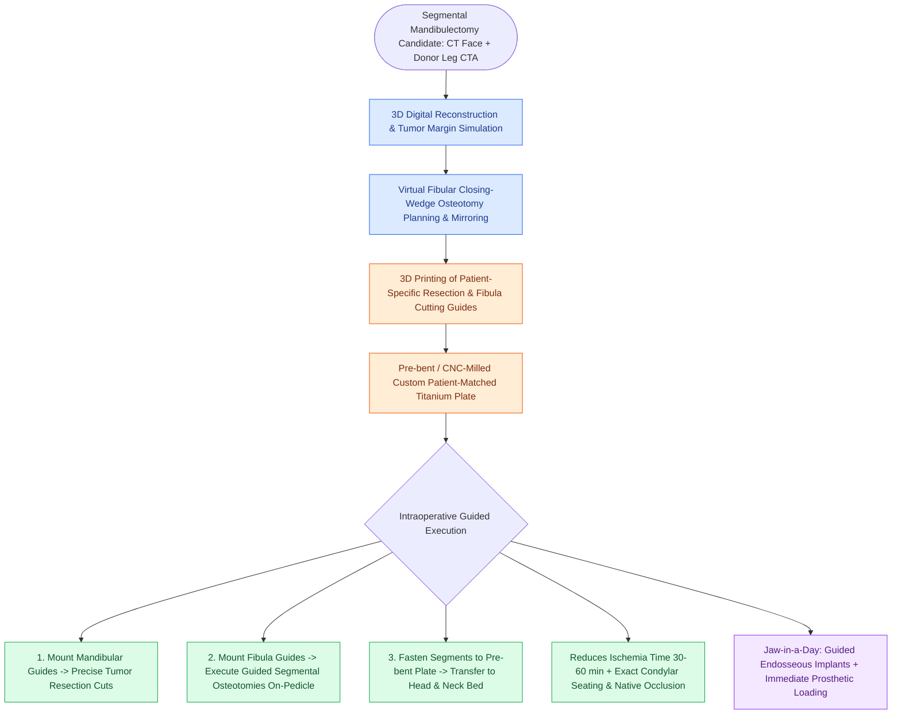

# Virtual surgical planning and 3D cutting guides optimize fibula contouring and dental implant rehabilitation

## Active Recall

> [!question]- How does Virtual Surgical Planning (VSP) reduce microvascular [[Microvascular arterial thrombosis presents with a pale, flat flap and requires immediate surgical exploration|flap ischemia]] time?
> *Answer / Clinical Rationale*: By utilizing **pre-fabricated 3D cutting guides and pre-bent reconstruction plates**, eliminating trial-and-error manual bone contouring.

> [!question]- What is the 'Jaw-in-a-Day' surgical protocol?
> *Answer / Clinical Rationale*: A single-stage procedure combining **mandibular tumor resection, fibula reconstruction, immediate osseointegrated dental implants, and immediate dental prosthesis placement**.

## Core Clinical & Mechanistic Principles
**Virtual Surgical Planning (VSP)** and computer-aided design / computer-aided manufacturing (CAD/CAM) have revolutionized composite mandibular and maxillary reconstruction:
- **Preoperative Digital Workflow**:
  1. High-resolution fine-cut CT of the maxillofacial skeleton and donor lower extremity (CTA/CT).
  2. 3D digital segmentation of the mandibular tumor with defined oncologic resection margins.
  3. Digital virtual harvest and multi-segment closing-wedge osteotomy planning of the fibula to recreate the native mandibular curve.
  4. 3D printing of **sterilizable patient-specific cutting guides** for both the mandible and fibula, and CNC-milling / pre-bending of custom titanium reconstruction plates.
- **Clinical & Functional Benefits**:
  - Drastically reduces intraoperative ischemia time ($30\text{–}60\text{ minutes}$ reduction).
  - Optimizes condylar positioning and dental occlusal relationships.
  - Enables **immediate or delayed osseointegrated dental implant placement** via guided drilling templates.

### Surgical Technique & Critical Safety Checks
- **Jaw-in-a-Day Protocol**: Simultaneous tumor resection, fibula harvest with VSP cutting guides, immediate dental implant placement, and immediate prosthetic dental loading in a single operation (see [[The fibula osteocutaneous free flap provides up to twenty-five centimeters of vascularized bone for mandible reconstruction|Fibula Free Flap Harvest]]).

## Connected Concepts & Graph Traversal
- **Fibula Free Flap Mastercraft**: [[The fibula osteocutaneous free flap provides up to twenty-five centimeters of vascularized bone for mandible reconstruction|Fibula Free Flap Harvest]]
- **AO/ASIF Plate Fixation**: [[Mandibular reconstruction plates require rigid bicortical screw fixation to withstand masticatory load|Mandibular Reconstruction Plates]]
- **Pre-Plating Techniques**: [[Pre-plating the intact mandible before osteotomy preserves accurate dental occlusion and contour|Pre-Plating the Intact Mandible]]
- **Segmental Mandibulectomy**: [[Segmental mandibulectomy resects full-thickness bone for medullary invasion and irradiated bone recurrence|Segmental Mandibulectomy]]
- **Osteotomy Geometry**: [[Step-cut chevron mandibulotomy maximizes bone surface contact and rotational stability|Step-Cut Chevron Mandibulotomy]]
- **Microvascular Monitoring**: [[Postoperative free flap monitoring includes Doppler ultrasound, pinprick bleeding, and capillary refill checks|Postoperative Flap Monitoring]]
