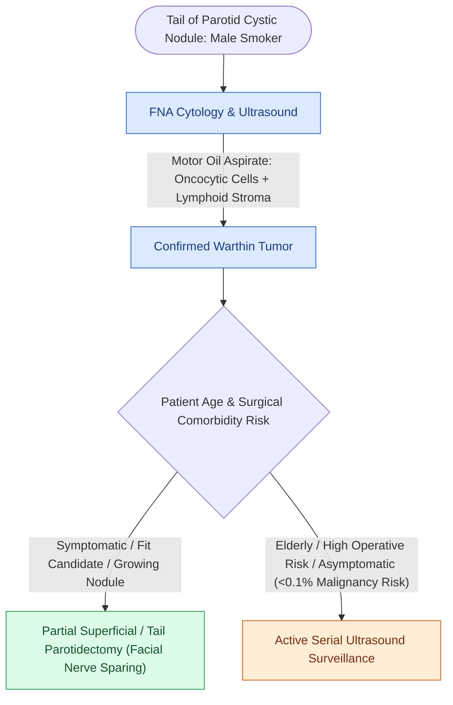

# Warthin tumor presents as a cystic parotid neoplasm associated with smoking and bilateral occurrence

## Active Recall

> [!question]- What clinical risk factor is strongly linked to the development of Warthin tumor?
> *Answer / Clinical Rationale*: **Cigarette smoking** (associated with an 8-fold increased risk).

> [!question]- What is the characteristic fluid appearance on fine-needle aspiration of a Warthin tumor?
> *Answer / Clinical Rationale*: Turbid, dark brown **'motor oil' or chocolate-colored viscous fluid** containing oncocytic cells and lymphocytes.

## Core Clinical & Mechanistic Principles
**Warthin Tumor (Papillary Cystadenoma Lymphomatosum)** is the second most common benign salivary gland neoplasm ($10\text{–}15\%$ of parotid tumors):
- **Clinical & Demographic Features**:
  - Striking association with **cigarette smoking** ($8\times$ relative risk).
  - Male predominance, typically presenting in the 6th–7th decades.
  - **Bilateral in $10\text{–}15\%$** of patients (synchronous or metachronous) and frequently **multifocal** within the same gland.
  - Arises almost exclusively in the **inferior pole (tail) of the parotid gland**.
- **Pathogenesis & Histology**:
  - Arises from heterotopic salivary ductal inclusions entrapped within intraparotid lymph nodes during embryological development.
  - *Classic Biphasic Histology*: Double layer of **tall columnar oncocytic epithelial cells** with granular eosinophilic cytoplasm lining cystic spaces, surrounded by a dense **lymphoid stroma with germinal centers**.

### Surgical Technique & Critical Safety Checks
- **Diagnostic FNA**: Aspirates characteristic dark brown / turbid "motor oil" fluid containing oncocytes and lymphocytes.
- **Management**: Superficial [[The facial nerve main trunk is localized using the tragal pointer, tympanomastoid suture, and digastric ridge|parotidectomy]] (partial superficial or tail resection) or active surveillance in elderly, high-risk surgical patients (malignant transformation is $<0.1\%$).

## Connected Concepts & Graph Traversal
- **Pleomorphic Adenoma**: [[Pleomorphic adenoma requires superficial parotidectomy with a cuff of normal tissue to prevent pseudopod recurrence|Pleomorphic Adenoma]]
- **Superficial Parotidectomy**: [[Superficial parotidectomy dissects the facial nerve branches to resect the lateral salivary lobe|Superficial Parotidectomy]]
- **Frey Syndrome**: [[Frey syndrome results from aberrant auriculotemporal reinnervation of sweat glands after parotidectomy|Frey Syndrome]]
- **Anatomical Foundation**: [[Ludwig angina presents with bilateral submandibular cellulitis and woody floor of mouth induration compromising the airway]]
- **Surgical Lymphadenectomy**: [[Carotid blowout syndrome is classified into threatened, impending, and acute hemorrhage]]
- **Oncologic Resection & Margins**: [[Transoral resection provides oncologic access for early-stage anterior oral cavity neoplasms]]
- **Aerodigestive / Pharyngolaryngeal**: [[Postcricoid hypopharyngeal carcinoma frequently invades the cervical esophagus and bilateral RLNs]]
