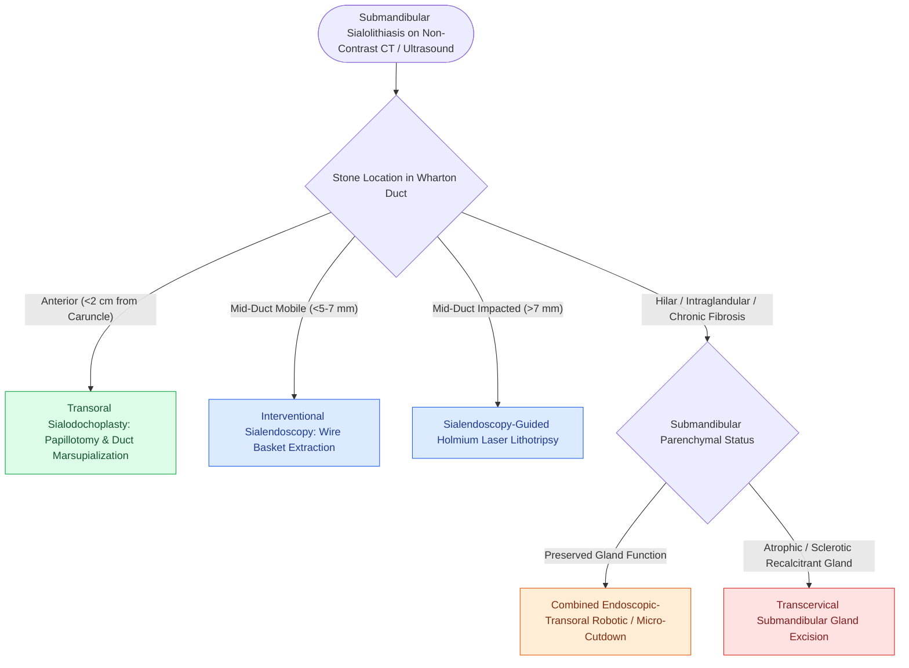

# Wharton duct sialolithiasis is managed with transoral sialodochoplasty or sialendoscopy

## Active Recall

> [!question]- Why are submandibular stones much more common than parotid stones?
> *Answer / Clinical Rationale*: Submandibular saliva is **more viscous, alkaline, and calcium-rich**, and Wharton's duct has an **uphill anti-gravity drainage course** with a narrower punctum.

> [!question]- What is the relationship between the lingual nerve and Wharton's duct in the posterior floor of mouth?
> *Answer / Clinical Rationale*: The lingual nerve **crosses under Wharton's duct from lateral to medial** near the posterior border of the mylohyoid muscle.

## Core Clinical & Mechanistic Principles
The **submandibular gland** is the most common site of salivary calculi ($80\text{–}90\%$ of all sialolithiasis) due to dependent alkaline saliva, high calcium/phosphate content, and the uphill anti-gravity course of **Wharton's duct**:
- **Diagnostic Evaluation**:
  - Bimanual palpation along the floor of mouth.
  - Non-contrast CT ($>80\%$ of submandibular stones are radio-opaque).
  - High-resolution ultrasound.
- **Treatment Algorithms by Stone Location**:
  1. **Anterior / Distal Duct Stones (within $2.0\text{ cm}$ of punctum)**:
     - **Transoral Sialodochoplasty (Ductotomy)** under local anesthesia: Place a traction suture behind the stone, cut longitudinally over the stone directly onto the calculus, extract stone, and marsupialize the duct edges to the floor of mouth mucosa.
  2. **Mid-Duct / Proximal Stones**:
     - **[[Sialendoscopy enables diagnostic visualization and stone extraction in chronic obstructive sialadenitis|Interventional Sialendoscopy]]** with stone basket extraction or holmium laser lithotripsy.
  3. **Hilus / Intraglandular Stones ($>8\text{ mm}$ or parenchyma destruction)**:
     - Combined transoral/sialendoscopic approach or **[[Submandibular gland excision requires preservation of the marginal mandibular, lingual, and hypoglossal nerves|submandibular gland excision]]**.

## References
1. Abdel Razek, A.A.K., Mukherji, S. (2017). Imaging of sialadenitis. *Neuroradiol J*, 30(3):205-215.
2. Jackson, N.M., Mitchell, J.L., Walvekar, R.R. (2020). Inflammatory Disorders of the Salivary Glands. In Flint, P.W., et al. (Eds.), *Cummings Otolaryngology Head and Neck Surgery* 7e (pp. 1157-1170). Philadelphia, PA: Elsevier.
3. Roland, L.T., Skillington, S.A., Ogden, M.A. (2017). Sialendoscopy-assisted transfacial removal of parotid sialoliths: A systematic review and meta-analysis. *Laryngoscope*, 127(11):2510-2516.

## Connected Concepts & Graph Traversal
- **Submandibular Excision Technique**: [[Submandibular gland excision requires preservation of the marginal mandibular, lingual, and hypoglossal nerves|Submandibular Gland Sialoadenectomy]]
- **Interventional Sialendoscopy**: [[Sialendoscopy enables diagnostic visualization and stone extraction in chronic obstructive sialadenitis|Diagnostic & Interventional Sialendoscopy]]
- **General Sialolithiasis Algorithm**: [[Salivary gland sialolithiasis management ranges from manual massage to sialendoscopy based on stone size and location|Salivary Sialolithiasis Management Tree]]
- **Floor of Mouth Relocation**: [[Floor of mouth carcinoma requires sublingual gland excision and Wharton duct relocation|Wharton Duct Relocation in FOM Surgery]]
- **Suppurative Sialadenitis**: [[Suppurative sialadenitis of the parotid and submandibular glands is treated with hydration, sialagogues, and anti-staphylococcal antibiotics|Acute Suppurative Sialadenitis]]
- **Martin's Maneuver**: [[Subplatysmal flap elevation and Martin's maneuver protect the marginal mandibular nerve|MMN Protection in Submandibular Surgery]]
