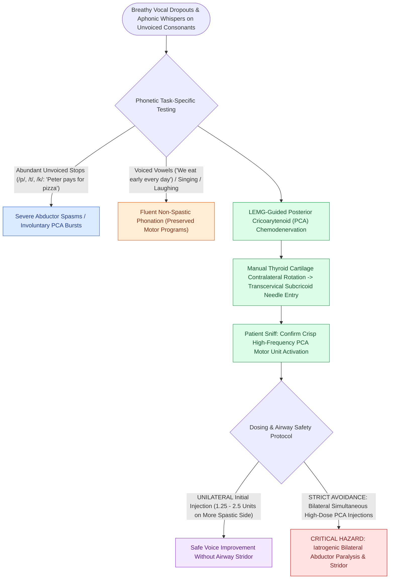

# Abductor spasmodic dysphonia causes breathy voice breaks treated with PCA Botox

## Active Recall

> [!question]- What phonetic stimuli trigger voice breaks in abductor spasmodic dysphonia versus [[Adductor spasmodic dysphonia causes strained voice breaks treated with thyroarytenoid Botox|adductor spasmodic dysphonia]]?
> *Answer / Clinical Rationale*: ABSD is triggered by **unvoiced consonants** (e.g., /p/, /t/, /k/, /s/, /h/ in *"Harry has hot soup"*), whereas ADSD is triggered by **voiced vowels** (e.g., *"We eat eight eggs"*).

> [!question]- Why are bilateral simultaneous PCA Botox injections rarely performed in ABSD?
> *Answer / Clinical Rationale*: The PCA is the **sole abductor** of the vocal folds; paralyzing both PCAs simultaneously causes iatrogenic bilateral abductor paralysis, severe inspiratory stridor, and acute airway compromise.

## Core Clinical & Mechanistic Principles
**Abductor Spasmodic Dysphonia (ABSD)** is a focal laryngeal dystonia characterized by intermittent, involuntary hyperkinetic contractions of the [[The posterior cricoarytenoid is the sole vocal fold abductor|posterior cricoarytenoid (PCA)]] muscles during speech.

### Pathophysiology & Task-Specific Phenotype
- **Unvoiced Consonant Spasms**: Spasmodic bursts of PCA activation occur characteristically during the transition from **unvoiced consonants** (such as /p/, /t/, /k/, /s/, /h/) to vowels (e.g., *"Harry has hot soup"*, *"Peter pays for pizza"*).
- **Vocal Quality**: Breathy voice dropouts, prolonged unvoiced whispers, sudden aphonic breaks, and severe vocal air wastage.
- **Differentiating from Muscle Tension Dysphonia**: ABSD symptoms worsen under emotional stress and phone conversations, but improve during laughing, singing, or sensory tricks (*geste antagoniste*).

## Electromyographic Technique & Injection Protocol
- **Target Muscle**: The Posterior Cricoarytenoid (PCA) muscle.
- **Dosage**: **$1.25\text{ to }5.0\text{ units}$ of Botox** per injection.
- **Unilateral vs Staged Bilateral Protocol**: Because the PCA is the sole vocal fold abductor, **bilateral simultaneous high-dose PCA injections are strictly avoided** to prevent acute [[Bilateral abductor vocal fold paralysis causes acute airway compromise requiring glottic enlargement|bilateral abductor paralysis]] and life-threatening stridor. Clinicians typically perform unilateral PCA injection or asymmetric staged dosing.
- **LEMG Needle Vector**: 
  1. Rotate the [[Thyroplasty cartilage window dimensions differ between males and females|thyroid cartilage]] framework manually to the contralateral side.
  2. Insert the hollow-bore recording needle from the posterior-inferior border of the [[Cricotracheal resection removes subglottic stenosis while sparing posterior cricoid and RLNs|cricoid lamina]], directing anteromedially into the PCA muscle belly.
  3. Verify placement by having the patient perform a sharp **inspiratory sniff** (producing crisp, high-frequency motor unit recruitment).

## Critical Failure Modes & Error Traps
- **Bilateral Airway Obstruction**: Overdosing or injecting both PCA muscles simultaneously can eliminate vocal fold abduction, precipitating acute upper airway compromise requiring emergency tracheostomy.

## Connected Concepts & Graph Traversal
- **Contrasting Dystonia**: [[Adductor spasmodic dysphonia causes strained voice breaks treated with thyroarytenoid Botox|Adductor Spasmodic Dysphonia (ADSD)]]
- **Target Muscle**: [[The posterior cricoarytenoid is the sole vocal fold abductor|Posterior Cricoarytenoid (PCA) Muscle]]
- **Diagnostic Verification**: [[Laryngeal electromyography differentiates vocal fold paralysis from joint fixation|LEMG Activation with Sniff]]
- **Avoided Airway Emergency**: [[Bilateral abductor vocal fold paralysis causes acute airway compromise requiring glottic enlargement|Bilateral Abductor Paralysis]]
- **Clinical Management**: [[Thyroplasty cartilage window dimensions differ between males and females|Thyroplasty Window Dimensions]]
