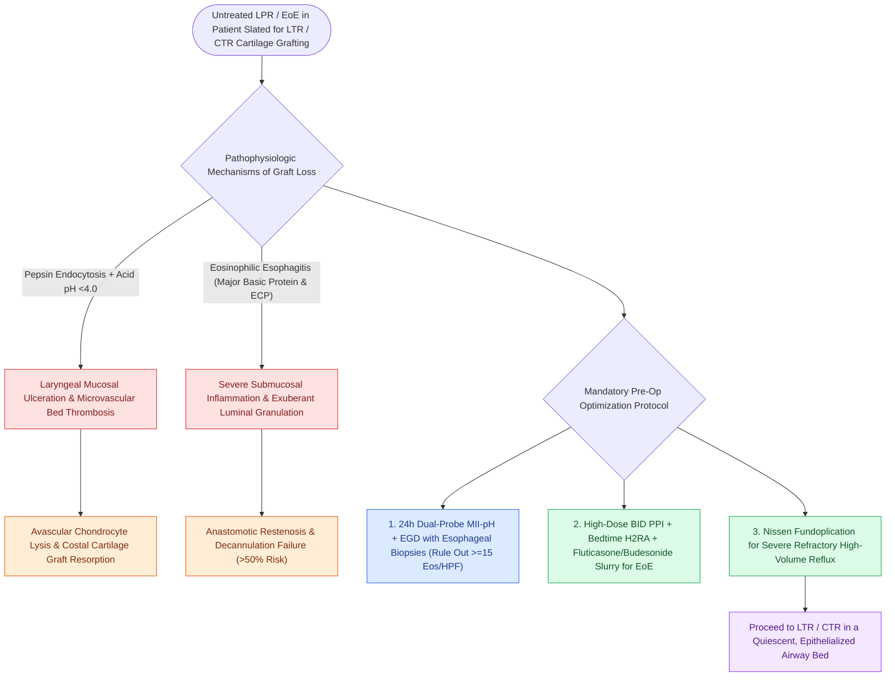

# Active reflux and eosinophilic esophagitis compromise airway graft survival

## Active Recall

> [!question]- Why does active laryngopharyngeal reflux lead to costal cartilage graft failure in LTR?
> *Answer / Clinical Rationale*: Pepsin and gastric acid induce mucosal ulceration and microvascular thrombosis; because the newly grafted costal cartilage relies on diffusion and rapid mucosal re-vascularization, reflux-induced ischemia causes chondrocyte lysis, chondromalacia, and complete graft resorption.

> [!question]- What preoperative gastrointestinal diagnostic evaluation is mandatory in pediatric patients undergoing complex airway reconstruction?
> *Answer / Clinical Rationale*: Dual-probe 24-hour pH/impedance monitoring and **EGD with esophageal biopsies** to actively diagnose and treat reflux and eosinophilic esophagitis before surgery.

## Core Clinical & Mechanistic Principles
Uncontrolled **[[Laryngopharyngeal reflux presents with globus and throat clearing but responds inconsistently to empiric PPIs|Laryngopharyngeal Reflux]] (LPR)** and mucosal inflammatory disorders such as **Eosinophilic Esophagitis (EoE)** are the most frequent causes of delayed cartilage graft resorption, microvascular failure, granulation tissue proliferation, and restenosis following airway reconstruction.

### Pathophysiological Mechanisms of Graft Destruction
1. **Pepsin & Gastric Acid Micro-Aspiration**:
   - Pepsin penetrates deep into the laryngeal and tracheal mucosal intercellular spaces, where it is endocytosed by laryngeal epithelial cells and chondrocytes.
   - Low acidic pH ($<4.0$) activates intracellular pepsin, triggering cell lysis, disruption of extracellular matrix, and profound breakdown of [[Hyaluronic acid regulates lamina propria hydration and shock absorption|hyaluronic acid]] and collagen scaffolds.
2. **Ischemic Chondrocyte Necrosis**:
   - Non-vascularized [[Laryngotracheal reconstruction expands the airway using carved costal cartilage grafts|costal cartilage grafts]] rely on plasmatic diffusion across the raw mucosal bed. Acidic reflux exposure induces intense microvascular thrombosis and mucosal ulceration, devitalizing the graft and leading to complete **cartilage graft chondromalacia / resorption**.
3. **EoE-Mediated Eosinophilic Major Basic Protein**:
   - Eosinophil degranulation releases Major Basic Protein (MBP) and Eosinophil Cationic Protein (ECP), which directly damage airway perichondrium and stimulate aggressive granulation tissue formation.

## Mandatory Preoperative Optimization Protocol
Prior to performing Laryngotracheal Reconstruction (LTR) or [[Cricotracheal resection removes subglottic stenosis while sparing posterior cricoid and RLNs|Cricotracheal Resection (CTR)]]:
1. **Aggressive Acid Suppression**: High-dose proton pump inhibitors (PPI, twice daily) combined with an $\text{H}_2$-receptor antagonist at bedtime.
2. **Diagnostic Confirmation**: 24-hour dual-probe pH-impedance testing and esophagogastroduodenoscopy (EGD) with proximal and distal esophageal biopsies (to rule out EoE: $\ge 15\text{ eosinophils/HPF}$).
3. **Surgical Fundoplication**: Patients with severe, medically refractory LPR must undergo **Nissen fundoplication** prior to open airway reconstruction.

## Critical Failure Modes & Error Traps
- **Operating in an Inflamed Field**: Performing open airway reconstruction in a patient with active untreated LPR or EoE results in a $>50\%$ rate of graft dehiscence, exuberant granulation tissue, and anastomotic restenosis.

## Connected Concepts & Graph Traversal
- **Reflux Diagnostics**: [[Laryngopharyngeal reflux presents with globus and throat clearing but responds inconsistently to empiric PPIs|LPR Diagnosis]]
- **Graft Reconstruction**: [[Two-stage LTR maintains a tracheostomy with prolonged endolaryngeal stenting|Two-Stage LTR Stenting]]
- **Stenosis Grading**: [[The Cotton-Myer classification grades subglottic stenosis by luminal reduction|Cotton-Myer Classification]]
- **Esophageal Motility**: [[High-resolution manometry classifies achalasia and esophageal motility disorders by the Chicago criteria|High-Resolution Manometry]]
- **Airway Dilation**: [[Endoscopic airway dilation combines radial incisions with balloon bronchoplasty|Endoscopic Airway Dilation]]
