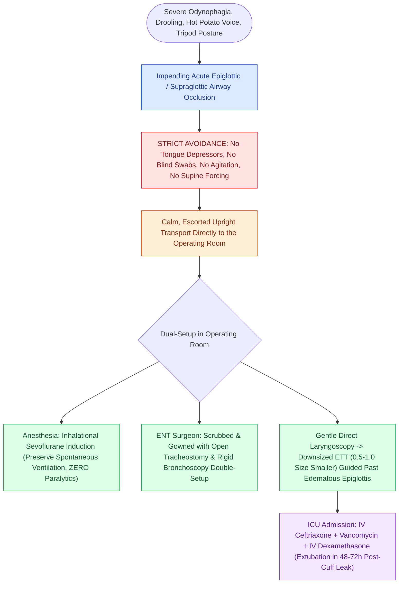

# Acute epiglottitis presents with rapid-onset odynophagia, fever, and the tripod sign requiring immediate airway protection

## Active Recall

> [!question]- Why is pharyngeal examination with a tongue depressor strictly contraindicated in a patient suspected of having acute epiglottitis?
> *Answer / Clinical Rationale*: Mechanical stimulation or gagging induced by a tongue depressor can trigger sudden, fatal **reflex laryngospasm** or cause the heavily edematous, trapdoor-like epiglottis to impact tightly over the narrowed laryngeal inlet, causing instantaneous total airway occlusion.

> [!question]- What classic sign on a lateral soft tissue neck radiograph confirms the diagnosis of acute epiglottitis?
> *Answer / Clinical Rationale*: The **"thumbprint sign" (or thumb sign)**, representing the markedly swollen, rounded, radiopaque silhouette of the epiglottis protruding into the hypopharyngeal airway space, accompanied by obliteration of the vallecular air space.

## Core Clinical & Mechanistic Principles

**Acute epiglottitis (supraglottitis)** is a rapidly progressive, life-threatening bacterial cellulitis of the epiglottis, aryepiglottic folds, arytenoids, and false vocal folds (supraglottic structures). Historically a pediatric disease driven by **Haemophilus influenzae type b (Hib)**, routine Hib vaccination has shifted the epidemiological peak toward adults (mean age 45–55 years), where pathogens include **Streptococcus pneumoniae**, **Group A Streptococcus (S. pyogenes)**, **Staphylococcus aureus** (including MRSA), and *Klebsiella pneumoniae*.

The supraglottic submucosa is loose and highly vascular, allowing rapid inflammatory fluid accumulation. Swelling of the epiglottis curls it posteriorly like a trapdoor, while edematous aryepiglottic folds prolapse into the glottic aperture, creating dynamic upper airway obstruction.

Classic clinical manifestations include:
- **The "4 D's"**: **Dysphagia**, **Dysphonia** (muffled "hot potato" voice), **Drooling** (due to severe odynophagia), and **Distress**.
- **Tripod / Sniffing Posture**: Patient sits upright, leaning forward, with neck extended and jaw thrust forward to mechanically align the airway axes and maximize supraglottic caliber.
- **Pain out of proportion to pharyngeal exam**: Oropharynx appears normal, but palpation of the hyoid/thyrohyoid membrane elicits exquisite tenderness.
- **Radiographic "Thumbprint Sign"**: Lateral soft-tissue neck X-ray reveals an enlarged, rounded, edematous epiglottis resembling a human thumb, with effacement of the vallecula.

### Surgical Technique & Craft Nuance: Controlled Airway Securement

1. **Avoid Agitation & Blind Probing**: In pediatric or severe adult presentations, **never** perform blind pharyngeal instrumentation with a tongue blade or force the patient supine, as acute laryngospasm, epiglottic impaction, and cardiorespiratory arrest can occur instantaneously.
2. **Flexible Fiberoptic Evaluation**: In cooperative, non-distressed adults, cautious awake flexible nasopharyngoscopy in an upright position in a monitored resuscitation bay can directly visualize the fiery red, "cherry-red" swollen epiglottis. In severe respiratory distress or pediatric patients, skip bedside endoscopy and transport directly to the OR.
3. **Operating Room Intubation Protocol**:
   - The ENT surgeon scrubbed with a sterile tracheotomy set and rigid bronchoscope open on the field.
   - Anesthesia performs inhalational induction with sevoflurane in 100% $O_2$, maintaining spontaneous ventilation. Muscle relaxants are strictly avoided until the airway is secure.
   - Direct laryngoscopy (using a Macintosh or video laryngoscope) exposes the swollen epiglottis. An endotracheal tube **one full size smaller** than age-predicted is carefully guided into the posterior glottic chink.
4. **Medical Pharmacotherapy**: Once intubated, obtain blood cultures and throat swabs, and initiate **IV Ceftriaxone (2 g IV q24h) PLUS Vancomycin (15–20 mg/kg IV q12h)** and IV **dexamethasone (10 mg IV q8h)**. Extubation is planned in 48–72 hours following repeat flexible fiberoptic confirmation of epiglottic edema resolution and a positive cuff leak.

### Key Consultation Supplies
- Personal protective equipment (PPE): Face shield, mask, gown, gloves
- Portable flexible video nasopharyngolaryngoscope with recording monitor
- Topical decongestant/anesthetic spray (0.05% oxymetazoline / 4% lidocaine)
- Oxygen delivery adjuncts: Humidified nasal cannula, non-rebreather mask, blow-by oxygen tubing
- Immediate OR transport cart: Open pediatric and adult rigid bronchoscopy set, Parsons/Dedo direct laryngoscopes, video laryngoscope, cuffed and uncuffed endotracheal tubes (including 0.5–1.0 size smaller than age-predicted), and sterile emergency open [[Standard open tracheotomy utilizes horizontal intersinusoidal or Bjork flap entry|cricothyrotomy/tracheostomy]] tray

> [!example]- **Operative Note Template: Urgent direct laryngoscopy and endotracheal intubation under inhalational general anesthesia with open tracheostomy double-setup**
> **PREOPERATIVE DIAGNOSIS**: Acute epiglottitis / supraglottitis with impending airway compromise
> **POSTOPERATIVE DIAGNOSIS**: Acute epiglottitis / supraglottitis with impending airway compromise
> **PROCEDURE**: Urgent direct laryngoscopy and endotracheal intubation under inhalational general anesthesia with open tracheostomy double-setup
> **SURGEON**: [Surgeon Name, MD]
> **ASSISTANT**: [Resident/Fellow Name, MD]
> ANESTHESIA: General inhalational anesthesia (Sevoflurane / 100% O2) maintaining spontaneous ventilation
> ESTIMATED BLOOD LOSS: None
> SPECIMENS: Blood cultures, epiglottic surface swab for Gram stain and aerobic/anaerobic cultures
> INDICATION: [Patient age]-year-old presenting with acute onset severe odynophagia, tripod positioning, drooling, muffled voice, and lateral neck radiograph showing classic "thumbprint sign."
>
> **PROCEDURE IN DETAIL**:
> The patient was escorted directly to the operating room by the surgical and anesthesia teams, maintaining a calm, seated upright posture. Standard monitors were applied. The surgical team was fully scrubbed with a sterile tracheotomy set opened and illuminated on the field.
>
> Inhalational induction with sevoflurane in 100% oxygen was initiated while strictly preserving spontaneous respiration; no neuromuscular blocking agents were administered. Once an adequate depth of anesthesia was achieved, gentle direct laryngoscopy was performed using a Macintosh [or Miller / Parsons] blade. Direct visualization revealed a profoundly edematous, fiery cherry-red epiglottis with marked swelling of bilateral aryepiglottic folds and arytenoids, severely narrowing the glottic aperture. Under direct visualization, an endotracheal tube (size [X.X] mm, one full size smaller than standard) with a loaded stylet was smoothly passed through the posterior glottic chink into the trachea. Bilateral breath sounds and end-tidal CO2 were immediately confirmed. Epiglottic surface swabs and blood cultures were obtained. The endotracheal tube was securely taped, and the patient was transferred to the Pediatric/Adult ICU intubated in stable condition.

## References
1. Guardiani, E., Bliss, M., Harley, E. (2010). Supraglottitis in the era of Haemophilus influenzae type B: A 20-year experience. *Laryngoscope*, 120(11):2180-2185.
2. Sidell, D.R., Messner, A.H. (2020). Evaluation and Management of the Pediatric Airway. In *Cummings Otolaryngology Head and Neck Surgery* 7e (pp. 3053-3067). Philadelphia, PA: Elsevier.
3. Tuchman, J.B., Mehta, D.K. (2013). Complex Upper Airway Problems. In Johnson, J.J., Rosen, C.A. (Eds.), *Bailey’s Head and Neck Surgery-Otolaryngology* 5e (pp. 896-907). Baltimore, MD: Lippincott Williams & Wilkins.

## Connected Concepts & Graph Traversal
- **🔗 Differential Airway Stridor (Pediatrics)**: [[Pediatric stertor and stridor differentiate upper supraglottic airway obstruction from intrathoracic tracheobronchial disease|Pediatric Stridor Localization]]
- **Supraglottic Sensation & Anatomy**: [[The superior laryngeal nerve provides supraglottic sensation and cricothyroid motor control|Superior Laryngeal Nerve]]
- **Alternative Medical Airway Emergency**: [[Mast cell-mediated histaminergic angioedema responds rapidly to epinephrine, antihistamines, and corticosteroids|Acute Angioedema]]
- **Emergency Surgical Airway**: [[Standard open tracheotomy utilizes horizontal intersinusoidal or Bjork flap entry|Emergency Surgical Airway]]
- **🔗 Deep Neck Infection Differential (Head and Neck)**: [[Deep neck space infections spread along cervical fascial planes between the pharynx, mediastinum, and skull base|Deep Cervical Space Infection]]
- **🔗 Toxic Subglottic Differential (Pediatrics)**: [[Bacterial tracheitis presents with toxic croup-like stridor, high fever, and thick subglottic mucopurulent pseudomembranes requiring urgent airway debridement|Bacterial Tracheitis]]
