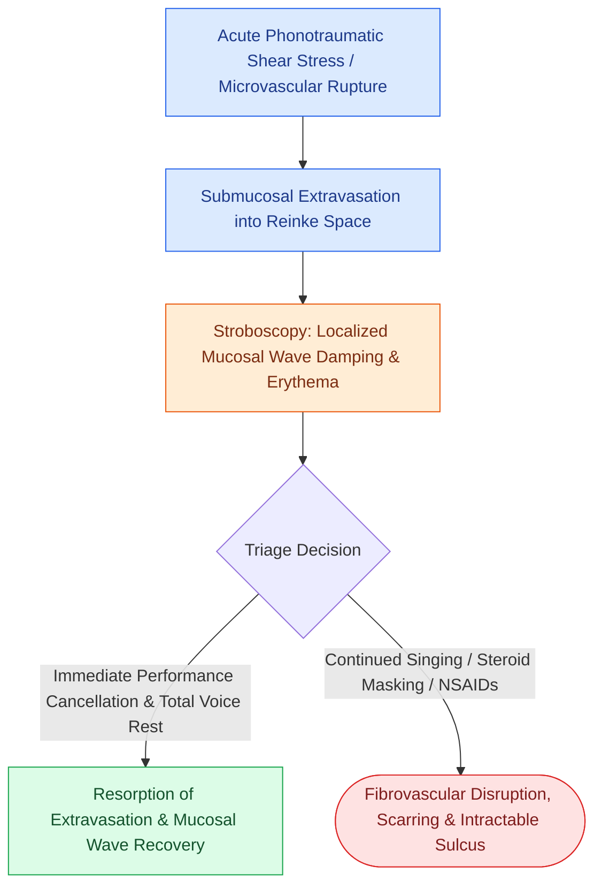

# Acute vocal fold hemorrhage requires strict voice rest and absolute performance cancellation to prevent permanent fibrovascular scarring

## Active Recall

> [!question]- What is the pathognomonic stroboscopic finding of an acute vocal fold hemorrhage, and what is the cardinal management rule for an elite vocal performer?
> *Answer / Clinical Rationale*: Stroboscopy demonstrates **erythematous extravasation of blood within the superficial lamina propria (Reinke space) with localized loss or severe damping of the mucosal vibratory wave**. The cardinal management rule is **strict total voice rest and absolute performance cancellation**; singing or vocal projection during acute hemorrhage risks shearing the delicate microvasculature, leading to organization into a fibrotic nodule, fibrous scar, or intractable vocal fold cyst with permanent loss of the mucosal wave.

> [!question]- What pharmacological agents are strictly contraindicated during acute vocal fold hemorrhage?
> *Answer / Clinical Rationale*: **Nonsteroidal anti-inflammatory drugs (NSAIDs), aspirin, and anticoagulants** are contraindicated due to platelet inhibition exacerbating the hematoma. Furthermore, **drying antihistamines, decongestants, and intramuscular steroid "quick fixes" used to push through a performance** must be strictly avoided, as masking acute phonotrauma under forced phonation drastically accelerates mucosal tearing and scarring.

## Core Clinical & Mechanistic Principles
**Acute vocal fold hemorrhage** is a true phoniatric emergency resulting from the rupture of a submucosal microvascular capillary or ectasia within the [[The vocal fold comprises five distinct histological layers|superficial lamina propria (Reinke space)]]. It typically occurs following sudden, intense phonotrauma (e.g., shouting, screaming, forceful coughing, or strenuous singing outside of the natural tessitura/range) or during premenstrual mucosal vascular engorgement.

### Clinical Evaluation, Staging & Craft Nuance
1. **Differentiating Hemorrhage from Laryngitis**:
   - [[Laryngopharyngeal reflux presents with globus and throat clearing but responds inconsistently to empiric PPIs|Acute laryngitis]] produces diffuse bilateral erythema and edema with preserved (though sluggish) mucosal waves. In contrast, **vocal fold hemorrhage** is typically unilateral and characterized by a discrete, pooling hematoma within Reinke space that completely dampens the traveling mucosal wave on videostroboscopy.
2. **Management Protocol**:
   - **Absolute Voice Rest**: Minimum 7 to 14 days of complete voice rest until stroboscopy verifies total resorption of the hematoma and return of mucosal pliability.
   - **Vocal Hygiene & Hydration**: Aggressive systemic hydration, ambient humidification, and high-dose antireflux therapy to prevent contact irritation.
   - **Delayed Surgical Intervention**: Microvascular [[Phonomicrosurgery requires suspension laryngoscopy and stereoscopic magnification|phonomicrosurgical cold instrument excision or pulsed angiolytic KTP laser ablation]] is reserved only for persistent organizing ectasias or post-hemorrhagic varices once the acute inflammatory phase has completely settled.

## Connected Concepts & Graph Traversal
- **Histological Bedrock**: [[The vocal fold comprises five distinct histological layers|Layered Structure of Lamina Propria]]
- **Microflap Craft**: [[Phonomicrosurgery requires suspension laryngoscopy and stereoscopic magnification|Phonomicrosurgery Technique]]
- **Reflux Exacerbation**: [[Laryngopharyngeal reflux presents with globus and throat clearing but responds inconsistently to empiric PPIs|Laryngopharyngeal Reflux]]
- **Differential Polypoid Lesions**: [[Vocal fold polyps arise from phonotraumatic microvascular injury in Reinke's space|Vocal Fold Polyps]]
- **Surgical Laser Modalities**: [[The KTP laser targets oxyhemoglobin at 532 nm for photoangiolysis|Angiolytic KTP Laser Craft]]
