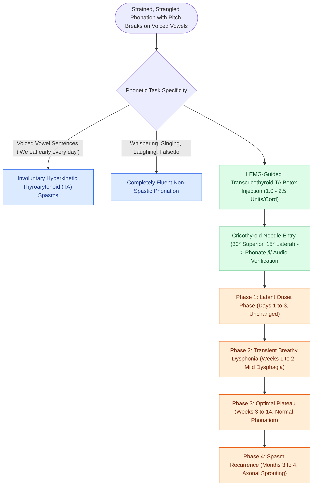

# Adductor spasmodic dysphonia causes strained voice breaks treated with thyroarytenoid Botox

## Active Recall

> [!question]- What speech stimulus triggers characteristic voice breaks in adductor spasmodic dysphonia?
> *Answer / Clinical Rationale*: **Voiced vowels and voiced consonants** (e.g., sentences with all-voiced sounds like *"We eat eight eggs"*), whereas non-speech tasks (singing, laughing) are spared.

> [!question]- What is the target muscle and typical initial dose for Botulinum toxin injection in ADSD?
> *Answer / Clinical Rationale*: The **Thyroarytenoid (TA) muscle**, with an initial dose of **$1.0\text{ to }2.5\text{ units}$** of Botulinum Toxin A per vocal fold under LEMG guidance.

## Core Clinical & Mechanistic Principles
**Adductor Spasmodic Dysphonia (ADSD)** is a task-specific focal laryngeal dystonia characterized by involuntary, hyperkinetic spasms of the vocal fold adductor muscles during speech.

### Pathophysiology & Task-Specific Phenotype
- **Basal Ganglia Dysfunction**: Caused by central motor processing abnormalities within the cortico-striato-thalamo-cortical loops and basal ganglia networks.
- **Voiced Phoneme Spasms**: Hyperadduction spasms occur characteristically during the production of **voiced phonemes, vowels, and connected speech** (e.g., *"We eat eight eggs every day"*).
- **Vocal Quality**: Strained, strangled, effortful voice with pitch breaks, glottic stops, and phonatory arrests.
- **Task Specificity**: Phonation during non-speech tasks (coughing, laughing, singing, pitch-glides, or speaking in falsetto) is characteristically spared.

## Electromyographic & Surgical Technique
- **First-Line Gold Standard**: Targeted injection of **Botulinum Toxin A (Botox)** into the [[The thyroarytenoid muscle modulates glottal stiffness and adduction|Thyroarytenoid (TA) muscles]].
- **Dosage**: Initial starting dose is typically **$1.0\text{ to }2.5\text{ units}$ of Botox** per vocal fold (bilateral or unilateral).
- **Electromyographic (LEMG) Guidance**: 
  1. Patient is supine. A monopolar hollow-bore EMG needle is passed through the cricothyroid membrane paramedian, angled 30° superiorly and 15° laterally into the TA muscle belly.
  2. Correct placement is confirmed by crisp motor unit discharge sounds on the EMG audio monitor when the patient phonates /i/.
  3. The Botox solution is slowly injected.

## Post-Injection Clinical Cycle
1. **Days 1–3**: Latent phase.
2. **Weeks 1–2**: Transient breathy dysphonia and mild liquid dysphagia (due to chemical paresis of the TA).
3. **Weeks 3–14**: Optimal stable phonation (absence of spasms; clear, effortless voice).
4. **Months 3–4**: Gradual return of mild spasms as motor endplates sprout new axonal terminals, prompting repeat injection.

## Critical Failure Modes & Error Traps
- **Overdosage**: Doses exceeding 3–5 units bilaterally can cause profound breathy aphonia and severe aspiration of thin liquids for several weeks.

## Connected Concepts & Graph Traversal
- **Muscle Anatomy**: [[The thyroarytenoid muscle modulates glottal stiffness and adduction|Thyroarytenoid Muscle]]
- **Vocal Abductor**: [[The posterior cricoarytenoid is the sole vocal fold abductor|Posterior Cricoarytenoid (PCA)]]
- **Diagnostic Stroboscopy**: [[Videostroboscopy visualizes mucosal wave dynamics and glottal closure|Videostroboscopy]]
- **Muscle Tension Differential**: [[Muscle tension dysphonia arises from supraglottic hyperfunction and responds to circumlaryngeal voice therapy|Muscle Tension Dysphonia]]
- **LEMG Confirmation**: [[Laryngeal electromyography differentiates vocal fold paralysis from joint fixation|LEMG Confirmation]]
