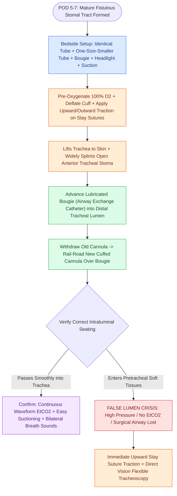

# Adult tracheostomy tube exchange at one week requires a mature tract, tracheal stay sutures, and bougie guidance

## Active Recall

> [!question]- Why is the initial tracheostomy tube exchange strictly avoided before postoperative day 5 to 7 in open tracheostomy?
> *Answer / Clinical Rationale*: Prior to day 5–7, the surgical tract between the skin and the tracheal lumen is an **immature, unepithelialized fibroareolar space**. Attempting tube exchange through an immature stoma carries a high risk of pushing the new cannula into the pretracheal or paratracheal soft tissue, creating a fatal **false lumen** and complete airway obstruction.

> [!question]- What physical maneuver utilizing lateral tracheal stay sutures facilitates emergency recannulation if a tube is accidentally dislodged?
> *Answer / Clinical Rationale*: Pulling the lateral stay sutures **anteriorly (upward) and laterally (outward)**. This lifts the trachea up against the anterior cervical skin and physically pulls the lateral margins of the tracheal incision apart, creating a widely patent, direct portal into the tracheal lumen.

## Core Clinical & Mechanistic Principles

**The first tracheostomy tube exchange** is a critical postoperative milestone typically scheduled between **postoperative day 5 and 7**. Prior to postoperative day 5, the stomal tract between the anterior cervical skin and tracheal lumen is immature and comprised of loose fibroareolar tissue. Premature dislodgement or forceful re-insertion into an immature stoma risks entering the pretracheal or paratracheal soft tissues, creating a fatal **false lumen** with acute airway loss and tension pneumomediastinum.

By day 5–7, granulation tissue and fibrous bridging establish a defined, mature fistulous tract. Safety measures during open tracheotomy include the placement of lateral **[[Tracheal stay sutures prevent false tract entry during accidental decannulation|tracheal stay sutures]]** (e.g., 2-0 or 3-0 Prolene or silk anchored through the anterior tracheal rings on either side of the tracheotomy) or a [[The Bjork flap facilitates emergency tracheostomy recannulation|Björk flap]] (inferiorly based tracheal flap sutured to the inferior skin edge). Traction applied upward and outward on lateral stay sutures lifts the trachea anteriorly toward the skin surface and splints open the stoma, facilitating rapid and accurate recannulation.

### Surgical Technique & Craft Nuance: Step-by-Step First Exchange

1. **Equipment Readiness**: Essential bedside equipment includes:
   - Identical size tracheostomy tube AND a tube **one size smaller** (with corresponding obturators).
   - Suction setup with French catheters and Yankauer.
   - Tracheal dilator (Trousseau dilator or Laborde 3-bladed dilator).
   - Lubricated endotracheal **bougie (Cook airway exchange catheter)**.
   - Headlight, 10 mL syringe for cuff deflation, and supplemental $O_2$.
2. **Pre-Oxygenation & Suctioning**: The patient is pre-oxygenated with 100% $O_2$, the cuff is suctioned above the cuff and deflated, and the neck is slightly extended with a shoulder roll.
3. **Stay Suture Traction**: Lateral tracheal stay sutures (labeled "Left" and "Right") are identified. An assistant applies steady anterior and lateral traction on both stay sutures to pull the trachea against the anterior neck wall.
4. **Bougie-Assisted Exchange**: A lubricated bougie is introduced through the existing tracheostomy tube into the distal trachea. The old tube is withdrawn over the bougie while maintaining the bougie in the tracheal lumen. The new, lubricated, cuffed tube with obturator (or rail-roaded over the bougie) is smoothly advanced into the trachea with a 90-degree rotary motion following the tracheal curve.
5. **Confirmation of Placement**: Immediate confirmation of correct intratracheal positioning is verified by:
   - Waveform **end-tidal $CO_2$ ($EtCO_2$)** or colorimetric capnography.
   - Equal bilateral chest rise and breath sounds.
   - Free passage of a flexible suction catheter into the distal bronchus.
   - Flexible tracheoscopy if any resistance is encountered.
## References
1. Mitchell, R.B., Hussey, H.M., Setzen, G., et al. (2013). Clinical consensus statement: Tracheostomy care. *Otolaryngol Head Neck Surg*, 148(1):6-20.
2. Kraft, S.M., Schindler, J.S. (2020). Tracheotomy. In Flint, P.W., et al. (Eds.), *Cummings Otolaryngology Head and Neck Surgery* 7e (pp. 95-103). Philadelphia, PA: Elsevier.
3. Durbin Jr., C.G. (2010). Tracheostomy: why, when, and how? *Respir Care*, 55(8):1056-1068.

## Connected Concepts & Graph Traversal
- **Surgical Flap Alternative**: [[The Bjork flap facilitates emergency tracheostomy recannulation|Björk Flap Technique]]
- **Primary Open Procedure**: [[Standard open tracheotomy utilizes horizontal intersinusoidal or Bjork flap entry|Standard Open Tracheotomy]]
- **Percutaneous Alternative**: [[Percutaneous dilatational tracheostomy utilizes bronchoscopic guidance and Seldinger dilation between tracheal rings|Percutaneous Tracheostomy]]
- **Critical Vascular Complication**: [[Tracheoinnominate fistula presents with sentinel bleeding requiring hyperinflation tamponade and emergency surgical ligation|Tracheoinnominate Fistula]]
- **Emergency Resuscitation Protocol**: [[Total laryngectomy stomas and tracheostomies require distinct emergency airway resuscitation algorithms|Laryngectomy vs Trach Resuscitation]]
