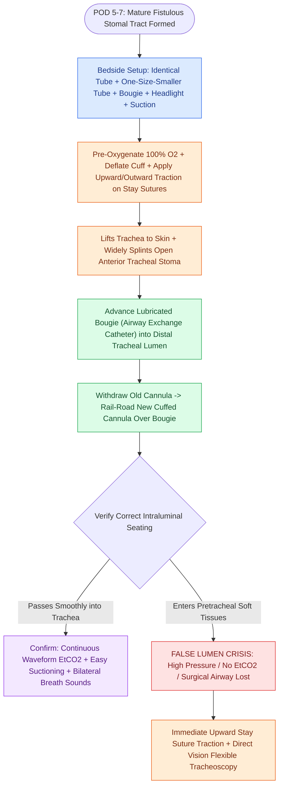

# Adult tracheostomy tube exchange at one week requires a mature tract, tracheal stay sutures, and bougie guidance

## Active Recall

> [!question]- Why is the initial tracheostomy tube exchange strictly avoided before postoperative day 5 to 7 in open tracheostomy?
> *Answer / Clinical Rationale*: Prior to day 5–7, the surgical tract between the skin and the tracheal lumen is an **immature, unepithelialized fibroareolar space**. Attempting tube exchange through an immature stoma carries a high risk of pushing the new cannula into the pretracheal or paratracheal soft tissue, creating a fatal **false lumen** and complete airway obstruction.

> [!question]- What physical maneuver utilizing lateral tracheal stay sutures facilitates emergency recannulation if a tube is accidentally dislodged?
> *Answer / Clinical Rationale*: Pulling the lateral stay sutures **anteriorly (upward) and laterally (outward)**. This lifts the trachea up against the anterior cervical skin and physically pulls the lateral margins of the tracheal incision apart, creating a widely patent, direct portal into the tracheal lumen.

## Core Clinical & Mechanistic Principles

**The first tracheostomy tube exchange** is a critical postoperative milestone typically scheduled between **postoperative day 5 and 7**. Prior to postoperative day 5, the stomal tract between the anterior cervical skin and tracheal lumen is immature and comprised of loose fibroareolar tissue. Premature dislodgement or forceful re-insertion into an immature stoma risks entering the pretracheal or paratracheal soft tissues, creating a fatal **false lumen** with acute airway loss and tension pneumomediastinum.

By day 5–7, granulation tissue and fibrous bridging establish a defined, mature fistulous tract. Safety measures during open tracheotomy include the placement of lateral **[[Tracheal stay sutures prevent false tract entry during accidental decannulation|tracheal stay sutures]]** (e.g., 2-0 or 3-0 Prolene or silk anchored through the anterior tracheal rings on either side of the tracheotomy) or a [[The Bjork flap facilitates emergency tracheostomy recannulation|Björk flap]] (inferiorly based tracheal flap sutured to the inferior skin edge). Traction applied upward and outward on lateral stay sutures lifts the trachea anteriorly toward the skin surface and splints open the stoma, facilitating rapid and accurate recannulation.

### Surgical Technique & Craft Nuance: Step-by-Step First Exchange

1. **Equipment Readiness & Two-Provider Standard**: Minimum two providers (physician + RT/nurse) at bedside with:
   - Pre-tested, water-soluble lubricated target tracheostomy tube AND a **backup tube one size smaller** (with obturators).
   - Suction setup (French catheters, Yankauer), **Vienna or Killian nasal speculum** / Trousseau or Laborde tracheal dilator, Army-Navy/Senn retractors, cricoid hook.
   - Lubricated endotracheal **bougie (Cook airway exchange catheter)**, **flexible fiberoptic tracheoscope/bronchoscope**, headlight, 10 mL syringe (air for [[Shiley, Bivona, and Portex tracheostomy tubes differ in cannula design, cuff profile, and airway resistance|Shiley]], sterile water for Bivona TTS), and oral intubation gear.
2. **Pre-Oxygenation & Suctioning**: Pre-oxygenate with **$100\%\text{ }FiO_2$ for 3–5 minutes**, position supine with gentle neck extension, deeply suction oral cavity and airway, cut retention sutures while stabilizing flanges, and completely deflate the cuff.
3. **Stay Suture Traction & Direct Nasal Speculum Visualization**: Apply upward and outward traction on labeled lateral stay sutures and immediately insert a **nasal speculum** into the stoma, spreading gently to directly visualize the glistening white cartilaginous tracheal rings. *Never advance a new tube blindly against resistance.*
4. **Insertion, Obturator Removal & Bougie Option**: Smoothly advance the lubricated tube along the tract curve (or rail-road over a lubricated bougie passed through the old tube in deep/obese necks or recent PDT), **instantly withdraw the occlusive obturator**, insert the inner cannula, and inflate the cuff.
5. **Objective Triad Confirmation & Collar Fit**: Immediately verify (1) continuous waveform **$EtCO_2$**, (2) equal bilateral chest rise and breath sounds, and (3) **flexible fiberoptic tracheoscopy** confirming the distal tip sits centered in the true lumen **$>2\text{–}3\text{ cm}$ above the carina** without bevel impingement. Fasten the collar with two fingerbreadths of clearance.
6. **Recognizing a False Passage**: Zero $EtCO_2$, peak inspiratory pressure $>40\text{ cm }H_2O$, progressive subcutaneous crepitus, and absent breath sounds indicate pretracheal false passage—remove the tube immediately, pull stay sutures to expose the true lumen, or orally intubate from above.

> [!example]- **Operative Note Template: Bedside tracheostomy tube exchange**
> **PROCEDURE**: Bedside tracheostomy tube exchange
> **PRE-PROCEDURAL DIAGNOSIS**: Tracheostomy-dependent state requiring routine tube exchange / downsizing
> **POST-PROCEDURAL DIAGNOSIS**: Tracheostomy-dependent state status-post successful tube exchange
> **SURGEON**: [Surgeon Name, MD] | **ASSISTANT**: [Resident/Fellow Name, MD], [RT/RN Name]
>
> **PROCEDURE IN DETAIL**:
> After consent, surgical pause, supine positioning, and 3 minutes of 100% $FiO_2$ pre-oxygenation, deep suctioning and diagnostic tracheoscopy confirmed a mature tract without granulation or erosion. Retention sutures were cut, cuff completely deflated, and the old tube withdrawn while maintaining direct stomal visualization with a nasal speculum. A pre-tested, lubricated replacement tube was inserted smoothly without resistance, the obturator immediately removed, inner cannula secured, and cuff inflated to 22 cm $H_2O$. Waveform $EtCO_2$, symmetric bilateral breath sounds, and flexible fiberoptic confirmation (>2 cm above carina) were verified, and the flange secured with two fingerbreadths of clearance.

## References
1. Mitchell, R.B., Hussey, H.M., Setzen, G., et al. (2013). Clinical consensus statement: Tracheostomy care. *Otolaryngol Head Neck Surg*, 148(1):6-20.
2. Kraft, S.M., Schindler, J.S. (2020). Tracheotomy. In Flint, P.W., et al. (Eds.), *Cummings Otolaryngology Head and Neck Surgery* 7e (pp. 95-103). Philadelphia, PA: Elsevier.
3. Durbin Jr., C.G. (2010). Tracheostomy: why, when, and how? *Respir Care*, 55(8):1056-1068.

## Connected Concepts & Graph Traversal
- **Surgical Flap Alternative**: [[The Bjork flap facilitates emergency tracheostomy recannulation|Björk Flap Technique]]
- **Primary Open Procedure**: [[Standard open tracheotomy utilizes horizontal intersinusoidal or Bjork flap entry|Standard Open Tracheotomy]]
- **Percutaneous Alternative**: [[Percutaneous dilatational tracheostomy utilizes bronchoscopic guidance and Seldinger dilation between tracheal rings|Percutaneous Tracheostomy]]
- **Tube System Differences**: [[Shiley, Bivona, and Portex tracheostomy tubes differ in cannula design, cuff profile, and airway resistance|Shiley vs Bivona vs Portex]]
- **Stomal Bleeding Rescue**: [[Tracheostomy stomal bleeding is controlled with cuff overinflation, hemostatic agents, and silver nitrate cautery|Stomal Bleeding Management]]
- **Critical Vascular Complication**: [[Tracheoinnominate fistula presents with sentinel bleeding requiring hyperinflation tamponade and emergency surgical ligation|Tracheoinnominate Fistula]]
- **Emergency Resuscitation Protocol**: [[Total laryngectomy stomas and tracheostomies require distinct emergency airway resuscitation algorithms|Laryngectomy vs Trach Resuscitation]]
