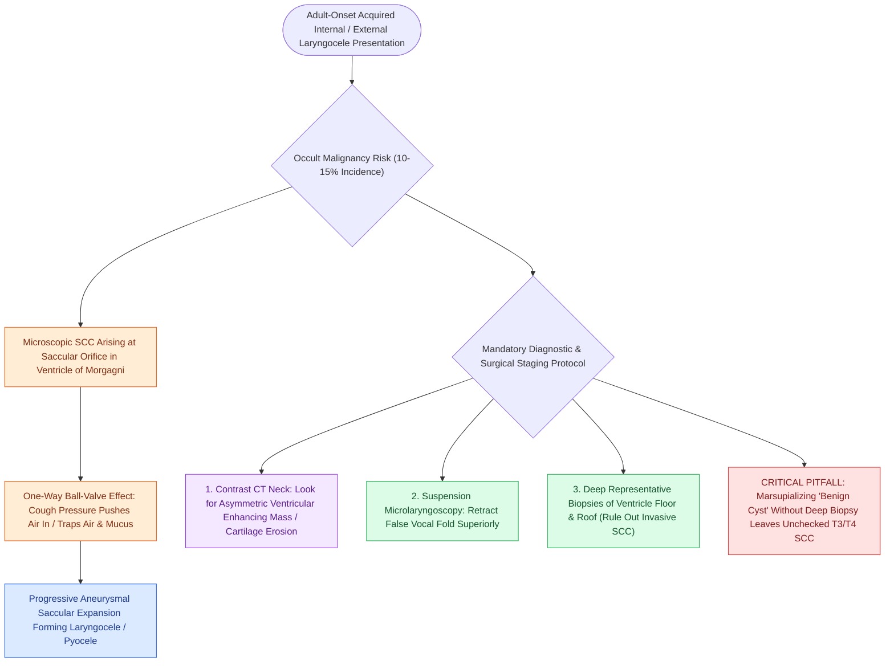

# Adult-onset laryngoceles require ventricular biopsy to rule out occult SCC

## Active Recall

> [!question]- Why must an adult with a newly diagnosed laryngocele undergo deep endoscopic biopsy of the laryngeal ventricle?
> *Answer / Clinical Rationale*: Up to **$10\text{–}15\%$ of adult-onset laryngoceles** are caused by an **occult squamous cell carcinoma** obstructing the narrow orifice of the saccule, creating a one-way ball-valve that traps air and mucus.

> [!question]- What anatomical structure must be retracted during direct laryngoscopy to inspect the saccular orifice?
> *Answer / Clinical Rationale*: The **false vocal cord (ventricular fold)** must be elevated to visualize the floor and anterior roof of the ventricle of Morgagni.

## Core Clinical & Mechanistic Principles
In adults presenting with an acquired, unilateral **[[Internal laryngoceles present as supraglottic masses medial to thyroid cartilage|internal]] or [[External laryngoceles herniate through the thyrohyoid membrane into the lateral neck|external laryngocele]]**, up to **10% to 15% of cases** are secondary to an underlying **occult Squamous Cell Carcinoma (SCC)** arising within the laryngeal ventricle or false vocal cord.

### Ball-Valve Pathophysiology
1. **Occult Neoplasm at Saccular Orifice**: A microscopic or small invasive carcinoma originates within the depths of the laryngeal ventricle (Morgagni's ventricle) or the base of the saccule.
2. **One-Way Ball-Valve Obstruction**: The tumor mass partially occludes the narrow neck/orifice of the saccule, acting as a one-way ball-valve:
   - High intralaryngeal pressure during coughing or phonation forces air and mucus past the obstruction into the saccular lumen.
   - The tumor prevents normal retrograde venting and mucus drainage, trapping air and secretions under pressure.
3. **Progressive Saccular Dilation**: The saccule progressively expands to form a symptomatic secondary laryngocele or laryngopyocele.

## Mandatory Clinical & Diagnostic Workup
- **Contrast-Enhanced CT Neck**: Essential to evaluate for asymmetrical soft tissue enhancement, mucosal thickening, or cartilage erosion at the base of the saccule.
- **Operative Suspension Microlaryngoscopy & Ventricular Biopsy**: 
  - Every adult patient with an acquired laryngocele **must undergo direct operative microlaryngoscopy**.
  - The false vocal cord must be gently retracted with a blunt elevator or micro-forceps, and the entire floor and roof of the **[[The laryngeal ventricle separates supraglottic and glottic lymphatic pathways|laryngeal ventricle of Morgagni]] must be visualized and biopsied under magnification**.
  - Blindly excising or marsupializing a laryngocele without obtaining deep ventricular biopsies risks missing an early, curable laryngeal cancer until it progresses to unresectable T3/T4 disease.

## Critical Failure Modes & Error Traps
- **Treating Only the "Cyst"**: Dismissing a new adult laryngocele as simple "benign dilation" without performing deep biopsies of the ventricle leads to delayed cancer diagnosis, regional nodal metastases, and poor survival.

## Connected Concepts & Graph Traversal
- **Internal Pathology**: [[Internal laryngoceles present as supraglottic masses medial to thyroid cartilage|Internal Laryngoceles]]
- **External Pathology**: [[External laryngoceles herniate through the thyrohyoid membrane into the lateral neck|External Laryngoceles]]
- **Endoscopic Visualization**: [[Phonomicrosurgery requires suspension laryngoscopy and stereoscopic magnification|Suspension Microlaryngoscopy Setup]]
- **Oncologic Staging & Surgery**: [[Total laryngectomy achieves en bloc laryngeal resection with permanent end-stoma|Total Laryngectomy]]
- **Clinical Management**: [[The laryngeal ventricle separates supraglottic and glottic lymphatic pathways|Laryngeal Embryologic Boundary]]
