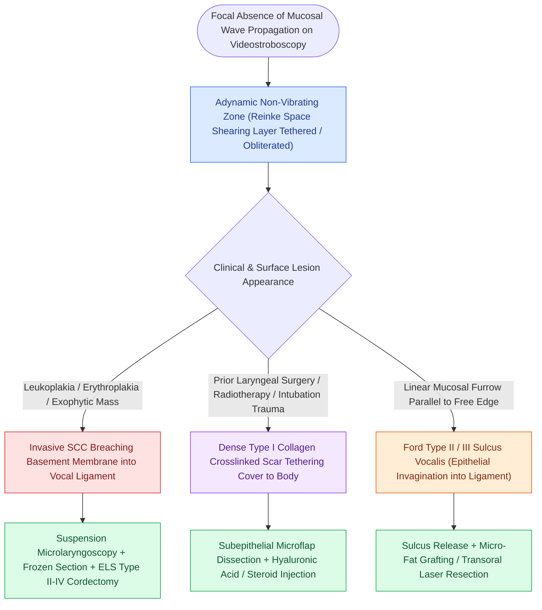

# Adynamic vocal fold segments indicate mucosal stiffening, malignancy, or scar

## Active Recall

> [!question]- Why does an adynamic segment on videostroboscopy raise high clinical suspicion for invasive carcinoma in a patient with vocal fold leukoplakia?
> *Answer / Clinical Rationale*: Superficial dysplasia remains confined to the epithelium and preserves some mucosal wave; loss of the mucosal wave (adynamic segment) indicates tumor invasion through the basement membrane into the underlying vocal ligament or vocalis muscle.

> [!question]- What non-malignant condition most commonly produces an adynamic segment?
> *Answer / Clinical Rationale*: Vocal fold scarring or Ford Type III sulcus vocalis, where dense Type I collagen tethers the epithelium directly to the [[The deep lamina propria provides tensile stiffness via crosslinked collagen|deep lamina propria]].

## Core Clinical & Mechanistic Principles
An **adynamic segment** (or **non-vibrating zone**) is defined on [[Videostroboscopy visualizes mucosal wave dynamics and glottal closure|videostroboscopy]] as a focal, localized segment along the free edge or superior surface of the vocal fold that exhibits complete absence of [[The mucosal wave travels as a fluid mechanical displacement|mucosal wave]] propagation during phonation, while the remainder of the vocal fold vibrates.

### Underlying Pathophysiological Mechanisms
The generation of a mucosal wave requires a pliable shearing plane within [[The superficial lamina propria acts as a pliable shearing fluid bed|Reinke's space]]. An adynamic zone occurs when this shearing mechanism is destroyed by one of three primary mechanisms:
1. **Malignant Infiltration**: Carcinoma cells breach the [[The basement membrane zone anchors epithelium to superficial lamina propria|basement membrane zone]] and invade into the [[The vocal ligament comprises intermediate and deep lamina propria|vocal ligament]] or [[The thyrovocalis muscle provides isometric pitch and tension control|vocalis muscle]], tethering the cover to the stiff body.
2. **Dense Collagenous Scarring**: Traumatic, surgical, or post-radiotherapy fibroblast activation deposits crosslinked Type I collagen, obliterating the [[Hyaluronic acid regulates lamina propria hydration and shock absorption|hyaluronic acid]] matrix (see [[Vocal fold scar results from disorganized Type I collagen deposition|vocal fold scar]]).
3. **Severe Sulcus Vocalis**: Deep epithelial invagination into the vocal ligament in Ford Type II or III [[Sulcus vocalis manifests as mucosal furrowing staged by the Ford classification|sulcus vocalis]].

## Diagnostic & Oncologic Significance
- **Hallmark of Micro-Invasion**: In the presence of a leukoplakic or erythroplakic lesion, an adynamic segment strongly suggests micro-invasive or invasive squamous cell carcinoma rather than simple benign hyperkeratosis or mild dysplasia.
- **Surgical Margin Planning**: Preoperative mapping of the adynamic segment guides the required depth of resection in [[The ELS classification categorizes endoscopic cordectomies from Types I to VI|transoral laser microsurgery (cordectomy)]].

## Critical Failure Modes & Error Traps
- **Benign vs Malignant Confounding**: Severe post-surgical scar can look identical to malignant recurrence on stroboscopy (both cause adynamic zones). Operative direct laryngoscopy with palpation and biopsy is mandatory if malignancy cannot be excluded.

## Connected Concepts & Graph Traversal
- **Mucosal Wave Dynamics**: [[The mucosal wave travels as a fluid mechanical displacement|Mucosal Wave Mechanics]]
- **Histological Layers**: [[The vocal fold comprises five distinct histological layers|Five Histological Layers]]
- **Vocal Ligament Anchor**: [[The vocal ligament comprises intermediate and deep lamina propria|Vocal Ligament]]
- **Stroboscopic Assessment**: [[Videostroboscopy visualizes mucosal wave dynamics and glottal closure|Videostroboscopy]]
- **Phonomicrosurgery**: [[Phonomicrosurgery requires suspension laryngoscopy and stereoscopic magnification|Phonomicrosurgery Technique]]
