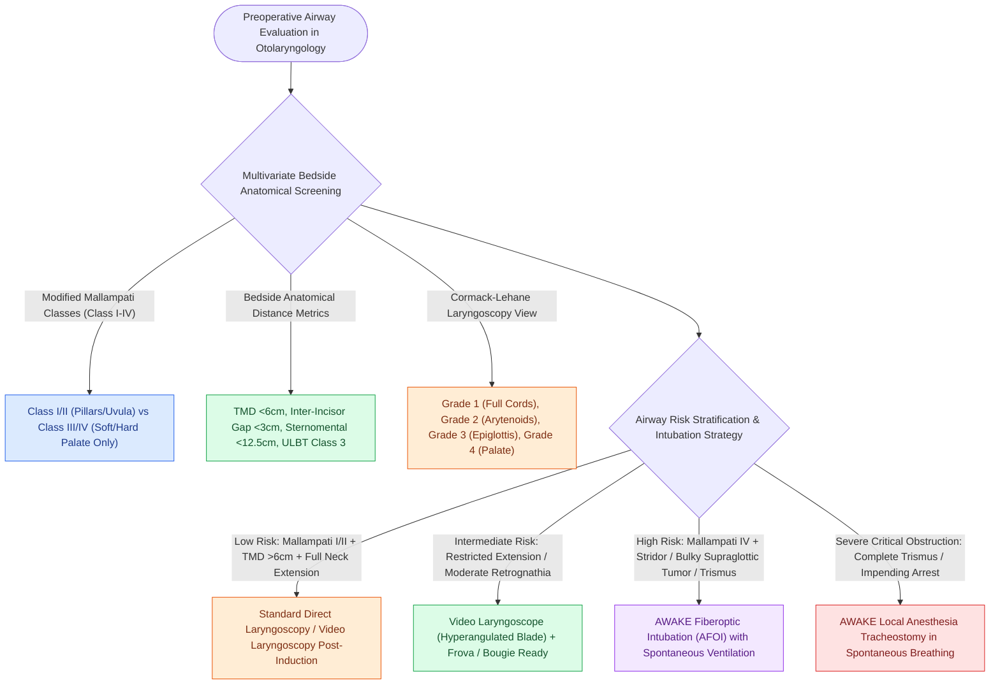

# Airway assessment classifications predict difficult direct laryngoscopy using anatomical landmarks

## Active Recall

> [!question]- What anatomical structures are visible in Modified Mallampati Classes I through IV?
> *Answer / Clinical Rationale*: With the patient seated upright, mouth open maximally, tongue protruded, and *without phonation*: - **Class I**: Soft palate, fauces, uvula, and anterior/posterior tonsillar pillars fully visible. - **Class II**: Soft palate, fauces, and uvula visible; pillars hidden by tongue base. - **Class III**: Soft palate and base of uvula visible only. - **Class IV**: Hard palate only visible (soft palate completely obscured).

> [!question]- What laryngeal structures are seen in Cormack-Lehane laryngoscopy Grades 1 through 4?
> *Answer / Clinical Rationale*: - **Grade 1**: Complete view of the entire vocal cords and glottic aperture. - **Grade 2**: Partial view of the glottis (posterior vocal cords / arytenoids visible; 2a: partial cords, 2b: arytenoids only). - **Grade 3**: Epiglottis visible only; no vocal cords or glottic aperture seen (3a: epiglottis can be lifted; 3b: epiglottis adherent to posterior pharynx). - **Grade 4**: Neither glottis nor epiglottis visible (soft palate only).

> [!question]- What critical bedside anthropometric dimensions flag an impending difficult intubation?
> *Answer / Clinical Rationale*: - **Thyromental Distance (TMD)**: $<6.0\text{ cm}$ ($<3$ fingerbreadths from thyroid notch to tip of mentum with neck extended). - **Inter-incisor Gap (Mouth Opening)**: $<3.0\text{–}3.5\text{ cm}$ ($<2$ fingerbreadths). - **Sternomental Distance**: $<12.5\text{ cm}$. - **Upper Lip Bite Test (ULBT) Class 3**: Lower incisors cannot reach or bite the upper lip.

## Core Clinical & Mechanistic Principles
Preoperative airway evaluation combines multiple anatomical scoring systems to stratify the risk of **Difficult Mask Ventilation (DMV)** and **Difficult Direct Laryngoscopy (DDL)**:

### Anesthetic Decision Tree
- **Anticipated Difficult Airway (Mallampati IV + TMD $<6\text{ cm}$ + Stridor/Tumor)**: Induction with neuromuscular blockade is contraindicated; the gold standard is **Awake Fiberoptic Intubation (AFOI)** or **[[Standard open tracheotomy utilizes horizontal intersinusoidal or Bjork flap entry|Tracheostomy]] under Local Anesthesia**.

## Connected Concepts & Graph Traversal
- **Awake Intubation Strategy**: [[Emergency cricothyrotomy provides rapid airway access through the cricothyroid membrane|Cricothyrotomy Emergency Protocol]]
- **Malignant Hyperthermia**: [[Malignant hyperthermia is triggered by volatile anesthetics and succinylcholine and treated with immediate intravenous dantrolene|Malignant Hyperthermia Resuscitation]]
- **Local Anesthetic Toxicity**: [[Local anesthetic systemic toxicity LAST is managed with airway stabilization and twenty percent intravenous lipid emulsion|LAST Management]]
- **Laryngeal Microsurgery**: [[Phonomicrosurgery requires suspension laryngoscopy and stereoscopic magnification|Suspension Laryngoscopy Craft]]
- **🔗 Deep Neck Space Obstruction (Head and Neck)**: [[Ludwig angina presents with bilateral submandibular cellulitis and woody floor of mouth induration compromising the airway|Ludwig Angina Airway Compromise]]
