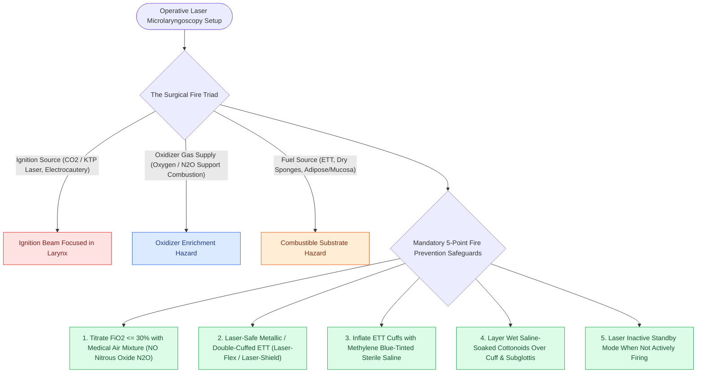
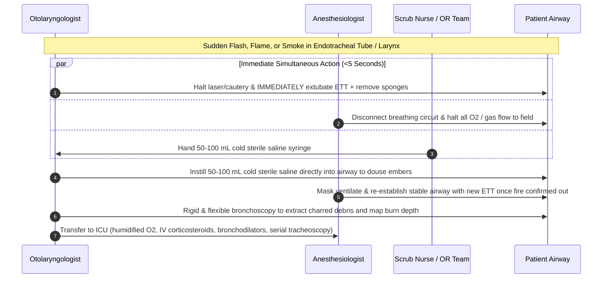

# Airway fire prevention requires FiO2 below 30 percent and laser-safe tubes

## Active Recall

> [!question]- Why must nitrous oxide be strictly avoided during laser microlaryngeal surgery?
> *Answer / Clinical Rationale*: Nitrous oxide ($\text{N}_2\text{O}$) decomposes at high temperatures to release oxygen, actively supporting and accelerating catastrophic combustion.

> [!question]- What are the first three immediate physical actions the surgeon and team must take if an airway fire ignites?
> *Answer / Clinical Rationale*: (1) **Disconnect the breathing circuit and immediately extubate the patient**, (2) **turn off all gas flows**, and (3) **instill cold sterile saline into the airway** to extinguish residual embers.

## Core Clinical & Mechanistic Principles
Airway fire is the most catastrophic complication in operative laryngology. Combustion requires three components (the **Fire Triad**):
1. **Ignition Source**: [[The CO2 laser vaporizes tissue via 10600 nm water absorption|CO2 laser]], [[The KTP laser targets oxyhemoglobin at 532 nm for photoangiolysis|KTP laser]], or electrocautery.
2. **Oxidizer**: High concentration of oxygen ($\text{FiO}_2$) or nitrous oxide ($\text{N}_2\text{O}$).
3. **Fuel**: Endotracheal tube (polyvinyl chloride, red rubber, silicone), cottonoids, or biological tissue.

## Mandatory Prevention Protocols
- **$\text{FiO}_2$ Titration**: Delivered oxygen concentration must be **reduced to $\text{FiO}_2 \le 30\%$** using an air/oxygen mixture prior to laser discharge.
- **Nitrous Oxide Prohibition**: $\text{N}_2\text{O}$ is **strictly prohibited** because it supports vigorous combustion.
- **Laser-Safe Endotracheal Tubes**: Standard PVC tubes are prohibited. Utilize metallic or specialized silicone laser-safe dual-cuffed tubes (e.g., Laser-Flex, Laser-Shield).
- **Dual Saline-Tinted Cuffs**: Inflate the proximal and distal endotracheal cuffs with sterile **saline tinted with methylene blue**. If a stray laser strike breaches the outer cuff, the escaped blue saline extinguishes the beam and provides an immediate visible signal to halt firing.
- **Saline-Soaked Neurosurgical Patties**: Place wet cottonoids around the subglottis and overlying the cuff to protect the tube from stray reflections.

## Immediate Fire Drill Protocol (If Ignition Occurs)

## Critical Failure Modes & Error Traps
- **Delayed Extubation**: Hesitating to remove the burning endotracheal tube allows burning plastic/silicone to deposit toxic fumes and molten debris deep into the distal tracheobronchial tree.

## Connected Concepts & Graph Traversal
- **CO2 Laser Physics**: [[The CO2 laser vaporizes tissue via 10600 nm water absorption|CO2 Laser Mechanics]]
- **KTP Photoangiolysis**: [[The KTP laser targets oxyhemoglobin at 532 nm for photoangiolysis|KTP Laser]]
- **Emergency Airway Rescue**: [[Total laryngectomy stomas and tracheostomies require distinct emergency airway resuscitation algorithms|Emergency Airway Protocols]]
- **Open Tracheostomy**: [[Open tracheostomy provides superior exposure and stay suture placement compared to percutaneous technique|Open Tracheostomy]]
- **High-Stakes Rescue**: [[High-stakes laryngeal complications require proactive landmarking and rescue protocols|Laryngeal Complication Protocols]]
