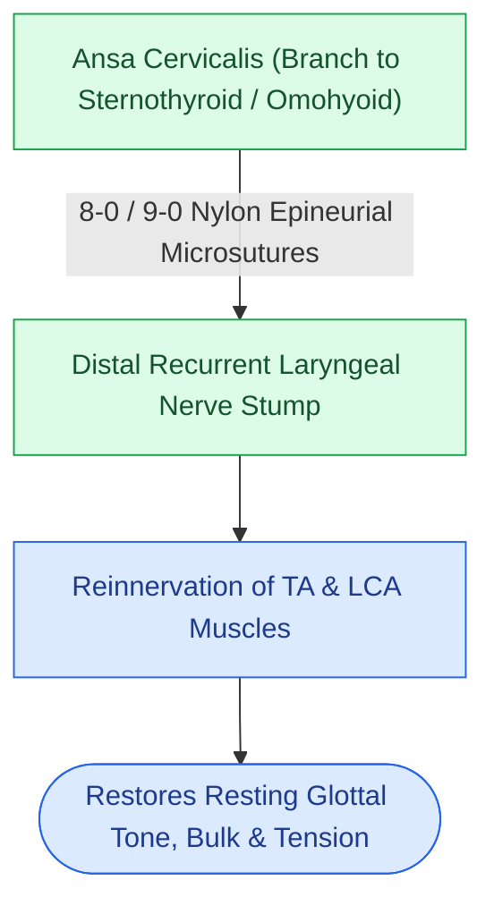
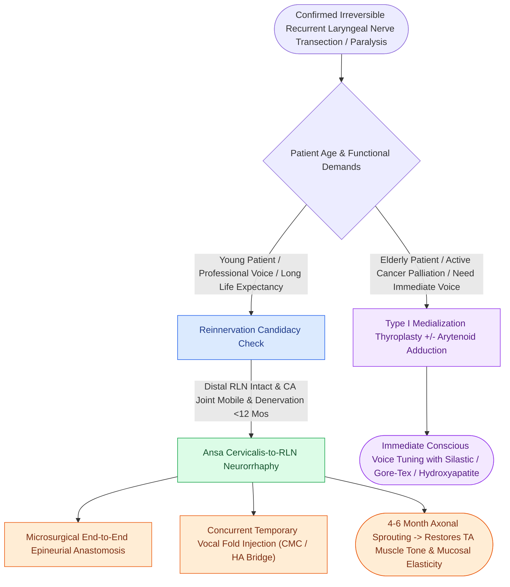

# Ansa cervicalis-to-recurrent laryngeal nerve neurorrhaphy restores vocal fold muscle tone and glottic competence without dynamic vocal fold abduction

## Active Recall

> [!question]- What is the primary physiological objective of nonselective ansa cervicalis-to-RLN neurorrhaphy, and does it restore dynamic vocal fold mobility?
> *Answer / Clinical Rationale*: The primary objective is to **restore basal resting neural tone and prevent long-term denervation atrophy** of the thyroarytenoid and lateral cricoarytenoid muscles, thereby maintaining vocal fold bulk and tension in a medialized phonatory position. Crucially, **it does NOT restore dynamic abduction or adduction**. The ansa cervicalis fires in synchrony with swallowing and strap muscle movement rather than phonation, and regenerated axons sprout nonselectively across both abductor and adductor motor units.

> [!question]- Why is concurrent temporary vocal fold injection augmentation mandatory when performing ansa-to-RLN reinnervation?
> *Answer / Clinical Rationale*: Axonal regeneration across the microsurgical neurorrhaphy occurs at approximately **1 mm/day**, requiring **4 to 6 months** before functional muscle reinnervation and vocal fold tonus are re-established. To protect the patient from persistent breathy dysphonia and aspiration during this latency window, a **temporary resorbable injection material** (such as carboxymethylcellulose or hyaluronic acid) is injected into the paralyzed vocal fold at the conclusion of the surgical procedure.

> [!question]- Which clinical cohort derives the greatest long-term advantage from ansa-to-RLN reinnervation compared to static Type I thyroplasty?
> *Answer / Clinical Rationale*: **Younger patients and professional voice users** with confirmed permanent RLN transection (e.g., following thyroidectomy, thoracic surgery, or skull base schwannoma excision) derive the greatest benefit. Unlike Type I thyroplasty, which introduces a rigid foreign implant that can migrate, extrude, or fail over decades, ansa reinnervation restores **living, vascularized muscle bulk and maintains native mucosal wave elasticity** without rigid framework distortion.

## Core Clinical & Mechanistic Principles

Unilateral vocal fold paralysis resulting from unrecoverable recurrent laryngeal nerve (RLN) injury presents a lifelong challenge of glottic insufficiency, aspiration risk, and vocal fatigue *(Cummings Review, Ch7, p.163)*. While static medialization (injection augmentation, Type I thyroplasty) addresses the mechanical gap, **laryngeal reinnervation** offers a biological reconstruction that restores intrinsic laryngeal neuromuscular tone.

### Reinnervation Taxonomy: Nonselective vs. Selective Techniques

| Technique | Donor Nerve Source | Recipient Target | Functional Outcome & Limitations |
| :--- | :--- | :--- | :--- |
| **Nonselective Neurorrhaphy (Standard)** | **Ansa cervicalis** (branch to sternothyroid or omohyoid) | Main trunk of distal **RLN** | Restores muscle bulk, tension, and medialization over 4–6 months. **No dynamic abduction/adduction**. Low morbidity. |
| **Selective Adductor/Abductor Reinnervation** | Ansa cervicalis + Phrenic nerve rootlet | Adductor branch (TA/LCA) + Abductor branch (PCA) | Attempts synchronized inspiratory abduction with phonatory adduction; highly complex, experimental. |
| **Nerve-Muscle Pedicle (Tucker Technique)** | Ansa branch with vascularized strap muscle block | Posterior Cricoarytenoid (PCA) muscle belly | Historically utilized for bilateral vocal fold paralysis; variable reinnervation success and high fibrotic failure rate. |

---

### Surgical Technique: Ansa Cervicalis-to-RLN Neurorrhaphy

1. **Patient Selection Criteria**:
   - Confirmed, irreversible RLN disruption (clean surgical transection, nerve resection for oncologic margin).
   - Intact distal RLN segment at the cricothyroid articulation / inferior constrictor entry.
   - Completely **mobile cricoarytenoid joint** on passive manual palpation (ankylosis is an absolute contraindication).
   - Optimal timeframe: within **1 to 6 months** of denervation. Beyond 12–24 months, motor endplate fibrosis and fatty muscle degeneration drastically diminish reinnervation efficacy.

2. **Operative Steps**:
   - Cervical incision along a natural skin crease overlying the lower thyroid lamina.
   - The **ansa cervicalis** is identified traversing the internal jugular vein or descending within the carotid sheath, branching to the sternohyoid, sternothyroid, and omohyoid.
   - The branch to the **anterior belly of the omohyoid or sternothyroid** is selected based on close caliber match to the RLN (~1.5 mm).
   - The donor nerve is sharply transected as distally as possible to maximize redundant length.
   - The distal RLN stump is identified as it enters the larynx posterior to the inferior cornu of the thyroid cartilage.
   - A **tension-free, end-to-end epineurial neurorrhaphy** is performed using **8-0 or 9-0 nylon or polypropylene sutures** under operative microscopy, often reinforced with fibrin glue.

3. **Concurrent Medialization Bridge**:
   - Because axonal regeneration proceeds at approximately **1 mm/day**, vocal recovery requires **4 to 6 months**.
   - Concurrent in-office or intraoperative vocal fold injection with a 3-month temporary gel (e.g., carboxymethylcellulose) provides immediate glottic competence and prevents aspiration while neural reinnervation matures.

---

### Clinical Comparison: Ansa Reinnervation vs. Type I Thyroplasty

| Feature | Ansa-to-RLN Reinnervation | Type I Medialization Thyroplasty |
| :--- | :--- | :--- |
| **Onset of Benefit** | Delayed (4 to 6 months) | Immediate (intraoperative voice tuning) |
| **Mechanism** | Biological muscle tone, volume preservation | Mechanical medial displacement by foreign implant |
| **Implant Risk** | **Zero foreign body risk** | Risk of migration, extrusion, or infection |
| **Voice Quality** | **Superior acoustic quality**: preserves mucosal wave flexibility and viscoelasticity | Good voice; may sound slightly stiff or strained |
| **Age Indication** | Preferred in **younger patients (<50–60 years)** | Preferred in older patients, cancer palliative settings |

Comprehensive anatomical and therapeutic integration links these principles directly to [[The thyroarytenoid muscle modulates glottal stiffness and adduction|Thyroarytenoid Muscle Function]].

## Connected Concepts & Graph Traversal
- **Primary Pathology**: [[Unilateral vocal fold paralysis causes glottic insufficiency, breathiness, and aspiration|Unilateral Vocal Fold Paralysis]]
- **Static Surgical Alternative**: [[Type I thyroplasty medializes the vocal fold with conscious voice tuning|Type I Medialization Thyroplasty]]
- **Temporary Injection Bridge**: [[Carboxymethylcellulose gel provides short-acting temporary vocal fold augmentation|Carboxymethylcellulose Temporary Augmentation]]
- **Posterior Gap Management**: [[Arytenoid adduction closes large posterior glottic gaps and corrects height mismatch|Arytenoid Adduction]]
- **Electrodiagnostic Baseline**: [[Laryngeal electromyography differentiates vocal fold paralysis from joint fixation|LEMG Prognostic Window]]
