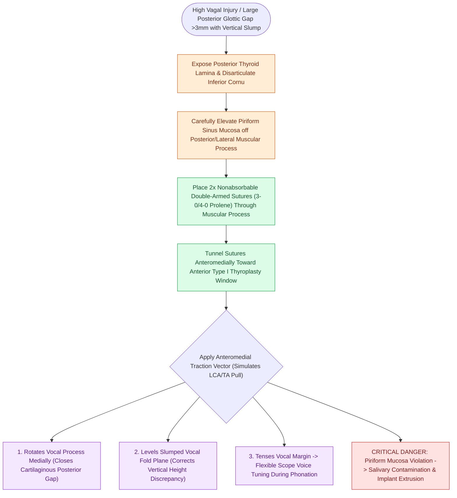

# Arytenoid adduction closes large posterior glottic gaps and corrects height mismatch

## Active Recall

> [!question]- Why is an isolated Type I medialization thyroplasty insufficient for patients with large posterior glottic gaps and high vagal injuries?
> *Answer / Clinical Rationale*: A Type I thyroplasty medializes only the anterior two-thirds (membranous vocal fold); it cannot rotate the cartilaginous vocal process or correct the vertical arytenoid slump caused by denervation of the LCA, TA, and CT muscles.

> [!question]- What critical anatomical structure must be carefully protected from perforation when dissecting the muscular process during an arytenoid adduction?
> *Answer / Clinical Rationale*: The **pyriform sinus hypopharyngeal mucosa**, which lies in direct contact with the posterolateral aspect of the muscular process.

## Core Clinical & Mechanistic Principles
**Arytenoid Adduction (AA)** (pioneered by Nobuhiko Isshiki) is an open framework surgical procedure designed to rotate and stabilize a paralyzed [[The cricoarytenoid joint moves via coupled rocking and sliding|arytenoid cartilage]] that has slumped anteriorly and lateralized.

### Mechanical Action & Suture Vector
- **Recreation of LCA/TA Pull**: Nonabsorbable sutures placed through the muscular process of the arytenoid cartilage pull **anteromedially and downward** toward the anterior thyroid lamina.
- **Correction of Three-Dimensional Deformity**:
  1. *Rotates the Vocal Process Medially*: Closes the large posterior cartilaginous glottic gap (>3 mm).
  2. *Lowers the Canting Vocal Fold*: Restores the vertical level alignment between the paretic and intact vocal folds.
  3. *Tenses the Vocal Margin*: Increases passive longitudinal stiffness along the vocal fold.

## Primary Clinical Indications
1. **Large Posterior Glottic Gap**: Inter-arytenoid cartilaginous gap $>3\text{ mm}$ on phonation.
2. **Vertical Level Discrepancy**: Paralyzed fold sagging significantly below the plane of the intact cord.
3. **High Vagal Injury / Severe Aspiration**: Complete vagal paralysis (denervating both [[The recurrent laryngeal nerve innervates all intrinsic muscles except cricothyroid|RLN]] and [[The superior laryngeal nerve provides supraglottic sensation and cricothyroid motor control|SLN]]) following skull base resections or glomus tumor surgery.

## Step-by-Step Surgical Execution
1. **Posterior Framework Exposure**: Expose the posterior border of the [[Thyroplasty cartilage window dimensions differ between males and females|thyroid cartilage alar lamina]]; incise the inferior pharyngeal constrictor attachment.
2. **Cricothyroid Joint Disarticulation**: Mobilize the thyroid lamina anteriorly by disarticulating the inferior cornu from the cricoid facet.
3. **Muscular Process Identification**: Palpate the muscular process; sharply divide overlying fibers of the [[The posterior cricoarytenoid is the sole vocal fold abductor|PCA]] and LCA.
4. **Suture Placement**: Place two double-armed 3-0 or 4-0 nonabsorbable sutures (Prolene) securely through the cartilaginous muscular process.
5. **Passage to Anterior Window**: Tunnel sutures anteriorly into the subperichondrial pocket of the [[Type I thyroplasty medializes the vocal fold with conscious voice tuning|Type I thyroplasty window]].
6. **Intraoperative Tuning & Fixation**: Tighten sutures under flexible laryngoscopy while the patient phonates; secure to the anterior thyroid framework.

## Critical Failure Modes & Error Traps
- **Pyriform Sinus Mucosal Perforation**: The pyriform sinus mucosa lies immediately posterior and lateral to the muscular process. Breaching this mucosal plane converts a sterile surgical space into a contaminated field communicating with pharyngeal saliva, drastically elevating the risk of neck abscess, deep infection, and implant extrusion.

## Connected Concepts & Graph Traversal
- **Joint Kinematics Corrected**: [[The cricoarytenoid joint moves via coupled rocking and sliding|Cricoarytenoid Joint Kinematics]]
- **Muscle Vector Recreated**: [[The lateral cricoarytenoid is the primary membranous fold adductor|Lateral Cricoarytenoid (LCA)]]
- **Combined Procedure**: [[Type I thyroplasty medializes the vocal fold with conscious voice tuning|Type I Medialization Thyroplasty]]
- **Pathology Managed**: [[Unilateral vocal fold paralysis causes glottic insufficiency, breathiness, and aspiration|Unilateral Vocal Fold Paralysis (UVFP)]]
- **Diagnostic Finding**: [[Glottal closure patterns identify specific laryngeal biomechanical deficits|Large Longitudinal / Posterior Glottal Gap]]
