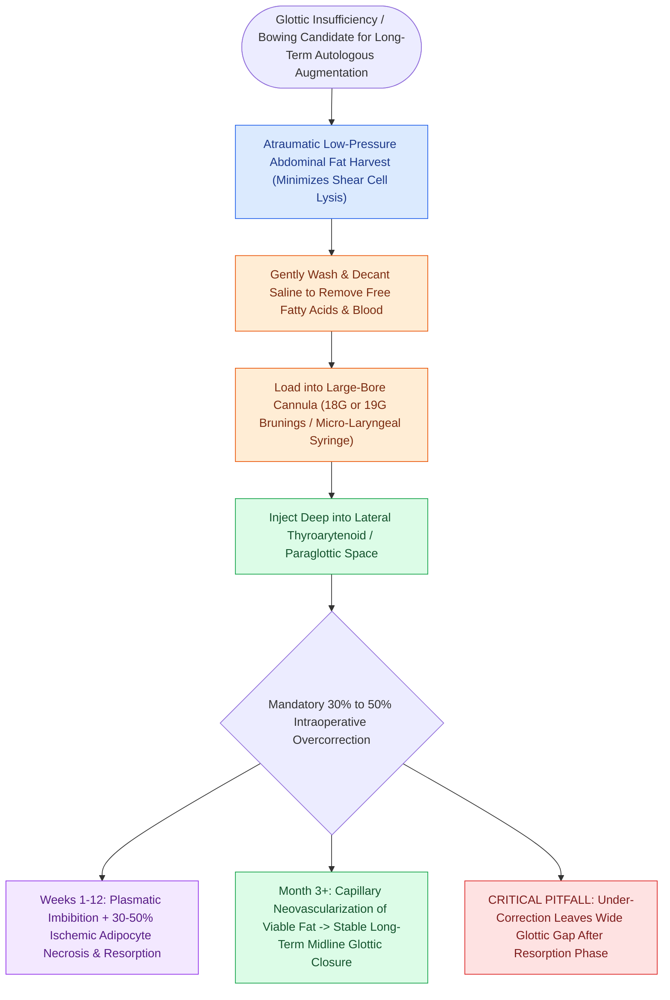

# Autologous fat augmentation requires overcorrection for resorption

## Active Recall

> [!question]- Why is 30% to 50% overcorrection mandatory during autologous fat laryngoplasty?
> *Answer / Clinical Rationale*: Transplanted free fat lacks an immediate vascular pedicle; a substantial fraction ($30\text{–}50\%$) of non-vascularized adipocytes undergoes ischemic necrosis and macrophage resorption over the first 6 to 12 weeks.

> [!question]- Why must a large-bore cannula (18- or 19-gauge) be used for fat injection?
> *Answer / Clinical Rationale*: Narrow needles generate high shear forces that lyse fragile adipocyte cell membranes, destroying graft viability and causing complete resorption.

## Core Clinical & Mechanistic Principles
**Autologous Fat Augmentation** (lipoinjection) is a biological technique for permanent or long-term vocal fold medialization, utilizing the patient's own adipose tissue harvested from the lower abdomen, flank, or thigh.

### Biological Properties & Viability
- **Complete Biocompatibility**: Because it is autologous tissue, fat carries zero risk of foreign-body reaction, immunological rejection, or delayed granuloma formation.
- **Viscoelastic Compatibility**: Adipose tissue has low shear viscosity and favorable viscoelastic properties that integrate smoothly into the deep vocal fold architecture.
- **Predictable Early Resorption**: Non-vascularized fat grafts rely on initial plasmatic imbibition followed by capillary neovascularization. A significant fraction of transplanted adipocytes undergo ischemic necrosis and resorption over the first 6 to 12 weeks.
- **Mandatory Overcorrection**: To achieve long-term [[Glottal closure patterns identify specific laryngeal biomechanical deficits|glottic closure]] after resorption stabilizes, the surgeon must perform an initial **30% to 50% overcorrection** at the time of surgery.

## Step-by-Step Surgical Nuances
1. **Atraumatic Harvesting**: Harvest subcutaneous fat using a low-pressure syringe aspiration or mini-open incision to avoid shearing and rupturing adipocyte cell membranes.
2. **Purification**: Wash with saline, filter, and gently decant to remove inflammatory free fatty acids, red blood cells, and serum.
3. **Large-Bore Cannula Delivery**: Inject via a dedicated **18-gauge or 19-gauge large-bore Brunings syringe or cannula**. Using smaller needles lyses adipocyte membranes, drastically increasing graft resorption.
4. **Target Plane**: Deliver the fat into the **lateral [[The thyroarytenoid muscle modulates glottal stiffness and adduction|thyroarytenoid muscle]] / [[The paraglottic space facilitates transglottic tumor spread|paraglottic space]]**.

## Critical Failure Modes & Error Traps
- **Under-correction**: Failing to overcorrect by 30–50% leaves the patient with persistent glottic incompetence once initial post-graft edema and non-viable adipocytes resorb.
- **Traumatic Injection**: Forcing fat through high-gauge needles destroys fat cells, transforming the graft into an oily fluid that resorbs completely within weeks.

## Connected Concepts & Graph Traversal
- **Calcium Hydroxylapatite Alternative**: [[Calcium hydroxylapatite provides durable medialization but causes granulomas if superficial|Calcium Hydroxylapatite]]
- **Temporary Injection Gel**: [[Carboxymethylcellulose gel provides short-acting temporary vocal fold augmentation|Carboxymethylcellulose Gel]]
- **Hyaluronic Acid Filler**: [[Cross-linked hyaluronic acid provides intermediate-duration vocal fold augmentation|Hyaluronic Acid Augmentation]]
- **Injection Anatomy**: [[Injection laryngoplasty requires precise placement into lateral thyroarytenoid muscle|Injection Laryngoplasty]]
- **Paralysis Indication**: [[Unilateral vocal fold paralysis causes glottic insufficiency, breathiness, and aspiration|Unilateral Vocal Fold Paralysis]]
